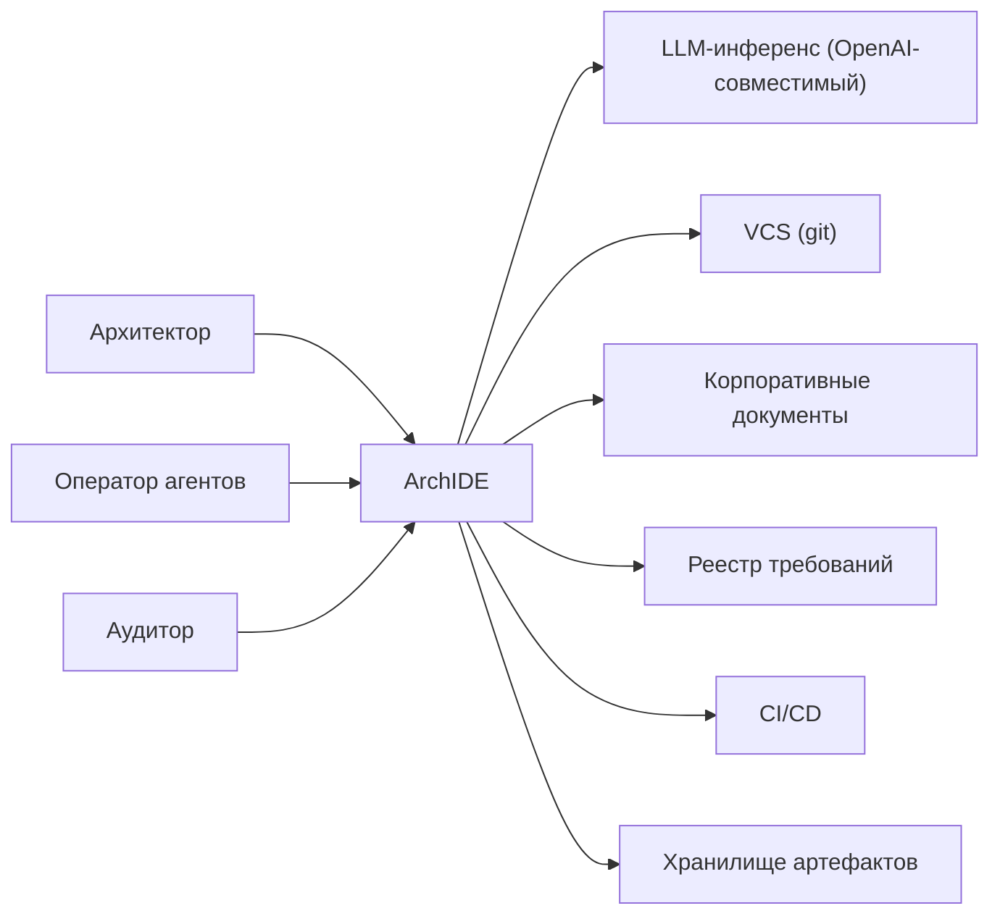
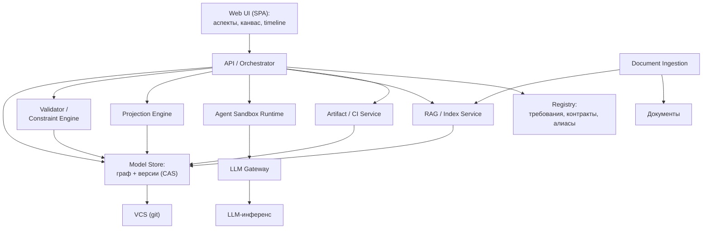
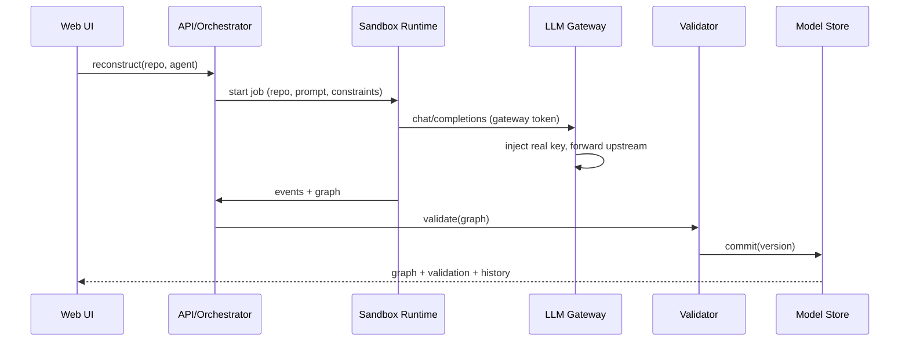
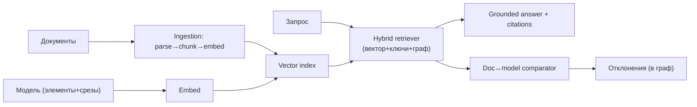

# ArchIDE — архитектура системы

Как устроена система целиком. Концепция — [`Concept.md`](Concept.md), план —
[`ROADMAP.md`](ROADMAP.md), PoC — [`archide-poc/`](archide-poc/).

## 1. Обзор

ArchIDE — среда, в которой архитектура описана **единым фасетным графом**
(каркас C4 + аспекты), а код, диаграммы и документы — его **проекции**. Система:

- хранит и **версионирует** модель (Merkle-DAG коммитов);
- **реконструирует** её из исходного кода и документации (с валидацией обоих);
- даёт **редактировать** с автоматическим обеспечением непротиворечивости;
- **генерирует и валидирует** код по модели (с подписанными метками трассируемости);
- связывает модель с **корпоративными документами** через RAG;
- исполняет **агентов в песочнице** через собственный LLM-шлюз.

## 2. Контекст (C4 L1)

**Акторы:** Архитектор, Оператор агентов, Аудитор.
**Внешние системы:** LLM-инференс (OpenAI-совместимый), VCS (git), корпоративные
документы (Confluence/Wiki/файлы), реестр требований (Jira/…), CI/CD, объектное
хранилище артефактов.

## 3. Контейнеры (C4 L2)

## 4. Компоненты по контейнерам

**Model Store**
- `Graph Store` — property graph (узлы/рёбра, аспекты, якоря).
- `Version Store` — content-addressed коммиты (Merkle-DAG), деревья снапшотов.
- `Metamodel Registry` — типы узлов/рёбер, схемы аспектов, правила якорей, словари.
- `Identity/Alias` — стабильные ID, namespace'ы, алиасы (rename-safe).
- `Requirements namespace` — внешние требования + провенанс.

**Validator / Constraint Engine**
- `Schema validator` (жёсткие инварианты), `Referential actions`
  (cascade/restrict/nullify/repoint), `Cross-aspect rules`, `Constraint language`,
  `Impact analyzer`, `Incremental validator`.

**Projection Engine**
- `Layout engine`, `Aspect renderers` (C4/DFD/state/BPMN/роли/…),
  `Serializers` (OpenAPI/proto/DDL/JSON Schema), `Slice builder` (§6),
  `Coverage matrix` (§15.6).

**Agent Sandbox Runtime**
- `Agent registry`, `Scheduler`, `Container runtime` (изоляция, лимиты),
  `Volume manager`, `Event bus` (лента активности), `Secrets/lease`.

**LLM Gateway**
- `Auth (lease)`, `Router` (upstream), `Stream` (SSE), `Quota/rate`, `Audit`.

**RAG / Index Service**
- `Chunker`, `Embedder`, `Vector index`, `Graph retriever`, `Hybrid ranker`,
  `Provenance/citations`, `Doc↔model comparator`.

**Document Ingestion**
- `Connectors` (Confluence/Wiki/файлы), `Parser`, `Chunker`, `Requirement linker`.

**Artifact / CI Service**
- `Generators`, `Marker issuer/verifier` (§15), `Conformance suite`, `Gate`.

**Registry**
- `Requirements`, `Contracts (GCR)`, `Aliases`, `Keys`.

## 5. Данные и хранилища

| Хранилище | Содержимое | Технология (варианты) |
|---|---|---|
| Graph Store | узлы/рёбра/аспекты/якоря | property graph (Neo4j/Kuzu/…) или in-memory + персистентность |
| Version Store | коммиты модели (Merkle-DAG) | CAS, git-подобные объекты |
| Каноническая сериализация | git-friendly модель | текстовые файлы + парсер |
| Vector Index | эмбеддинги чанков документов и элементов графа | pgvector/Qdrant/… |
| Document Store | исходные документы, метаданные, спаны | объектное хранилище |
| Artifact Store | артефакты, квитанции, метки | объектное хранилище |
| Registry | требования/контракты/алиасы/ключи | реляционная БД |

## 6. Ключевые потоки

**6.1 Реконструкция:** ingest репозитория → collect/compress → sandbox-агент
(проход 1: код; проход 2: документация) → validate (хост+агент, repair) → merge
(отклонения) → **commit** в модель.

**6.2 Редактирование:** UI-правка → **транзакция** → incremental validate → impact →
commit или блок с причиной (referential actions).

**6.3 Генерация/верификация:** slice → выдача **меток (lease)** → агент →
артефакты → **conformance gate** (подпись/размещение/покрытие/атрибуция) → привязка
`implemented_by` + commit артефактов.

**6.4 RAG-запрос:** query → гибридный retrieval (вектор + ключи + обход графа) →
(доки + элементы модели) → заземлённый ответ с **цитатами**; сверка док↔модель.

**6.5 Федерация:** publish контракта → GCR → discovery → федеративные рёбра →
derived-требования/тесты (§11).

## 7. Подсистема версионности

- **Commit** = `(parent, changes, author, ts, signature)`; адресация по контенту.
- **Tree** — снапшот модели (узлы/рёбра/аспекты) → хэш; дедупликация.
- **Ветки/merge**, **семантический diff**, **as-of** запросы, **restore**,
  **branch-from** (§16.3).
- **Пины** — запуск/срез фиксирует commit; метки (§15) ссылаются на commit.
- **GC** — сборка недостижимых объектов.

## 8. Подсистема RAG

- **Chunking**: структурный для документов (разделы/абзацы), семантический для графа
  (элемент + срез/проекция).
- **Retrieval**: гибрид + обход графа + фильтры (версия, проект, аспект).
- **Requirement linking**: извлечение → кандидаты связей → ревью → подтверждённые
  связи с **провенансом** (§17.3).
- **Grounding**: ответы с цитатами; утверждение из документа без опоры в модели
  помечается как отклонение.

## 9. Безопасность и доверие

- **Ключи**: реальный ключ инференса — только у хоста; агенты — токен/lease шлюза;
  ключ в контейнер не попадает.
- **Изоляция песочницы**: лимиты cpu/mem/pids/time, `--read-only`, cap-drop,
  сетевой доступ только к шлюзу.
- **Метки** подписываются хостом (§15); агент недоверенный — все артефакты через gate.
- **Права**: RBAC на редактирование (владение элементами/аспектами), аудит.

## 10. Развёртывание

- **Контейнеры**: `web`, `api`, `model-store`, `validator`, `projection`,
  `sandbox-runtime`, `gateway`, `rag`, `ingestion`, `artifact-ci`.
- **Тома**: shared agent volume, model store, vector index, doc store.
- **Сети**: внутренняя; egress наружу — только у `gateway`.
- **Масштабирование**: горизонтально — stateless (api/projection/rag); граф-стор —
  вертикально/партиционирование; валидация — инкрементальная.

## 11. Технологический стек (варианты)

| Слой | PoC | Целевое (варианты) |
|---|---|---|
| Backend | Python stdlib (`server.py`) | FastAPI/uvicorn, воркеры |
| Graph | in-memory dict + JSON | Neo4j / Kuzu / property-graph БД |
| Версии | — | git-подобный CAS (свои объекты или git) |
| Векторы | — | pgvector / Qdrant / Milvus |
| Frontend | vanilla SPA + SVG | тот же SPA (без сборки) либо framework |
| Агенты | Docker + stdlib/Kilo CLI | реестр-плагины, адаптеры |
| Эмбеддинги | — | локальные или внешние провайдеры |

## 12. Нефункциональные требования

- **Консистентность**: каждая версия проходит валидатор; нет невалидной истории.
- **Воспроизводимость**: запуски/генерации пиннят версию модели и артефактов.
- **Аудит**: провенанс требований/артефактов, подписи меток и квитанций.
- **Масштаб**: инкрементальная валидация, партиционирование графа.
- **Безопасность**: изоляция песочницы, ключи у хоста, RBAC.
- **Latency**: асинхронные запуски, стриминг событий, кэш проекций.

## 13. Текущее состояние vs целевое

| Компонент | PoC | Целевое |
|---|---|---|
| Model Store | in-memory граф + JSON | граф-БД + версии (CAS) |
| Validator | жёсткие инварианты | + referential actions, кросс-аспект, impact |
| Projection | SVG по одному уровню C4 | + все аспекты, экспорт спецификаций |
| Sandbox | Docker без mount, volume | + лимиты, изоляция, lease |
| Gateway | токен + подстановка ключа | + квоты, аудит, стриминг |
| RAG | — | ingestion, гибридный retrieval, требования |
| Artifact/CI | — | генераторы, метки, conformance gate |
| Versioning | — | коммиты, ветки, time-travel |

## 14. Соответствие концепции

| Раздел `Concept.md` | Контейнеры/компоненты |
|---|---|
| §1–§2 топология/метамодель | Model Store, Metamodel Registry |
| §3 поверхности, §8 окна | Web UI, Projection Engine |
| §4 зум C4, §12 агрегация | Projection Engine, Layout |
| §5 требования | Registry, Document Ingestion, RAG |
| §6 срезы | Projection Engine (Slice builder), API |
| §7 строгость, §14.4 инварианты | Validator / Constraint Engine |
| §11 федерация | Registry (GCR), Validator, RAG |
| §13 аспекты, §16 аспектный UI | Web UI (вкладки), Projection Engine |
| §14 редактирование/impact | Validator (transactions, impact), API |
| §15 метки | Artifact/CI (issuer/verifier) |
| §16 версионность/time-travel | Model Store (Version Store), Web UI (timeline) |
| §17 RAG | RAG/Index, Document Ingestion, Registry |
