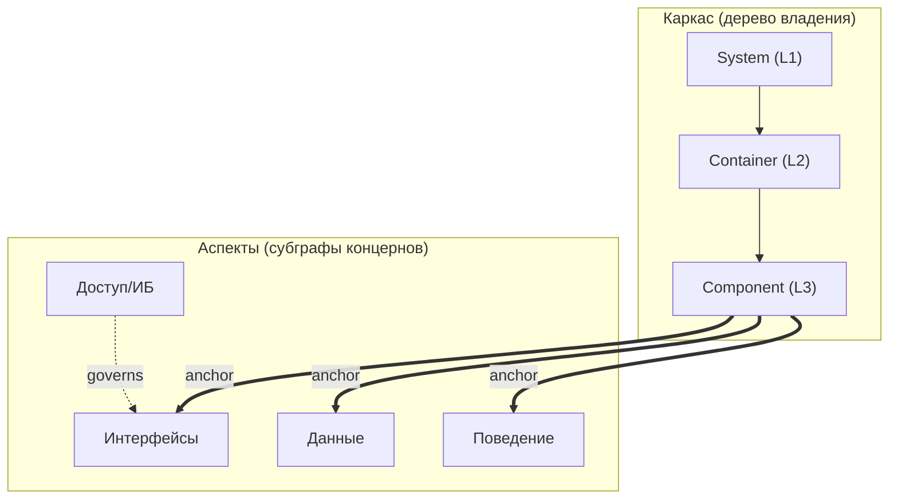

# ArchIDE — концепция: система субграфов

> **ArchIDE — это IDE для архитектурного графа.** Архитектура описана единым
> графом идентичностей; всё остальное — код, диаграммы, документы, срезы, версии —
> это **субграфы** этого графа. Человек и агент работают с субграфами, а не с
> текстом кода.

## 0. Ключевая идея

Один **универсальный типизированный граф идентичностей** `G`. Любая «вещь» в
системе — это **субграф** `G` с ролью:

- каркас (структура C4), аспекты (интерфейсы, данные, поведение, процессы,
  доступ, развёртывание, качество), агрегаты, проекции (диаграммы/спецификации),
  срезы контекста для агентов, версии, внешние свидетельства (требования, документы).

Три следствия:

1. Человек и агент редактируют **модель** (граф/субграфы), а не код.
2. Никакой документ/диаграмма не «хранится» — это **проекция** (запрос к графу).
3. Строгость обеспечивается не дисциплиной автора, а **схемой метамодели и
   валидатором**.

Следствие для топологии: **сущность существует ровно один раз** (одно «домашнее»
место), все остальные места ссылаются на неё по стабильному ID. Дублирование
физически невозможно — можно только ссылаться.

### 0.1. Принцип: динамическая устойчивость

Мы **сознательно не пытаемся** построить абсолютно универсальную модель архитектуры,
подходящую под любые системы — это недостижимо и ведёт к переусложнению. Вместо этого —
**легко расширяемая графовая модель** с **достаточно простой логикой построения**:
закрытые, но расширяемые словари типов; субграфы; проекции.

Непротиворечивость такой модели **не гарантируется идеальностью конструкции «по
построению»**, а **поддерживается динамически** — агентом. Это и есть **динамическая
устойчивость**: мы можем использовать **не идеальную базовую конструкцию**, но
**стабилизировать её динамически**, постоянно наблюдая и корректируя состояние.

Цикл (обратная связь, а не разовая проверка идеальной онтологии):

1. **наблюдение** — непрерывная проверка состояния графа (валидация, якоря,
   кросс-аспектные правила, impact, покрытие требований, отклонения код↔доки);
2. **обнаружение расхождений** — где целостность нарушена или неполна;
3. **коррекция** — предложение исправлений и авто-доработка связанных частей
   (в т.ч. после ручных правок), с подтверждением человеком.

Так снимается невозможное требование «идеальной онтологии заранее»: модель растёт и
уточняется в процессе, а согласованность удерживается постоянным циклом
«наблюдение → расхождение → коррекция». Агент здесь — не только исполнитель изменений,
но и **стабилизатор** целостности модели.

---

## 1. Универсальный граф (идентичности)

`G` — typed property graph.

**Узлы (закрытый словарь):**
- структурные: `System`, `Container`, `Component`, `Module`, `Actor`, `ExternalSystem`;
- контрактные: `Interface`/`Port`, `DataEntity`, `DataStore`;
- аспектные: `Operation`, `Message`, `StateMachine`, `State`, `Transition`,
  `Process`, `Activity`, `Role`, `Permission`, `Policy`, `Node`, `Environment`,
  `NFR`, `SLO`;
- кросс-функциональные: `Capability`, `Decision`, `AggregationInterface`;
- внешние якоря: `Requirement`, `Artifact`, `Agent`, `Task`.

**Рёбра (типизированные):**
- владение: `contains`;
- взаимодействие: `depends_on`, `calls`, `publishes`, `subscribes`, `reads`, `writes`;
- контракты: `exposes`, `consumes`, `implements`, `realizes`;
- трассировка: `satisfies`, `derived_from`, `constrains`, `verifies`, `conflicts_with`;
- реализация: `implemented_by`, `tested_by`, `deployed_as`, `generated_from`;
- привязка аспектов (якоря): `owns`, `exposes`, `governs`, `anchored_to`;
- управление: `owned_by`, `decided_by`, `assigned_to`.

**Идентичность:** стабильные ID (`scheme://path`), namespace'ы, реестр алиасов
(rename-safe). Закрытый словарь типов делает модель **строгой и машинно-проверяемой**.

**Топология (три ортогональные оси):**

| Ось | Топология | Роль | Инвариант |
|---|---|---|---|
| **A. Каркас** | строгое дерево (один родитель) | владение, уровни C4 | ровно один parent → один «дом» |
| **B. Mesh** | ориентированный DAG | взаимодействия, потоки | рёбра из разрешённых типов |
| **C. Cross-cutting** | ссылки во внешние пространства имён | требования, код, тесты, агенты | только по ID |



---

## 2. Субграфы и их роли

**Субграф** `S = (V_S, E_S, role, scope, version)` — часть `G` с ролью, охватом и
(опционально) закреплённой версией.

| Роль | Что это | Как получается |
|---|---|---|
| `backbone` | структура C4 (идентичность) | декомпозиция |
| `aspect` | слой концерна (интерфейсы/данные/поведение/…) | привязка к каркасу |
| `aggregate` | реифицированный набор связей/подграфов | агрегация `agg` |
| `projection` | диаграмма/спецификация (вид) | проекция `view` |
| `slice` | ограниченный контекст для агента | срез `slice` |
| `version` | состояние модели во времени | пин `pin` |
| `evidence` | внешнее свидетельство (требование, документ) | ingestion/линковка |

**Алгебра субграфов** — единый набор операций над любыми субграфами:

| Операция (токен) | Смысл | Где применяется |
|---|---|---|
| `merge` | объединить субграфы | многопроходная реконструкция, федерация |
| `common` | общее (пересечение) | согласие источников |
| `minus` | различие (вычитание) | **отклонения** код ↔ документы |
| `view` | вид на уровне/аспекте/охвате | C4-зум, диаграммы, спецификации |
| `slice` | ограниченный контекст вокруг узла | срезы для агентов |
| `agg` | реифицировать набор связей в одну сущность | интерфейсы агрегации |
| `pin` | закрепить состояние | версии, запуски, метки |
| `changes` | семантическое изменение | история, ревью, откат |

Всё дальнейшее — частные случаи этой алгебры. Это и есть «более полная структура»:
C4 — проекция каркаса, диаграмма состояния — проекция аспекта, срез агента —
`slice`, версия — `pin`, RAG-контекст — `merge(slice, evidence)`.

---

## 3. Каркас (C4) и уровни

Каркас — субграф структуры; уровни C4 — **глубина** дерева. «Нарисовать
диаграмму» = `view(backbone, level)`.

- L1 Context → `System` + `Actor`/`ExternalSystem`;
- L2 Container → дети System;
- L3 Component → дети Container;
- L4 Code → `CodeUnit` (может делегироваться сгенерированному коду).

Уровни **физически не могут рассинхронизироваться** — это один граф на разной
глубине. Правило видимости: ребро видно на уровне `L` тогда и только тогда, когда
`L ≤ min(глубина концов)`.

---

## 4. Аспекты (ортогональные субграфы)

Аспект — типизированный субграф по концерну, привязанный к каркасу **якорями**
(рёбра `owns`/`exposes`/`anchored_to`). Аспект не переопределяет структуру — только
дополняет её.

| Аспект | Элементы | Отвечает за | Проекция (генерирует) |
|---|---|---|---|
| Интерфейсы/контракты | Interface, Operation, Message, SchemaRef, Version | API, контракты | OpenAPI / proto / JSON Schema |
| Данные | DataEntity, Attribute, DataStore, DataFlow | схемы, потоки (DFD), происхождение | DDL / ER / DFD |
| Поведение | StateMachine, State, Transition, Event, Guard | состояния, события | state-диаграммы |
| Процессы | Process, Activity, Task, Gateway, Participant | сценарии, оркестрация | BPMN / sequence |
| Доступ/ИБ | Principal, Role, Permission, Policy, Resource | ролевые модели, политики | RBAC/ABAC, политики |
| Развёртывание | Node, Environment, Runtime, InfraResource | топология, среды | deployment-схемы |
| Качество | NFR, SLO, Constraint | нефункциональные требования | SLO-спеки |

**Кросс-аспектные связи** (делают модель связной):
`component —exposes→ interface —has→ operation —reads/writes→ dataEntity`;
`stateMachine —owned-by→ component`, `transition —emits→ event`,
`process —consumes→ event`; `role —allowed→ operation`,
`policy —governs→ resource`; `dataFlow —from→ dataStore —to→ process`;
`container —deployed-on→ node`.

---

## 5. Агрегация (интерфейсы агрегации)

Переход между уровнями может связывать **разнородные** связи, поэтому агрегат не
вычисляется, а **реифицируется**: `agg(links) → AggregationInterface`.

- Агрегат **содержит** любой состав оригинальных связей/подграфов (гетерогенность
  инкапсулируется), на грубом уровне предстаёт **одной сущностью**.
- Имеет `contract` (супертип содержимого) → валидатор проверяет **конформность**.
- Вложимость: `связь → агрегат → супер-агрегат`.
- Авто-подсказка кандидатов — эвристика; решение за моделью.

---

## 6. Срезы контекста для агентов

`slice(node)` — ограниченный субграф для задачи. Содержит ровно:

1. **где я** — узел + цепочка родителей;
2. **мой контракт** — порты/операции и сигнатуры;
3. **что трогаю** — прямые (1-hop) рёбра mesh с контрактами;
4. **зачем** — связанные требования;
5. **как реализовано** — привязанные артефакты/тесты;
6. **что НЕ моё** — явные границы.

Срезы **детерминированы, версионируются (`pin`), хешируются и не пересекаются**;
в аспектной модели срез делается **аспект-осознанным** (включает интерфейс, данные,
поведение, доступ компонента).

---

## 7. Требования и трассировка

Требования — внешний субграф `evidence`; подключаются адаптером (Jira/реестр/документы).

- Внешний ID → узел `Requirement` с провенансом (источник, версия, дата).
- Связь с моделью — типизированными рёбрами `satisfies / constrains / verifies`.
- **Два namespace — один граф**: архитектура и требования раздельно, соединены
  трассировкой.
- Матрица покрытия вычисляется (`view`), а не ведётся руками.

---

## 8. Строгость и согласованность

**Классификация инвариантов:**

| Класс | Разрешимость | Поведение |
|---|---|---|
| Жёсткие (типы, привязки, ссылки, дерево, уникальность) | да, дёшево | авто-энфорс, блокируют |
| Мягкие (покрытие, полнота, стиль) | да, допускают waiver | предупреждения + `Decision` |
| Суждения («правильна ли декомпозиция») | нет | только человек/агент |

**Механизмы строгости:** закрытая метамодель; канонический ID + алиасы; referential
integrity; единственное «домашнее» место; проекции-запросы; **referential actions**
на типах рёбер (`cascade | restrict | nullify | repoint`); **транзакции правок** с
gate валидатора; **impact-анализ** (транзитивное замыкание по dependency/anchor/
кросс-аспектным рёбрам); **инкрементальная валидация** затронутого подграфа.

---

## 9. Реконструкция из кода и документации

Двухпроходная реконструкция (код первичен, документация вторична):

1. **Проход 1 — код**: граф по исходникам (`view`/`slice` по коду).
2. **Проход 2 — документация**: граф по докам.
3. **Слияние** `merge(code, docs)`; элементы из обоих источников → `sources:["code","docs"]`;
   одноисточниковые — **отклонения** (`minus`) с пометкой.

Валидируется **и код, и документация**: конформанс метамодели, `evidence` на
исходники, проверка границ (для кода); согласованность доков с кодом и покрытие
(для документации). Разрешение идентичностей при слиянии — сигнатуры + ревью.

---

## 10. Редактирование и автоматическая непротиворечивость

Человек/агент правит модель; согласованность обеспечивается автоматически:

- **основной режим — диалог с агентом** (§15): пользователь формулирует намерение в
  чате, агент предлагает транзакцию правок, задаёт уточняющие вопросы, предупреждает
  об impact и **сам дорабатывает зависимые части графа**, сохраняя консистентность;
- **ручное редактирование сохраняется**: человек правит граф и его аспекты в UI;
  после ручных правок **агент-ревьюер проверяет граф** и **предлагает исправления**
  (семантический диф на подтверждение) для сохранения непротиворечивости и целостности;
- **транзакция правок → валидатор → принять/отклонить/починить**;
- **referential actions** обрабатывают удаление/перемещение (`contains` → cascade,
  `depends_on` → restrict/repoint, опубликованный контракт → immutable+versioned);
- **impact-анализ** показывает, что ещё затронуто; где детерминировано — авто-починка;
  где нет — waiver (`Decision`);
- добавление/удаление/перемещение **по ID** — дешёвы (ссылки не по пути).

---

## 11. Генерация и верификация

**Генерация** (`view`): контракты (OpenAPI/proto/JSON Schema), DDL, IaC, конфиги,
скелеты, тесты, диаграммы. **Пакет работ** = аспект-осознанный срез + критерии приёмки.

**Неподделываемые метки трассируемости:** из модели для каждого артефакта
генерируются **подписанные** метки, несущие **всю цепочку уровней**
(System→Container→Component→аспекты→Requirement) и `lease` запуска; ключ — у хоста,
агент подделать не может.

```
archide://v1
  artifact: artifact://svc/api/handler.py
  chain: { system, container, component, interface, requirement }
  lease: run=<id> slice=<id> nonce=<nonce>
  sig: <подпись хоста>
```

**Верификация (gate):** подпись; существование элемента и вхождение в lease;
размещение; **покрытие** (все уровни); **атрибуция** (нет кода без метки и «висячих»
меток); согласованность цепочки; покрытие требований (цепочка до кода + тесты).
Нарушение → отказ → цикл доработки. Строится **матрица покрытия** по уровням.

Тот же механизм меток применяется **не только к коду, но и к чанкам документов** в
RAG (§13.7): метка чанка позволяет верифицировать, что ответ опирается на реально
восстановленные фрагменты, а не на генерацию LLM.

---

## 12. Версионность и time-travel

- **Merkle-DAG коммитов** (`pin`): каждое изменение — коммит с контентной адресацией;
  версии иммутабельны.
- **Идентичность** элементов сохраняется между версиями (ID); история per-element.
- **Семантический diff** (`changes`): добавлен/удалён/изменён узел/ребро.
- **Ветки/merge** (валидатор как gate); **restore**; **preview** (as-of, без смены
  head); **branch-from**; **пин версии** для запусков/срезов (метки ссылаются на коммит).
- UI: timeline, diff-вид, «переключиться к состоянию», «восстановить», «ветка отсюда».

---

## 13. RAG: граф + корпоративные документы

Модель и корпоративные документы — **единое пространство извлечения**:

- документы → чанки → эмбеддинги (+ метаданные: источник, версия, страница, спан);
- граф → **граф-осознанные чанки** (элемент + срез/проекция);
- **гибридный поиск**: вектор + ключевые слова + **обход графа**.

**Привязка требований:** документы маппятся на `Requirement` (извлечение → кандидаты
→ ревью → подтверждение) с **провенансом** (док/страница/спан). RAG-ответ заземляется
на оба источника с **цитатами**; утверждение из документа без опоры в модели
помечается как **отклонение** (`minus`). Retrieval версионно-осознан (учитывает commit).

---

### 13.6. Персональные документы (Markdown / CSV) через чат

- В диалоге с агентом-ассистентом архитектор может **приложить документы**
  (**Markdown**, **CSV**) как **требования** или **справочную информацию** для агента.
- **Оригиналы** хранятся в **личной истории пользователя** на бэке (изоляция по
  пользователю) с провенансом (кто, когда, версия, тип).
- Документы **доступны для поиска в RAG** наряду с корпоративными и с графом.

### 13.7. Маркировка чанков и верификация ответов RAG

- При загрузке в RAG каждый **чанк документа** автоматически дополняется
  **уникальной подписанной меткой** — аналогом меток на элементах графа (§11):
  `{doc, chunk, version, user, span, sig}`.
- Метка **неподделываема** (ключ у хоста) и **уникальна** для чанка.
- **Результат RAG верифицируется по меткам**: ответ должен опираться на чанки с
  валидными метками ⇒ можно отличить **реально восстановленную** информацию от
  **сгенерированной** LLM.
- Цитаты в ответе ссылаются на **метки чанков**; утверждения без меток помечаются как
  **неподтверждённые** (не заземлённые).
- **Генерация ответа:** запрос пользователя вместе с найденными **маркированными**
  чанками подаётся в LLM (через шлюз §16/песочницу) — LLM формирует **заземлённый ответ
  с цитатами**, который затем **верифицируется по меткам** (что реально восстановлено, а
  что сгенерировано). Поиск и генерация — один режим вопросов в чате.

## 14. Федерация проектов

Проекты публикуют **контрактные поверхности** в общий реестр (GCR) с версиями и
иммутабельностью. Связи обнаруживаются автоматически (матчинг сигнатур, якоря,
пересечение данных, телеметрия), фиксируются в `federation.lock`, и **материализуются**
в derived-требования, ограничения и тесты. Федеративное ребро — это субграф-агрегат,
чей контракт = `published`-поверхность.

---

## 15. Поверхности и окна UI

**Поверхности (§0):** канвас (пространство), формы (inspector), грид (матрица),
диалог (NL) — все правят один граф; текст — машинная сериализация для git/агентов.

**Окна:** Model Navigator, Inspector, Requirements & Traceability, Agent Workspace,
Impact & Integrity, Conversation, Build & Runtime. Каждое окно — проекция модели.

**Диалог с агентом (основной сценарий работы с графом):** пользователь **поручает
изменения агенту в режиме чата**. Агент переводит намерение в **транзакцию правок**,
**задаёт уточняющие вопросы**, **предупреждает о проблемах** (impact, нарушения
инвариантов, потеря покрытия требований), формирует **семантический диф** на
подтверждение и после подтверждения **сразу дорабатывает другие части графа**, чтобы он
не потерял консистентность. По запросу агент создаёт **нестандартные аспекты, срезы и
представления** «на лету».

**Ручное редактирование сохраняется:** человек по-прежнему может править граф и его
аспекты **вручную** (канвас/формы/грид). После ручных правок **агент-ревьюер** проверяет
граф, находит нарушения целостности/покрытия и **предлагает исправления** (семантический
диф на подтверждение). Оба режима — чат и ручной — сосуществуют и проходят через один
gate согласованности.

**Аспектный UI:** вкладки аспектов рядом с уровнями C4; у каждого аспекта — своя
диаграмма (C4 / API / DFD-ER / state / BPMN / роли / топология / NFR). Режимы
просмотра: **tabs** (один аспект), **split** (несколько панелей **одновременно**),
**overlay** (аспекты поверх структуры на одной канве) — с **общим фокусом/уровнем** и
**кросс-аспектной подсветкой** связанных элементов (для полноты понимания модели).
**Просмотр по одному уровню**, хлебные крошки, zoom in/out, фильтр по источникам
(all/code/docs), панель истории/версий.

---

## 16. Технологический контур (кратко)

- **Хранилище модели**: каноническая git-friendly сериализация → парсер → индекс
  графа; версии — content-addressed (Merkle-DAG).
- **Ядро**: парсер + валидатор метамодели + движок субграфов (`view · slice · agg · pin · changes`).
- **API**: запросы к графу; агентский интерфейс (срезы, приёмка артефактов).
- **Песочница агентов**: Docker без bind-mount'ов, sandbox-протокол, лимиты, lease.
- **LLM-шлюз**: токен/lease агента, подстановка реального ключа, аудит.
- **RAG**: ingestion + гибридный retrieval + привязка требований.
- **Frontend**: web, док-панели, все — проекции одной модели.

Полная архитектура системы — в `ARCHITECTURE.md`; план развития — в `ROADMAP.md`.

---

## 17. Проверка гипотезы и ограничения

**Критерии оптимальности:** выразительность; отсутствие дублирования; локальность
изменения; разрешимость проверки; детерминизм проекций/генерации; верифицируемость;
эволюционируемость; обратимость; масштабируемость.

**Вердикт:** система субграфов — адекватная и близкая к оптимальной основа для
реконструкции (R), редактирования (E), генерации (G) и верификации (V) благодаря
единой идентичности (дешёвые правки по ID), типизированным якорям и закрытым
словарям (разрешимость), проекциям (детерминизм), срезам (скоупинг агентов).
**Неполна без** referential actions, транзакций+gate+impact и слоя конформанса.

**Эксперименты:** property-based (валидное принимается, невалидное отвергается,
детерминизм); метаморфные (rename/move не меняют смысл проекций); round-trip
(модель→генерация→реконструкция→сходимость); конформанс-тесты на внесённое нарушение.

**Неустранимые ограничения:** семантическая «правильность» архитектуры неразрешима
(нужны `Decision`/waiver); кросс-аспектные правила требуют ограниченного
декларативного языка; масштаб требует инкрементальной валидации.

---

## 18. Накопление опыта, самоадаптация и рефлексия агента

Агент, работающий с конкретным **архитектором-человеком**, должен **накапливать опыт
общения** и **адаптироваться** под него — не теряя стабильности и не ослабляя
инварианты. Это «динамическая устойчивость» (§0.1) на уровне самого агента.

### 18.1. Память и диалоги

- **Сохранение диалогов** (per architect / per project) со **провенансом**: намерение →
  предложенная транзакция → подтверждение/правка → результат.
- История структурирована (не «сырой чат»): каждый ход привязан к узлам/субграфам,
  версии модели и исходу.

### 18.2. Обратная связь

- **Явная**: оценки, комментарии, принятие/отклонение семантического дифа.
- **Неявная**: что принято/отклонено, повторные уточнения, откаты, ручные правки после
  предложения агента.
- Обратная связь **атрибутируется** (кто, к какому изменению, с каким исходом) и
  отделяется от содержательной корректности (её определяют валидатор/gate, а не тон).

### 18.3. Профиль архитектора

Из опыта формируется **профиль предпочтений**: терминология и стиль, желаемая
детализация, форматы представлений, риск-аппетит, склонность к уточняющим вопросам vs
действиям, приоритеты. Профиль **версионируется и обратим**.

### 18.4. Самоадаптация

Агент подстраивает **поведение** под профиль (тон, объём, дефолты, частота вопросов,
предлагаемые представления) — **в рамках инвариантов**: адаптация **не меняет
метамодель**, не ослабляет gate и не отключает безопасность.

### 18.5. Периодическая рефлексия

- **Батч-обзор** накопленного опыта → извлечение **уроков** → обновление профиля и
  «плейбука» агента.
- **Оценка результата**: сходимость (§0.1), доля принятых диффов, число откатов и
  уточнений; регрессии → откат адаптаций.

### 18.6. Устойчивость к токсичной обратной связи

- **Фильтрация и нейтрализация** оскорбительной, манипулятивной и противоречивой
  обратной связи; **отделение стиля от содержания**.
- **Приоритет объективных сигналов** (валидатор, gate, покрытие, тесты) над
  субъективными оценками: токсичный сигнал **не** становится «истиной» и не меняет
  корректность модели.
- **Ограничение влияния** отдельного негативного сигнала (веса, cool-down, эскалация),
  защита от «отравления» профиля.
- **Сохранение стабильности и эффективности**: даже при токсичной обратной связи
  поведение не деградирует, инварианты не ослабляются, качество не падает.
- **Аудит и обратимость**: все адаптации профиля прослеживаемы и откатываемы.

### 18.7. Инварианты

- Адаптация **не меняет** метамодель и инварианты целостности.
- Профиль и диалоги **версионируются**, имеют провенанс и обратимы.
- Токсичная обратная связь **не влияет** на корректность и безопасность.

---

**Суть:** ArchIDE — это IDE для архитектурного графа, представленного **системой
субграфов** над единым графом идентичностей: каркас, аспекты, агрегаты, проекции,
срезы, версии и внешние свидетельства — всё это субграфы, связанные алгеброй
`merge · common · minus · view · slice · agg · pin · changes`. Единая идентичность и закрытая метамодель дают строгость и
связность, проекции и срезы делают модель эффективной для людей и агентов, а
версионность и подписанные метки обеспечивают непротиворечивость и доказуемую
трассируемость.
