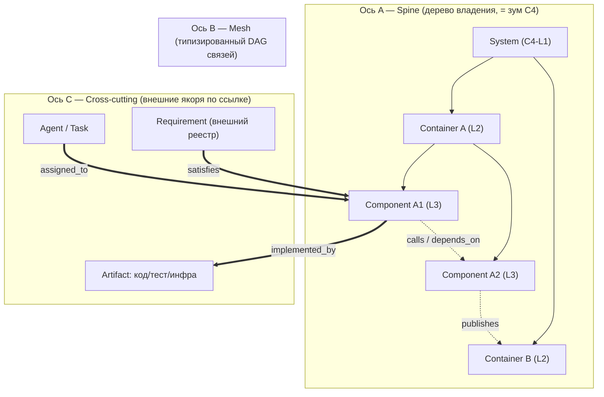
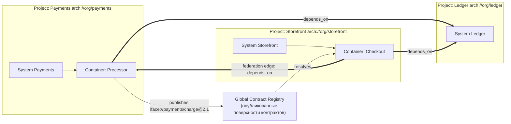
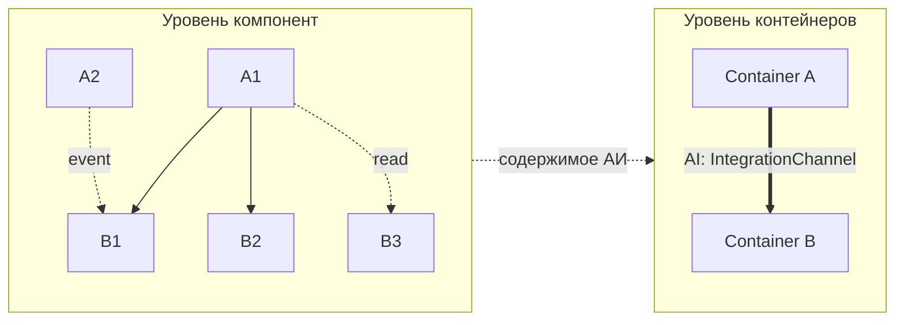
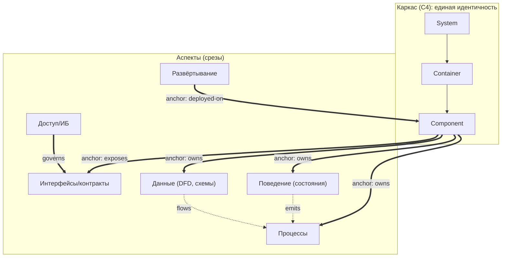

# ArchIDE — концепт

## 0. Ключевая идея

В основе лежит один принцип, из которого выводится вся топология:

> **Архитектура — это один типизированный граф. Код, диаграммы и документы — это проекции (представления) этого графа, а не его источник.**

Именно это решает главную проблему «кучи пересекающихся документов»: **в документной модели один смысл неизбежно дублируется в нескольких местах и расходится. В графовой модели сущность существует ровно один раз (у неё одно «домашнее» место), а все остальные места ссылаются на неё по стабильному идентификатору.** Дублирование становится физически невозможным — можно только ссылаться.

Три следствия:

1. Человек и агент редактируют **модель**, никогда не текст кода.
2. Никакой документ не «хранится» — он **вычисляется** запросом к графу.
3. Строгость обеспечивается не дисциплиной автора, а **схемой метамодели и валидатором**.

---

## 1. Топология модели (ядро концепта)

Модель — это **typed property graph**, организованный тремя ортогональными осями. Это и есть ответ на «принципиально важный выбор структуры».



| Ось | Топология | Роль | Инвариант |
|---|---|---|---|
| **A. Spine** | строгое дерево (один родитель) | владение и декомпозиция; уровни C4 | у каждого узла **ровно один** parent → один «дом» |
| **B. Mesh** | ориентированный DAG | взаимодействия: зависимости, вызовы, потоки данных | рёбра только из разрешённых типов; направление и контракт явны |
| **C. Cross-cutting** | гиперрёбра-ссылки во внешние пространства имён | требования, код, тесты, инфра, агенты, решения | узлы живут в своём namespace, прикрепляются **только по ID** |

**Почему это не превращается в кашу:** владение уникально (спайн — дерево), а связи множественны (mesh + cross-cutting). Классическая документная ошибка — «одно и то же описано в двух местах» — здесь невозможна: у сущности одно место, остальное — ссылки.

---

## 2. Метамодель (онтология)

Метамодель — это **схема**, а не свободный формат. Набор типов узлов и рёбер закрыт и расширяется только явно.

**Узлы:**

- Структурные: `System`, `Container`, `Component`, `CodeUnit` (L1–L4), `Actor`, `ExternalSystem`
- Контрактные: `Interface`/`Port`, `DataEntity`, `DataStore`
- Агрегация: `AggregationInterface` (АИ) — реифицированное ребро: содержит произвольный набор связей, но на грубом уровне предстаёт одной сущностью (см. §12)
- Кросс-функциональные: `Capability` (функциональная группировка, не входящая в дерево владения), `Decision` (ADR-узел, ссылается на затронутые узлы)
- Внешние якоря: `Requirement`, `Artifact` (код/тест/конфиг/инфра), `Agent`, `Task`

**Рёбра (типизированные):**

- Владение: `contains`
- Взаимодействие: `depends_on`, `calls`, `publishes`, `subscribes`, `reads`, `writes`
- Контракты: `exposes`, `consumes`, `implements`, `realizes`
- Трассировка: `satisfies`, `derived_from`, `constrains`, `verifies`, `conflicts_with`
- Реализация: `implemented_by`, `tested_by`, `deployed_as`, `generated_from`
- Управление: `owned_by`, `decided_by`, `assigned_to`

Закрытый словарь типов — это то, что делает модель **строгой и машинно-проверяемой**, а не «текстом с картинками».

---

## 3. Поверхности описания модели

Поправка к §0: **централен граф, а не текст.** Текстовый DSL — лишь одна из сериализаций, и делать его основным человеческим интерфейсом было ошибкой. Правильно: **много взаимозаменяемых поверхностей, все — живые проекции одного графа; любое редактирование есть мутация графа.**

Два эргономических профиля:

- **Человек** — пространственный, структурный, разговорный.
- **Агент** — структурированный текст + API (для агента DSL эргономичен).

### 3.1. Поверхности для человека

| Поверхность | Что это | Сильная сторона |
|---|---|---|
| **Canvas (пространство)** | узлы-карточки; вложенность = контейнмент; рёбра = протянутые связи; АИ = раскрываемые коннекторы границы; семантический зум = уровни C4 | видеть структуру целиком |
| **Inspector (формы)** | типизированные поля, выпадающие списки, пикеры со ссылками на сущности | свойства без синтаксиса |
| **Grid / матрица** | связи и трассировка таблицей: строки = рёбра, колонки = source / target / type / contract / requirement | массовое связывание и покрытие |
| **Диалог (NL)** | «Checkout вызывает Payments.charge и удовлетворяет REG-1042» → агент предлагает **семантический диф** → принять / отклонить | человек формулирует намерение, а не синтаксис |

### 3.2. Принципы эргономики

- **Grammar-driven (проекционное) редактирование:** редактор предлагает только допустимые типы узлов и рёбер — нарушить метамодель невозможно, синтаксис запоминать не нужно.
- **Progressive disclosure:** канвас — структура; клик — детали; текст — только для тех, кто хочет.
- **Семантический диф и undo:** изменения — мутации графа, ревью = «добавлен узел», «изменено ребро», а не текстовый diff.
- **Command palette и поиск по ID/имени** — навигация как «go to symbol».
- **Один граф, много поверхностей, двусторонняя синхронизация** — правка в любой поверхности мгновенно видна во всех.

### 3.3. Роль текста

Текст остаётся, но **не как человеческий интерфейс, а как машинная сериализация** для git-версионирования и обмена с агентами — автогенерируемая и стабильная. Пример (агентский вид):

```arch
component Payments.Processor {
  id: comp://payments/processor
  parent: container://payments
  exposes  iface://payments/charge   // порт (контракт)
  consumes iface://ledger/post
  depends_on component://ledger/writer { contract: iface://ledger/post }
  satisfies  req://REG-1042          // ссылка во внешний реестр
  implemented_by artifact://svc/payments/processor
  capability Payments              // кросс-функциональная привязка
}

iface payments/charge {
  id: iface://payments/charge
  operation charge(order: Order) -> Receipt
}
```

Требования к сериализации: (1) каждая сущность объявлена ровно один раз, (2) все ссылки — по ID, (3) парсер строит граф и **падает** при нарушении схемы или висячей ссылке. Человек этот текст руками не пишет — он получает его как проекцию и при необходимости правит.

---

## 4. C4 как операция зума, а не как набор диаграмм

Уровни C4 (Context → Container → Component → Code) — это **глубина спайна**. «Нарисовать диаграмму» = выполнить проекцию подграфа на заданной глубине.

- L1 Context → `System` + `Actor`/`ExternalSystem` + межсистемные рёбра
- L2 Container → дети System
- L3 Component → дети Container
- L4 Code → `CodeUnit` (может делегироваться сгенерированному коду)

Так уровни **физически не могут рассинхронизироваться** — это один и тот же граф на разной глубине, а не четыре файла диаграмм.

---

## 5. Реестр требований и трассировка

Требования приходят из **внешней среды внедрения/эксплуатации** (Jira/собственный реестр/регуляторные документы). Они — отдельное пространство имён, подключаемое адаптером синхронизации:

- Внешний ID маппится в узел `Requirement` с сохранением провенанса (источник, версия, дата).
- Связь с архитектурой — только типизированными рёбрами `satisfies / constrains / verifies`.
- **Два namespace — один граф**: архитектура и требования живут раздельно, соединяются трассировочными рёбрами.

Это даёт то, чего не даёт документный подход: **трассировочная матрица вычисляется** из графа (покрытие, «сироты», конфликты), а не поддерживается руками.

---

## 6. Проекция контекста для агента (главный рабочий артефакт)

Из модели + требований генерируется **ограниченный срез контекста** для конкретного узла или задачи. Это ключ к «удобной для агента структуре».

Срез для узла `N` содержит ровно:

1. **Где я** — сам `N` + цепочка родителей до `System`
2. **Мой контракт** — исходящие `exposes`/`consumes` порты и их сигнатуры
3. **Что я трогаю** — прямые (1-hop) рёбра mesh с контрактами
4. **Зачем** — связанные `Requirement`
5. **Как реализовано** — привязанные `Artifact`/тесты
6. **Что НЕ моё** — явные исключения и границы

Свойства среза: **детерминирован**, **версионируется**, **хешируется**, **не перекрывается** со срезами других узлов. Два агента на разных узлах получают непересекающиеся срезы → дублирования не возникает по построению. Агент работает со срезом, никогда — со всей моделью.

---

## 7. Механизмы строгости (почему система не деградирует)

| Механизм | Что предотвращает |
|---|---|
| Схема метамодели (закрытые типы) | изобретение «своих» сущностей и связей |
| Канонический ID + реестр алиасов | появление дублей одного концепта |
| Referential integrity | висячие ссылки, распад связности |
| Правило единственного «дома» | дублирование владения |
| Views = запросы (не хранятся) | расхождение документов |
| Генерируется, а не пишется вручную | ручной дрейф диаграмм/доков |
| Валидаторы инвариантов (напр. «у L3 обязателен L2-родитель», «каждое требование покрыто») | структурная деградация |
| Impact-анализ при мутации | незамеченные последствия изменений |

---

## 8. Окна WebIDE

Каждое окно — это **представление одной модели**, рендерящее одну из поверхностей §3; собственных хранилищ у окон нет, навигация — по ID узла.

1. **Model Navigator** — канвас (пространственная поверхность, §3.1): спайн C4, семантический зум, drill-down, раскрытие АИ.
2. **Inspector** — формы и свойства сущности, привязки, инварианты; здесь же доступ к текстовой сериализации (§3.3).
3. **Requirements & Traceability** — реестр требований, покрытие, матрица-грид, конфликты.
4. **Agent Workspace** — срезы контекста, задачи, активность агентов, сгенерированная структура.
5. **Impact & Integrity** — сироты, нарушения, impact-граф изменений.
6. **Conversation** — диалоговая поверхность (§3.1): формулировка намерения → семантический диф → принять / отклонить.
7. **Build & Runtime** — генерация артефактов, деплой, телеметрия, привязка результатов обратно в модель.

---

## 9. Рабочий цикл

```
Requirement intake (внешний реестр)
        │  адаптер синхронизации
        ▼
Узел + рёбра в графе  ──►  Валидация (схема + инварианты)
        │
        ▼
Генерация Agent-среза (bounded, hashed)
        │
        ▼
Агент реализует → Artifact привязывается к узлу (implemented_by / tested_by)
        │
        ▼
verifies ↔ Requirement, impact-пересчёт
        └──► снова в модель (цикл замкнут)
```

---

## 10. Технологический контур (кратко)

- **Хранилище модели:** текстовые DSL-файлы в git (единый источник, человекочитаемые диффы) → парсер → индекс графа в памяти/графовой БД для запросов.
- **Ядро:** парсер + валидатор метамодели + движок проекций (зум C4, срезы, impact).
- **API:** запросы к графу; отдельный **агентский интерфейс** (MCP-подобный), отдающий срезы и принимающий привязку артефактов.
- **Адаптеры:** синхронизация реестра требований, приёмка артефактов/телеметрии.
- **Frontend:** web, док-панели из §8, все — проекции одной модели.

---

## 11. Федерация проектов: авто-обнаружение взаимных связей

Сценарий: существует **много независимых проектов**, каждый — свой граф ArchIDE. Проекты не знают друг о друге заранее, но по мере развития делят интерфейсы, данные и внешние системы. Требование: ArchIDE **сам** обнаруживает эти связи и **материализует** их в требования, ограничения и тесты — без ручного ведения документов.

### 11.1. Расширение топологии: федеративная ось

Топология из §1 не ломается — добавляется четвёртая ось.



| Ось | Топология | Роль |
|---|---|---|
| **D. Federation** | рёбра между узлами **разных** проектных namespace | межпроектные зависимости, общие контракты и данные |

Инвариант сохраняется: **внутри проекта владение по-прежнему единственно**, федерация добавляет только типизированные рёбра-ссылки между namespace.

### 11.2. Глобальная идентичность

Ключевая техническая проблема — как сопоставить локальные ID разных проектов.

- Каждый проект регистрирует **URN-namespace**: `arch://org/payments`.
- Локальный ID квалифицируется: `arch://org/payments#iface://payments/charge`.
- Контрактные поверхности **адресуются по содержимому**: нормализованная сигнатура (имя, операции, схема payload, семантические теги) хешируется → `sig-hash`. Идентичные поверхности в разных проектах **унифицируются**.
- Реестр алиасов хранит переименования: смена имени **не рвёт** связь, идентичность (URN) сохраняется.

### 11.3. Global Contract Registry (GCR)

Общий append-only реестр **опубликованных контрактных поверхностей**. Проект «публикует» наружу только контрактную поверхность (порты, события, `DataEntity`, `ExternalSystem`-роли) — внутренности остаются приватными.

- Публикация версионируется и **иммутабельна** для данной версии.
- GCR — единственное место, где проекты «встречаются»; он же — арбитр совместимости.
- **Границы приватности:** `published` vs `internal`. Внутренние узлы недоступны извне — это защищает от протечек и от превращения федерации в «общий котёл».

### 11.4. Авто-обнаружение (механизмы)

Связи обнаруживаются **из самой модели**, а не декларируются людьми. Пять независимых детекторов:

1. **Матчинг по сигнатуре** — потребитель ищет поверхность с совпадающей `sig-hash` / тегами ⇒ кандидат-ребро.
2. **Разрешение внешних якорей** — проект объявил `ExternalSystem`/`Actor`, который в GCR соответствует реальному проекту ⇒ ребро к нему.
3. **Проверка заявленных зависимостей** — проект может *заявить* зависимость; GCR её **подтверждает** только при реальном совпадении поверхности (declaration как гипотеза, match как факт).
4. **Пересечение данных** — два проекта читают/пишут одну `DataEntity` из общего schema-registry ⇒ неявная связь.
5. **Наблюдаемая телеметрия** (опционально) — реальные вызовы в проде подтверждают и обогащают статический граф.

### 11.5. Разрешение кандидатов (resolution)

Обнаружение даёт **кандидаты**, resolution их фиксирует:

- **Точное совпадение** (сигнатура + версия) ⇒ авто-приём ребра.
- **Неоднозначность / конфликт ожиданий** ⇒ узел `Decision`, эскалация человеку/агенту.
- **Несовпадение версий** ⇒ ребро создаётся с **version-constraint** и пометкой несовместимости.
- Результат закрепляется в **`federation.lock`** проекта — детерминированные сборки (как lock-файл пакетного менеджера, но для архитектурных контрактов).

### 11.6. Материализация в требования

Из каждого принятого федеративного ребра **генерируются derived-требования** в обе стороны:

- **Потребитель B:** «B зависит от контракта C проекта A, диапазон версий X» → `derived_from` = ребро.
- **Провайдер A:** «A обязан удовлетворять потребителей B, D, E по контракту C» → контрактное/нефункциональное требование.

```arch
requirement Storefront.Checkout.dep-payments {
  id: req://storefront/derived/017
  kind: derived                      // генерируется, не редактируется руками
  derived_from: fed-edge://storefront/checkout -> payments/processor
  constrains: component://storefront/checkout
  text: "Checkout depends on arch://org/payments#iface://payments/charge @ ^2.1"
}
```

Derived-требования **помечены как производные** и пересчитываются автоматически — инвариант «нет дублирующих документов» сохранён.

### 11.7. Материализация в ограничения

Каждое ребро рождает набор **валидируемых ограничений**:

| Класс | Смысл |
|---|---|
| **Boundary** | потребитель вправе обращаться только к `published`-поверхности провайдера, не во внутренности |
| **Compatibility** | изменение контракта провайдера обязано сохранять обратную совместимость в рамках диапазона версий потребителей |
| **Data-classification** | общая `DataEntity` распространяет классификацию/регламент на обоих потребителей и провайдера |
| **Protocol/Security** | общий интерфейс навязывает протокол, аутентификацию, лимиты обеим сторонам |
| **SLA** | провайдер принимает наблюдаемые обязательства перед потребителями |

```arch
constraint Storefront.Checkout.boundary {
  id: con://storefront/checkout/boundary
  applies_to: component://storefront/checkout
  kind: boundary
  rule: "call only arch://org/payments#iface://payments/charge@^2.1 (published surface)"
  severity: error
}
```

Ограничения проверяются **непрерывно**; нарушение ломает сборку проекта.

### 11.8. Материализация в тесты

Ограничения и derived-требования обязаны иметь верификацию — она тоже генерируется:

- **Contract-тесты (consumer-driven, pact-стиль):** провайдер обязан пройти ожидания потребителя; потребитель — корректно обработать ответы.
- **Integration-тесты** на границе федерации, построенные из контрактной поверхности.
- **Compatibility/regression-тесты:** при изменении поверхности A автоматически прогоняются contract-тесты всех потребителей; breaking-изменение **валит** сборку.
- **Traceability-тесты (coverage):** проверка, что у каждого derived-требования и ограничения есть верифицирующий тест.

```arch
test Storefront.Checkout.pact.charge {
  id: test://storefront/checkout/pact/charge
  kind: contract
  verifies: con://storefront/checkout/boundary
  provider: arch://org/payments#iface://payments/charge@^2.1
  consumer: component://storefront/checkout
}
```

### 11.9. Версионирование и протокол breaking change

- Контракты версионируются на архитектурном уровне; поверхность версии иммутабельна.
- Любая мутация модели запускает **impact-движок**: пересчёт затронутых федеративных рёбер → список затронутых потребителей.
- **Breaking change protocol:** провайдер публикует новую версию → GCR вычисляет совместимость → при разрыве в потребителях генерируются **migration-требования** и migration-тесты, а merge блокируется до их разрешения **или** явного waiver-узла `Decision` (с обоснованием и сроком).
- Semver на архитектурном уровне: `major` = breaking, `minor` = расширение, `patch` = совместимая правка.

### 11.10. Governance: владение и promotion

- У каждой поверхности есть **владелец-провайдер**; потребители могут только ссылаться, не редактировать.
- **Promotion:** если контракт нужен нескольким проектам, он выносится в **shared-проект** (проект-коллекция контрактов), на который ссылаются все → устраняется дублирование контракта между проектами.
- Конфликты ожиданий разрешаются `Decision`-узлами, привязанными к ребру (с провенансом и историей).

### 11.11. Границы срезов агентов в федерации

Принцип из §6 сохраняется: срез агента проекта **не расширяется на внутренности других проектов**. Срез получает только **федеративную границу**:

- внешние контрактные поверхности, которые проект публикует и потребляет (с версиями);
- связанные derived-требования, ограничения и тесты;
- явные исключения и запреты (boundary).

Так агенты разных проектов по-прежнему получают **непересекающиеся срезы** — федерация не превращается в общий котёл.

### 11.12. Сквозной сценарий (Payments / Storefront / Ledger)

1. Storefront объявляет потребность принимать платежи → `ExternalSystem` «Payments».
2. GCR находит опубликованную поверхность проекта Payments `iface://payments/charge@2.1`.
3. Детектор матчинга сигнатур создаёт **кандидат-ребро**.
4. Resolution подтверждает → федеративное ребро + запись в `federation.lock` Storefront.
5. **Требования:** в Storefront и Payments генерируются derived-требования.
6. **Ограничения:** boundary, compatibility, security на обеих сторонах.
7. **Тесты:** contract-тест «Checkout ⇄ charge@^2.1» на обеих сторонах.
8. Payments меняет сигнатуру `charge` (breaking) → impact-движок помечает Storefront → **breaking change protocol**: migration-требование + migration-тест, merge заблокирован до разрешения или waiver.
9. Ledger потребляется и Payments, и Storefront → детектор пересечения данных находит общую `DataEntity` → **data-classification-ограничение** распространяется на оба проекта и на провайдера Ledger.
10. Позже контракт `charge` нужен третьему проекту → **promotion** в shared-проект `arch://org/contracts/payments`, все ссылаются на него.

### 11.13. Автоматика vs human-in-the-loop

| Полностью автоматически | Требует подтверждения (агент/человек) |
|---|---|
| матчинг сигнатур, разрешение якорей | неоднозначные матчи |
| генерация derived-требований/ограничений/тестов | breaking-изменения |
| проверка совместимости и impact | waiver'ы и сроки |
| поддержка `federation.lock` | promotion общих контрактов |

**Итог:** федерация расширяет топологию ArchIDE одной осью (D) и GCR, но **не нарушает ни одного базового инварианта**: владение остаётся единственным, документы остаются проекциями, требования/ограничения/тесты — генерируются из графа, а срезы агентов остаются ограниченными. Межпроектные связи обнаруживаются автоматически и сразу отражаются в требованиях, ограничениях и тестах.

---

## 12. Агрегация связей: интерфейсы агрегации

Формальные правила слияния (R1–R5, таблица `lift_L`) действительно хрупки: переход между уровнями может связывать **разнородные** связи, и никакая таблица «подъёма типов» не покроет все комбинации. Правильное решение — не *вычислять* агрегат, а **реифицировать** его: ввести первоклассную сущность, которая **содержит любой состав оригинальных связей, но на грубом уровне предстаёт одной сущностью**.

### 12.1. Что такое интерфейс агрегации (АИ)

**Интерфейс агрегации (Aggregation Interface, АИ)** — это узел, который заменяет произвольный набор рёбер более низкого уровня на **одну именованную сущность**. Это «реификация ребра»: связь становится объектом.

АИ не сводит типы и не подбирает правила слияния — он **хранит** оригинальные связи как есть. Разнородность перестаёт быть проблемой, потому что АИ её не устраняет, а **инкапсулирует**.



### 12.2. Анатомия АИ

| Поле | Смысл |
|---|---|
| `id` | стабильная идентичность (именуемая сущность) |
| `scope` | **содержимое** — произвольное множество оригинальных рёбер/АИ (любых типов) |
| `owner` | где АИ «висит»: граница между грубыми узлами или внутренность одного |
| `arity` | 2 (ребро) или n (гиперребро/шина) |
| `contract` | контракт, который видит грубый уровень (супертип содержимого) |
| `direction` | направленный / двунаправленный / шина |

### 12.3. Контракт АИ и конформность

Ключ к строгости: у АИ есть **собственный контракт** (например, `iface://payments`), и он — **супертип** для содержимого:

- каждое агрегируемое ребро обязано **конформно** (refinement) контракту своего АИ;
- валидатор проверяет конформность → АИ не «мусорка», а реальная абстракция;
- грубый уровень видит только контракт АИ, не детали содержимого.

### 12.4. Вложенность и масштабирование

АИ может агрегировать другие АИ → **иерархия агрегации**: `связь → АИ → супер-АИ`. Это масштабируется на любую сложность и естественно совпадает с уровнями C4.

### 12.5. Правила (вместо R1–R5)

| # | Правило | Смысл |
|---|---|---|
| **A1** | Покрытие | каждое видимое ребро грубого уровня покрыто **ровно одним** АИ (без сирот и двойного счёта) либо явно исключено |
| **A2** | Конформность | содержимое конформно контракту АИ |
| **A3** | Обратимость | содержимое хранится дословно; drill-down = раскрыть АИ |
| **A4** | Идентичность | АИ — именованная сущность со стабильным ID; переименование не рвёт связь |
| **A5** | Гетерогенность | состав содержимого не ограничен типами — инкапсуляция вместо слияния |

Правило видимости (у связи есть естественный «этаж») сохраняется, но **свёртка больше не вычисляется** — она материализована в АИ.

### 12.6. Откуда берутся АИ

- **Авторские** — человек/агент объявляет АИ и его содержимое (полный контроль, любая гетерогенность).
- **Авто-предложение** — система предлагает кандидата-АИ для пучка связей на границе; человек/агент принимает, называет, редактирует.

Здесь формальные правила из прежней версии **понижаются до эвристики-подсказки**, а не закона: они лишь предлагают кандидатов, решение остаётся за моделью.

### 12.7. Унификация с §11 и портами

- **Federation-ребро (§11) — это АИ**, чьё содержимое пересекает namespace'ы, а контракт = `published`-поверхность.
- **Порт/интерфейс узла** — это АИ, агрегирующий набор операций/контрактов.
- Значит, порты, границы контейнеров и межпроектные связи — **один и тот же механизм**.

### 12.8. Почему это проще

- нет таблиц `lift_L` и правил слияния — гетерогенность инкапсулирована;
- грубый уровень прост: узлы + именованные АИ;
- АИ обсуждаемы людьми и агентами как обычные сущности;
- drill-down тривиален (АИ содержит оригиналы);
- вложенность масштабируется на любую сложность.

**Вывод:** агрегация — это **сущность**, а не вычисление. Интерфейс агрегации сохраняет любой состав оригинальных связей и заменяет их одной сущностью на грубом уровне, устраняя и сложность формальных правил, и проблему разнородности.

## 13. Многоаспектная модель: расширение за пределы C4

### 13.1. Проблема

C4 описывает **структуру** (кто/что и как вложено), но не поведение, данные, интерфейсы, процессы, роли и политики ИБ. Наивное решение — завести «типы диаграмм» — снова возвращает фрагментацию и расхождение документов, от которой мы уходили в §0.

### 13.2. Ключевой принцип

Не добавляем параллельные документы. **Обобщаем граф**: все прочие артефакты — это **аспекты (срезы) одного и того же графа**, натянутые на единый каркас идентичности.

- **Каркас (backbone)** — структурная идентичность (C4): `System → Container → Component → Module`, `Actor`, `ExternalSystem`. Единственное место, где «существуют» вещи: одна сущность — один узел.
- **Аспект (concern/facet)** — ортогональный типизированный слой над каркасом.
- **Привязка (anchor)** — типизированное ребро, соединяющее элемент аспекта ровно с одним элементом каркаса (или с опубликованным контрактом).
- **Проекция (projection)** — вычисляемое представление (диаграмма/спецификация): подграф (каркас ⊕ выбранные аспекты) в заданном охвате и на заданном уровне.
- **Правила согласованности** — инварианты, связывающие аспекты с каркасом и между собой.

Формально: **модель = фасетный граф** (faceted classification) — один набор сущностей (каркас) + N ортогональных иерархий-аспектов + проекции. Это и есть «более общая структура».



### 13.3. Аспекты и их элементы

| Аспект | Элементы | Отвечает за | Генерирует |
|---|---|---|---|
| **Структура (C4)** | System, Container, Component, Module, Actor, ExternalSystem | декомпозиция, границы | C4-диаграммы |
| **Интерфейсы/контракты** | Interface, Operation, Message, SchemaRef, Version | API, контракты | OpenAPI / proto / JSON Schema |
| **Данные** | DataEntity, Attribute, DataStore, DataFlow, Lineage | схемы, потоки (DFD), происхождение | DDL / ER / DFD |
| **Поведение** | StateMachine, State, Transition, Event, Guard, Action | состояния, события | state-диаграммы |
| **Процессы** | Process, Activity, Task, Gateway, Participant, Interaction | сценарии, оркестрация | BPMN / sequence |
| **Доступ/ИБ** | Principal, Role, Permission, Policy, Resource, Control | ролевые модели, политики | RBAC/ABAC, политики |
| **Развёртывание** | Node, Environment, Runtime, InfraResource | топология, среды | deployment-схемы |
| **Качество** | NFR, SLO, Constraint | нефункциональные требования | SLO-спеки |

### 13.4. Инварианты (почему не будет противоречий)

1. **Единственная идентичность** — сущность существует один раз (в каркасе); аспекты ссылаются по ID.
2. **Единственная привязка** — у каждого элемента аспекта ровно один anchor (в каркас или в опубликованный контракт); ничего не «висит в воздухе».
3. **Замкнутые словари аспектов** — типы узлов/рёбер каждого аспекта закрыты; аспект не может изобретать структурные сущности.
4. **Referential integrity** — по всему графу, включая кросс-аспектные рёбра.
5. **Проекции — чистые функции модели** — диаграмма не хранится, а вычисляется, поэтому не может разойтись.
6. **Кросс-аспектные правила** — операция контракта ссылается на существующую схему данных; поток данных соединяет существующие сущности/хранилища/процессы; переход ссылается на состояния той же машины; разрешение роли ссылается на операцию из контракта; политика `governs` существующий ресурс.

### 13.5. Примеры кросс-аспектных связей

- `component —exposes→ interface —has→ operation —reads/writes→ dataEntity`
- `stateMachine —owned-by→ component`; `transition —emits→ event`; `process —consumes→ event`
- `role —allowed→ operation`; `policy —governs→ resource` (interface/operation/dataEntity)
- `dataFlow —from→ dataStore —to→ process` (DFD)
- `container —deployed-on→ node —in→ environment`

### 13.6. Как встраиваются уровни, агрегация и федерация

- **Уровни (зум C4)** применяются к каркасу; проекция = (аспект × охват × уровень).
- **Интерфейсы агрегации (§12)** обобщаются: агрегировать можно не только связи, но и целые подграфы аспектов (грубый «поток данных» = агрегат многих потоков).
- **Федерация (§11)** обобщается: публиковать можно любой элемент аспекта (интерфейс, сущность данных, политику) с той же машинерией идентичности/версий/совместимости.

### 13.7. Практическое расширение метамодели

- Ввести **namespace аспекта** и **реестр схем аспектов**: каждая схема объявляет свои типы узлов/рёбер и допустимые типы якорей.
- **Валидатор** проверяет привязки, замкнутость словарей и кросс-аспектные правила (расширяет §7).
- **UI**: рядом с уровнями C4 — **вкладки аспектов**; каждая рендерит свою проекцию (state-диаграмму, DFD, API, роли…) из того же графа.

### 13.8. Вывод

Одна идентичность + ортогональные аспекты + привязки + проекции + правила согласованности дают **единый цифровой двойник** системы, где C4 — лишь структурный аспект, а остальные артефакты — его ортогональные срезы. Добавление нового аспекта не ломает существующие: он добавляет слой и правила, не переопределяя структуру.

## 14. Проверка гипотезы: редактирование, согласованность, генерация, верификация

### 14.1. Гипотеза и критерии

Гипотеза: фасетный граф (§13) оптимален не только для реконструкции, но и для (E) частичного редактирования человеком, (G) генерации для агентной разработки и (V) верификации результата агента.

Критерии «оптимальности» (иначе проверять нечем): выразительность; отсутствие дублирования; **локальность изменения**; **разрешимость проверки согласованности**; детерминизм проекций/генерации; верифицируемость; эволюционируемость; обратимость; масштабируемость.

### 14.2. Сценарий частичного редактирования (E)

Операции: добавить/удалить/переименовать узел; добавить/удалить/изменить ребро; **переместить** узел в каркасе (re-parent); изменить контракт; удалить компонент.

Что структура даёт автоматически:

- **Дешёвые rename/move** — ссылки по ID, а не по пути ⇒ переименование/перемещение не рвёт связи.
- **Локальность** — правка узла затрагивает только его anchors и инцидентные рёбра; **impact** = транзитивное замыкание по dependency/anchor/кросс-аспектным рёбрам.
- **Проверяемость** — согласованность есть набор **разрешимых предикатов** над типизированным графом (типы, привязки, ссылки, дерево, уникальность, замкнутость словарей, кросс-аспектные правила).

Механика: **транзакция правок → валидатор → принять/отклонить/починить**, инкрементально — только по затронутому подграфу.

### 14.3. Что нужно добавить для полного автоматизма

1. **Referential actions на типах рёбер** (аналог FK-политик): `cascade | restrict | nullify | repoint`. Без них удаление/перемещение не автоматизируется: `contains` → cascade, `depends_on` → restrict (нельзя удалить, пока зависят) либо repoint, ссылки на опубликованный контракт → immutable + versioned.
2. **Транзакции + gate валидации + impact-анализ** — модель правки.
3. **Слой соответствия/верификации** (артефакт↔модель, контракт-тесты, покрытие) — gate приёмки (§14.6).
4. Опционально: **владельцы/полномочия** и разрешение конфликтов (мультиредактор/федерация); **декларативный язык ограничений** для кросс-аспектных правил.

### 14.4. Классификация инвариантов

| Класс | Разрешимость | Поведение |
|---|---|---|
| **Жёсткие** (типы, привязки, ссылки, дерево, уникальность) | да, дёшево | авто-энфорс, блокируют |
| **Мягкие** (покрытие требований, полнота, стиль) | да, но допускают waiver | предупреждения + `Decision`-узел |
| **Суждения** («правильна ли декомпозиция») | нет | только человек/агент |

### 14.5. Генерация и агентная разработка (G)

Из модели генерируется/используется:

- **Артефакты**: скелеты кода, контракты (OpenAPI/proto/JSON Schema), DDL, конфиги, IaC, тесты.
- **Аспект-осознанные срезы контекста (§6)**: срез компонента включает его интерфейс, данные, поведение, доступ — всё нужное агенту по его концерну.
- **Пакеты работ**: узел + его срез + критерии приёмки (из требований/контрактов).
- **Контракты как интерфейс между агентами**: агенты реализуют к контрактам, контракт-тесты проверяют.
- **Прямое использование**: модель — источник; агент правит модель и/или производит артефакты, привязанные к узлам (§0), а не код «сам по себе».

### 14.6. Верификация результата агента (V)

1. **Структурное соответствие** — артефакты привязаны к узлам (`implemented_by`), границы соблюдены (не лезет во внутренности).
2. **Соответствие контрактам** — сгенерированный/реализованный интерфейс совпадает с моделью (diff схем/сигнатур).
3. **Поведенческое** — реализованная машина состояний совпадает с моделью (тесты из модели).
4. **Данные** — схемы совпадают.
5. **Доступ** — политики/разрешения применяются (тесты).
6. **Трассируемость** — каждый артефакт трассируется к узлу/контракту; несвязанные артефакты — нарушение.
7. **Model-based / property-based тесты** — модель как оракул.
8. **Gate** — результат принимается только при прохождении конформанса + валидатора + покрытия; иначе — цикл доработки (как repair при реконструкции).

Механизм проверок 1–6 конкретизируется **неподделываемыми метками трассируемости** (§15).

### 14.7. Как проверять саму гипотезу (эксперименты)

- **Property-based**: случайные валидные модели + случайные правки → валидатор обязан (a) принимать валидное, (b) отвергать невалидное, (c) быть детерминированным.
- **Метаморфные**: rename/move не меняют смысл проекций; delete+re-add восстанавливает.
- **Round-trip**: модель → генерация → повторная реконструкция из артефактов → сходимость.
- **Конформанс-тесты**: внесённое нарушение обязано ловиться gate’ом.
- **Матрица**: операции правок × инварианты → ожидаемое обнаружение.

### 14.8. Вердикт

Гипотеза **подтверждается частично**: фасетный граф — адекватная и близкая к оптимальной основа для E/G/V благодаря единой идентичности (дешёвые правки по ID), типизированным привязкам и закрытым словарям (разрешимость проверок), проекциям (детерминизм генерации) и срезам (скоупинг агентов). Но «оптимальность» **неполна без** referential actions, транзакций+gate+impact и слоя конформанса. Неустранимые ограничения: семантическая «правильность» архитектуры неразрешима (нужны `Decision`/waiver); кросс-аспектные правила требуют ограниченного декларативного языка; масштаб требует инкрементальной валидации.

## 15. Неподделываемые метки трассируемости и покрытие реализации

### 15.1. Идея

Из модели для каждого артефакта/единицы генерируются **подписанные метки** (trace markers), которые агент **обязан** проставить в коде в местах, реализующих соответствующие сущности. Метка несёт **всю цепочку уровней** архитектуры (System→Container→Component→аспекты→Requirement) и подписана ключом хоста, которого у агента нет ⇒ агент не может её подделать.

### 15.2. Структура метки

Метка = подписанный payload:

```
archide://v1
  artifact: artifact://svc/api/handler.py
  chain:
    system:      sys://app
    container:   container://app/api
    component:   component://app/api/handler
    interface:   iface://app/api/charge
    requirement: req://REG-1042
  lease: run=<run-id> slice=<slice-id> nonce=<nonce>
  sig: <подпись хоста>
```

В коде — компактно: `// @archide <base64url(payload)>.<base64url(sig)>`.

Метка содержит **все уровни и аспекты**, поэтому по одной метке видно, каким элементам всех уровней соответствует участок кода.

### 15.3. Неподделываемость

- **Подпись**: `sig = Sign_K(payload)`, ключ `K` только у хоста ⇒ агент не выпустит метку для произвольного/нового элемента.
- **Lease (одноразовость)**: метка привязана к запуску/срезу (`run`, `slice`, `nonce`) ⇒ метку из другого пакета работ нельзя переиспользовать.
- **Привязка к артефакту**: метка валидна только в артефакте, который в модели связан с элементом (`implemented_by`).
- **Аттестация постфактум**: после получения артефактов хост строит подписанную **квитанцию** (receipt): элемент → артефакт + хэш региона. Это ловит перенос/подмену места и даёт проверяемый манифест (SBOM-подобный).
- Что подпись **не** гарантирует: агент может **пропустить** метку или поставить **не туда** — это ловят проверки покрытия и размещения (§15.5), а не подпись.

### 15.4. Как метки попадают в код

- **Генерируемый код** — метки ставит генератор (хост) детерминированно.
- **Код агента** — в срез (§6) агент получает **подписанные метки своего пакета работ** (по одной на элемент) и обязан разместить их на границах единиц (файл/класс/функция); новые метки он выпустить не может.

### 15.5. Верификация и gate

Хост сканирует артефакты и проверяет:

1. подпись валидна (не подделана);
2. элемент существует в модели и входит в lease запуска;
3. **размещение** — метка в артефакте/регионе, привязанном к элементу;
4. **покрытие** — для каждого элемента охвата (все уровни) есть метка;
5. **атрибуция** — нет кода без метки (unattributed) и нет «висячих» меток;
6. **согласованность цепочки** (component принадлежит container и т.д.);
7. **требования** — каждый `req` покрыт цепочкой до кода и верифицирующими тестами (`verifies`).

Нарушение → отказ → цикл доработки (§14.6).

### 15.6. Покрытие по уровням

Строится **матрица покрытия** (элементы × артефакты) по уровням: полнота реализации требований видна «сразу» (heatmap: система→контейнер→компонент→интерфейс→данные→поведение→доступ→требование). Это UI-проекция модели, отдельно не хранится.

### 15.7. Связь с предыдущими разделами

- §6 срезы — теперь включают подписанные метки пакета работ.
- §7 строгость — добавляется жёсткий инвариант «каждый регион атрибутирован; каждый элемент охвата покрыт».
- §11 федерация — метки ссылаются на опубликованные контракты; кросс-проектное покрытие.
- §12 агрегация — метки грубых уровней ссылаются на агрегированные интерфейсы.
- §13 аспекты — метки многомерны (интерфейс/данные/поведение/доступ) ⇒ многоаспектная трассировка.
- §14 верификация — метки есть конкретный механизм конформанса и gate.

### 15.8. Ограничения и меры

- Шум в коде → метки на границах единиц, не на каждой строке.
- Управление ключом → ключ хоста, ротация по проекту/запуску; ключ не попадает в контейнер.
- rename/delete элементов → метки по ID переживают rename; удаление делает метки «просроченными» → ловится referential actions (§14.3).
- Криптостойкость vs удобство → HMAC достаточно в рамках доверенного хоста; Ed25519 — если нужен внешний аудит.

---

**Суть:** ArchIDE — это не «IDE для кода», а **IDE для архитектурного графа**. Топология «спайн (владение) + mesh (связи) + cross-cutting (внешние якоря по ссылке)» с закрытой метамоделью даёт строгость, связность и масштабируемость на системы любой сложности, а генерация ограниченных срезов контекста делает модель эффективной для агентов без дублирования смыслов.
