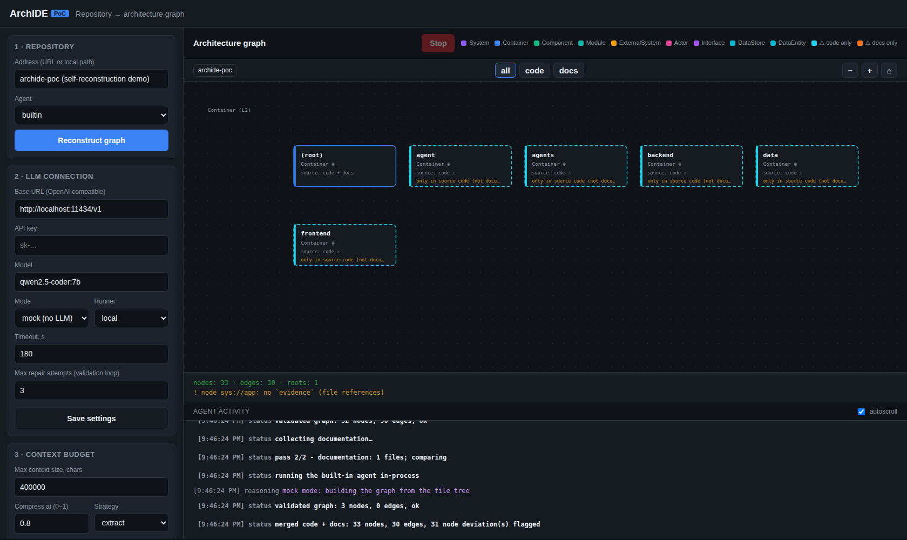
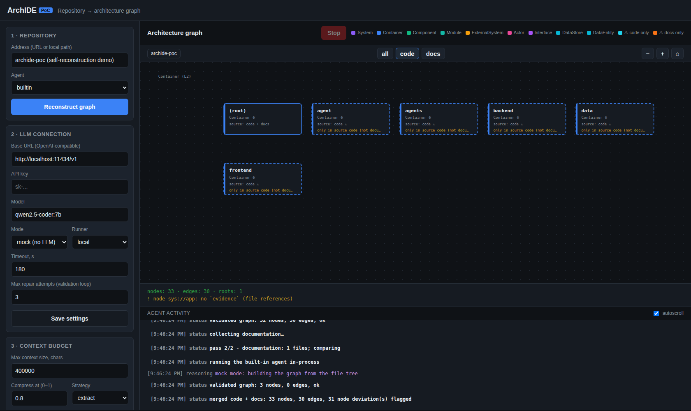
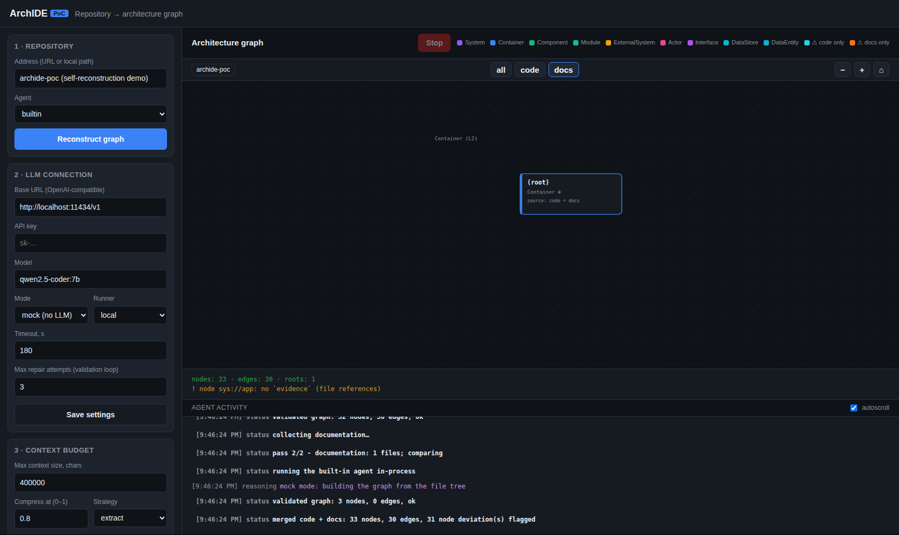
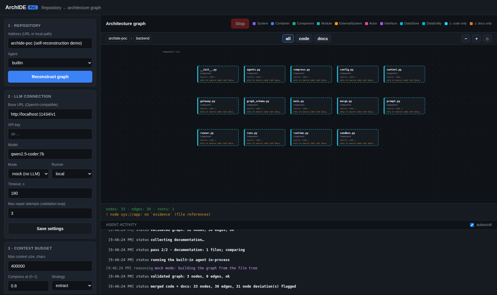

# ArchIDE

**IDE для архитектурного графа, а не для кода.** Человек и агент работают с
архитектурой на понятном языке; код, диаграммы и документы — это **проекции**
единой модели, а не её источник.

> Архитектура — один типизированный граф. Код, диаграммы и документы — это
> представления этого графа. Сущность существует ровно один раз (одно «домашнее»
> место), все остальные места ссылаются на неё по стабильному ID.

## Идея

- **Единый граф, а не куча документов.** В документной модели один смысл
  дублируется и расходится; в графовой — сущность существует один раз, остальное
  — ссылки.
- **Каркас (C4) + аспекты.** C4 — структурная идентичность (System→Container→
  Component→Module). Поведение, данные, интерфейсы, процессы, доступ, ИБ —
  ортогональные **аспекты**, натянутые на тот же каркас (см. `Concept.md` §13).
- **Проекции, а не артефакты.** Диаграмма/спецификация вычисляется из модели —
  поэтому не может «разойтись» с ней.
- **Агенты работают по ограниченным срезам.** Из модели генерируется bounded-срез
  контекста для конкретной задачи; агент не видит всю систему.
- **Двухпроходная реконструкция.** Сначала по **исходному коду**, затем сравнение
  с **документацией**; расхождения (отклонения) показываются явно с указанием
  источника.
- **Строгость машинная, а не дисциплинарная.** Закрытая метамодель + валидатор +
  цикл доработки; неподделываемые метки трассируемости (см. `Concept.md` §15).

Подробно: [`Concept.md`](Concept.md) · План: [`ROADMAP.md`](ROADMAP.md).

## Скриншоты

Просмотр **строго по одному уровню** (C4), с фильтром по источникам и живой
лентой активности агента. Демо-данные — самореконструкция PoC.

**Все источники** (отклонения подсвечены цветом/пунктиром и текстом):



**Только исходный код** / **только документация**:




**Drill-down на следующий уровень** (компоненты контейнера `backend`, L3):



## Текущее состояние (PoC)

Реализовано в `archide-poc/`:

- **Среда управления агентами:** реестр агентов (встроенный + **Kilo Code CLI**),
  запуск в **Docker-песочнице без bind-mount'ов** (sandbox-протокол по HTTP).
- **LLM-шлюз:** агенты ходят через шлюз со **своим токеном**; шлюз подставляет
  **настоящий** ключ инференса (в контейнер ключ не попадает).
- **Наблюдаемость:** живая лента активности (размышления/логи/статусы), принудительная
  остановка, асинхронные запуски.
- **Общий том** (аналог PVC) для всех агентов; бюджет контекста и **сжатие**
  (extract/truncate/drop).
- **Двухпроходная реконструкция** код → документация со **слиянием и отклонениями**;
  валидация на хосте и в агенте + цикл доработки (настраиваемое число попыток).
- **UI:** граф по одному уровню C4, хлебные крошки, zoom in/out, переключение
  источников (all/code/docs), self-contained SVG-рендер.

Не реализовано (см. дорожную карту): модель как хранилище-редактор, аспекты,
referential actions/транзакции/impact, подписанные метки, конформанс-слой.

## Быстрый старт

Зависимостей из PyPI нет — сервер и агент на стандартной библиотеке Python.

```bash
cd archide-poc
docker build -t archide-agent:latest agent/
docker build -t archide-kilo:latest agents/kilo/   # опционально: Kilo Code CLI
./run.sh            # -> http://127.0.0.1:8000
```

Без Docker/LLM: в UI выберите `mode = mock`, `runner = local` — весь конвейер
пройдёт без инференса.

Демо UI без сервера: откройте `archide-poc/frontend/index.html?demo=1`
(`&mode=code|docs`, `&focus=<node-id>`).

## Дорожная карта (кратко)

`Ф0` PoC (среда агентов, частично) → `Ф1` продуктизация песочницы → `Ф2`
универсальная модель архитектуры → `Ф3` полная реконструкция из кода и
документации (с валидацией) → `Ф4` редактирование модели и автоматическая
непротиворечивость → `Ф5` генерация и валидация кода по модели.

Полностью: [`ROADMAP.md`](ROADMAP.md).

## Структура репозитория

```
README.md            стартовая страница (эта)
Concept.md           концепция (архитектурный граф, аспекты, метки, …)
ROADMAP.md           дорожная карта
docs/screenshots/    скриншоты UI
archide-poc/         рабочий PoC (сервер, агенты, UI)
  server.py          stdlib HTTP: UI + API + sandbox + LLM-шлюз
  backend/           модель/валидация/runner/merge/gateway/…
  agent/             встроенный агент (stdlib) + Dockerfile
  agents/kilo/       sandbox Kilo Code CLI + Dockerfile
  frontend/          UI (без сборки) + SVG-рендер
```

## Статус

Proof of concept. Лицензия — см. [LICENSE](LICENSE).
