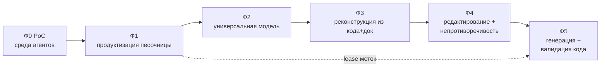

# ArchIDE — дорожная карта развития

От среды управления произвольным агентом в песочнице → к универсальной модели
архитектуры → к полной реконструкции из кода и документации (с валидацией обоих)
→ к редактированию модели с авто-непротиворечивостью → к генерации и валидации
кода по модели.

Ссылки вида `§N` — на разделы `Concept.md`.

## Как читать

Каждая фаза: **цель → объём → результаты → критерии выхода → связь с концепцией**.
Фазы упорядочены по зависимостям; параллельно идут «горизонтальные» треки.

---

## Фаза 0 — PoC (текущее состояние, частично)

**Цель:** доказать базовый цикл «репозиторий → граф».

Уже сделано: реестр агентов (builtin + Kilo Code CLI); sandbox-протокол без
bind-mount'ов; LLM-шлюз со своим токеном и подстановкой настоящего ключа;
живая лента активности и Stop; общий Docker-volume; бюджет/сжатие контекста;
двухпроходная реконструкция (код → документация) со слиянием и отклонениями;
валидация (хост + агент) и repair-цикл; просмотр по одному уровню C4 с
фильтром по источникам.

**Чего нет:** модель как хранилище/редактор; аспекты (§13); referential actions,
транзакции и impact (§14.3); метки трассируемости (§15); конформанс-слой (§14.6).

---

## Фаза 1 — Среда управления агентами в песочнице

**Цель:** надёжная, расширяемая и наблюдаемая среда исполнения любых агентов.

**Объём**
- Реестр агентов как **плагин-манифест** (id, kind, image, entrypoint,
  capabilities, ресурсные подсказки); адаптеры под CLI/service агентов.
- **Изоляция песочницы**: лимиты cpu/memory/pids/time, `--read-only` + tmpfs,
  `--cap-drop ALL`, непривилегированный пользователь, сетевой доступ только к
  шлюзу/сайдкару.
- **LLM-шлюз**: токен/lease на агента, квоты и rate-limit, ретраи, стриминг,
  аудит запросов (хэши/метаданные, без утечки ключей).
- **Запуски**: структурированная модель событий, персистентные логи и артефакты,
  воспроизводимые run-записи.
- **Volume**: разделение shared/scratch, версионирование и GC.

**Результаты:** реестр агентов-плагинов; hardened-контейнер; шлюз с lease/квотами;
персистентные запуски; менеджмент тома.

**Критерии выхода:** произвольный агент запускается воспроизводимо; лимиты и
отмена подтверждены; есть аудит; ключ инференса не попадает в контейнер.

**Связь:** §3, §8, §11 (шлюз), §15.3–15.4 (инфраструктура lease).

---

## Фаза 2 — Универсальная модель архитектуры

**Цель:** превратить граф в **хранилище-первоисточник** с закрытой метамоделью.

**Объём**
- **Хранилище модели**: git-friendly каноническая сериализация + индекс графа;
  стабильные ID, namespace'ы, реестр алиасов.
- **Реестр метамодели**: типы узлов/рёбер, **схемы аспектов** (§13.7),
  правила якорей, закрытые словари.
- **Интерфейсы агрегации** (§12) как первоклассные сущности.
- **Требования**: отдельный namespace + трассировка (§5).
- **Валидатор v1**: жёсткие инварианты (§7, §14.4).
- **Поверхности**: канвас по уровням, формы, грид, диалог; представления — проекции.

**Результаты:** модель хранится и версионируется; аспекты C4 + ≥2 дополнительных;
валидатор блокирует невалидное; диаграммы не хранятся отдельно.

**Критерии выхода:** реальная система описана в модели (C4 + ≥2 аспекта);
невалидная модель отклоняется; изменение в модели отражается во всех
представлениях.

**Связь:** §1, §2, §4, §5, §7, §12, §13.

---

## Фаза 3 — Полная реконструкция из кода и документации (с валидацией)

**Цель:** достоверная реконструкция в фасетную модель + проверка обоих источников.

**Объём**
- **Многопроходная реконструкция**: код (первично) → документация (вторично) →
  слияние с отклонениями (§14; обобщение текущего PoC).
- **Аспект-осознанное извлечение**: не только структура, но интерфейсы/контракты,
  схемы данных, машины состояний, процессы, доступ, развёртывание (§13).
- **Валидация кода**: конформанс метамодели, `evidence` на исходники, проверка границ.
- **Валидация документации**: согласованность доков с кодом (отклонения), покрытие.
- **Разрешение идентичностей** при слиянии + ревью неоднозначных совпадений.
- **Оценочный стенд**: property/metamorphic/round-trip (§14.7), метрики качества.

**Результаты:** реконструктор в фасетную модель; проекции по аспектам; отчёт об
отклонениях; стенд оценки.

**Критерии выхода:** реальные репозитории реконструируются с проекциями по
аспектам; отклонения код↔доки видны; результат воспроизводим; метрики записаны.

**Связь:** §11, §13, §14, §15 (атрибуция реконструированных артефактов).

---

## Фаза 4 — Редактирование модели и автоматическая непротиворечивость

**Цель:** человек/агент правит модель, а согласованность обеспечивается автоматически.

**Объём**
- **Транзакции правок + gate валидации + инкрементальная проверка** затронутого
  подграфа (§14.2).
- **Referential actions на типах рёбер**: `cascade | restrict | nullify | repoint`
  (§14.3).
- **Impact-анализ** в UI; авто-починка где детерминировано; waiver через `Decision`.
- **Язык ограничений** для кросс-аспектных правил (§13.4, §14.3).
- **Владельцы/полномочия** и разрешение конфликтов (мультиредактор, федерация §11).

**Результаты:** редактор модели; движок impact; referential actions; waivers;
конкурентные правки.

**Критерии выхода:** операции add/delete/move либо сохраняют непротиворечивость,
либо блокируются с точной причиной; impact виден; нет «висячих» ссылок.

**Связь:** §7, §11, §13, §14.2–14.4.

---

## Фаза 5 — Генерация и валидация кода по модели

**Цель:** модель → артефакты + gate приёмки результата агента.

**Объём**
- **Генераторы**: контракты (OpenAPI/proto/JSON Schema), DDL, IaC, конфиги,
  скелеты, тесты (§14.5).
- **Пакеты работ**: аспект-осознанные срезы + критерии приёмки (§6, §14.5).
- **Подписанные метки трассируемости** (§15): выпуск на пакет работ, размещение
  агентом, верификация (подпись, размещение, покрытие, атрибуция, цепочка, требования).
- **Конформанс-слой** (§14.6): структурный/контрактный/поведенческий/данные/доступ/
  трассируемость; model-based и property-тесты; матрица покрытия (§15.6).
- **Repair-цикл** до прохождения gate.

**Результаты:** генераторы; выдача меток; верификатор; матрица покрытия; gate.

**Критерии выхода:** сгенерированный и агентский код проходит gate; покрытие по
всем уровням видно; нет кода без атрибуции.

**Связь:** §6, §14.5–14.6, §15.

---

## Горизонтальные треки (идут параллельно)

| Трек | Содержание |
|---|---|
| **Безопасность и доверие** | ключи шлюза/меток, изоляция песочницы, аудит, подписанные аттестации |
| **UX/поверхности** | канвас по уровням, вкладки аспектов, грид-трассировка, heatmap покрытия |
| **Агентская экосистема** | реестр-плагины, адаптеры CLI/service, per-agent lease/квоты |
| **Метрики и эксперименты** | стенд §14.7: property/metamorphic/round-trip, качество реконструкции, latency валидации, pass-rate gate |
| **Персистентность и масштаб** | каноническая сериализация, индексация, инкрементальная валидация |

## Риски и меры

| Риск | Мера |
|---|---|
| Достоверность LLM-реконструкции | аспект-осознанные промпты, стенд оценки, ревью отклонений |
| Неоднозначность идентичностей при слиянии | сигнатуры, ревью, явные правила разрешения |
| «Взрыв» кросс-аспектных правил | ограниченный декларативный язык, слоистость, waiver |
| Сложность управления ключами | ключ у хоста, ротация, lease, Ed25519 для внешнего аудита |
| Шум меток / неисполнение агентом | генератор ставит сам, агенту — только назначенные метки, gate ловит пропуски |
| Масштаб проверок | инкрементальная валидация по затронутому подграфу |

## Ближайшие шаги (что делать сейчас)

1. Зафиксировать каноническую сериализацию модели и реестр метамодели (Ф2).
2. Ввести referential actions и транзакции правок + impact (Ф4) — это разблокирует
   редактирование.
3. Выпуск подписанных меток и верификатор покрытия (Ф5, опирается на lease из Ф1).
4. Расширить реконструкцию на аспекты (интерфейсы/данные/поведение) (Ф3).
