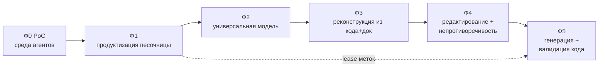

# ArchIDE — дорожная карта развития

От среды управления произвольным агентом в песочнице → к универсальной модели
архитектуры → к полной реконструкции из кода и документации (с валидацией обоих)
→ к редактированию модели с авто-непротиворечивостью → к генерации и валидации
кода по модели.

Ссылки вида `§N` — на разделы `Concept.md`.

## Как читать

Каждая фаза: **цель → объём → результаты → критерии выхода → связь с концепцией**.
Фазы упорядочены по зависимостям; параллельно идут «горизонтальные» треки.

---

## Фаза 0 — PoC (текущее состояние, частично)

**Цель:** доказать базовый цикл «репозиторий → граф».

Уже сделано: реестр агентов (builtin + Kilo Code CLI); sandbox-протокол без
bind-mount'ов; LLM-шлюз со своим токеном и подстановкой настоящего ключа;
живая лента активности и Stop; общий Docker-volume; бюджет/сжатие контекста;
двухпроходная реконструкция (код → документация) со слиянием и отклонениями;
валидация (хост + агент) и repair-цикл; просмотр по одному уровню C4 с
фильтром по источникам.

**Чего нет:** модель как хранилище/редактор; аспекты (§4); referential actions,
транзакции и impact (§8, §10); метки трассируемости (§11); конформанс-слой (§11).

---

## Фаза 1 — Среда управления агентами в песочнице

**Цель:** надёжная, расширяемая и наблюдаемая среда исполнения любых агентов.

**Объём**
- Реестр агентов как **плагин-манифест** (id, kind, image, entrypoint,
  capabilities, ресурсные подсказки); адаптеры под CLI/service агентов.
- **Изоляция песочницы**: лимиты cpu/memory/pids/time, `--read-only` + tmpfs,
  `--cap-drop ALL`, непривилегированный пользователь, сетевой доступ только к
  шлюзу/сайдкару.
- **LLM-шлюз**: токен/lease на агента, квоты и rate-limit, ретраи, стриминг,
  аудит запросов (хэши/метаданные, без утечки ключей).
- **Запуски**: структурированная модель событий, персистентные логи и артефакты,
  воспроизводимые run-записи.
- **Volume**: разделение shared/scratch, версионирование и GC.

**Результаты:** реестр агентов-плагинов; hardened-контейнер; шлюз с lease/квотами;
персистентные запуски; менеджмент тома.

**Критерии выхода:** произвольный агент запускается воспроизводимо; лимиты и
отмена подтверждены; есть аудит; ключ инференса не попадает в контейнер.

**Связь:** §15, §16 (шлюз/песочница), §11 (инфраструктура lease для меток).

---

## Фаза 2 — Универсальная модель архитектуры

**Цель:** превратить граф в **хранилище-первоисточник** с закрытой метамоделью.

**Объём**
- **Хранилище модели**: git-friendly каноническая сериализация + индекс графа;
  стабильные ID, namespace'ы, реестр алиасов.
- **Реестр метамодели**: типы узлов/рёбер, **схемы аспектов** (§4),
  правила якорей, закрытые словари.
- **Интерфейсы агрегации** (§5) как первоклассные сущности.
- **Требования**: отдельный namespace + трассировка (§7).
- **Валидатор v1**: жёсткие инварианты (§8).
- **Поверхности**: канвас по уровням, формы, грид, диалог; представления — проекции.
- **Аспектный UI**: вкладки аспектов + **мультиаспектный просмотр** (несколько
  аспектов **одновременно**: панели/overlay, общий фокус/уровень, кросс-аспектная
  подсветка).
- **Диалог (read-only)**: чат-агент строит кастомные **представления и срезы** над
  графом по запросу.

**Результаты:** модель хранится и версионируется; аспекты C4 + ≥2 дополнительных;
валидатор блокирует невалидное; диаграммы не хранятся отдельно.

**Критерии выхода:** реальная система описана в модели (C4 + ≥2 аспекта);
невалидная модель отклоняется; изменение в модели отражается во всех
представлениях.

**Связь:** §1, §2, §3, §4, §5, §7, §8.

---

## Фаза 3 — Полная реконструкция из кода и документации (с валидацией)

**Цель:** достоверная реконструкция в фасетную модель + проверка обоих источников.

**Объём**
- **Многопроходная реконструкция**: код (первично) → документация (вторично) →
  слияние с отклонениями (§9; обобщение текущего PoC).
- **Аспект-осознанное извлечение**: не только структура, но интерфейсы/контракты,
  схемы данных, машины состояний, процессы, доступ, развёртывание (§4).
- **Валидация кода**: конформанс метамодели, `evidence` на исходники, проверка границ.
- **Валидация документации**: согласованность доков с кодом (отклонения), покрытие.
- **Разрешение идентичностей** при слиянии + ревью неоднозначных совпадений.
- **Оценочный стенд**: property/metamorphic/round-trip (§17), метрики качества.

**Результаты:** реконструктор в фасетную модель; проекции по аспектам; отчёт об
отклонениях; стенд оценки.

**Критерии выхода:** реальные репозитории реконструируются с проекциями по
аспектам; отклонения код↔доки видны; результат воспроизводим; метрики записаны.

**Связь:** §4, §9, §11.

---

## Фаза 4 — Редактирование модели и автоматическая непротиворечивость

**Цель:** человек/агент правит модель, а согласованность обеспечивается автоматически.

**Объём**
- **Транзакции правок + gate валидации + инкрементальная проверка** затронутого
  подграфа (§8, §10).
- **Referential actions на типах рёбер**: `cascade | restrict | nullify | repoint`
  (§8).
- **Impact-анализ** в UI; авто-починка где детерминировано; waiver через `Decision`.
- **Язык ограничений** для кросс-аспектных правил (§4, §8).
- **Владельцы/полномочия** и разрешение конфликтов (мультиредактор, федерация §14).
- **Редакторы аспектов** (схемы/диаграммы), в т.ч. **мультиаспектные** (правка в
  нескольких панелях одновременно) — с gate согласованности.
- **Диалоговое управление графом (агент-редактор) — основной сценарий**: чат
  переводит намерение в транзакцию, задаёт уточняющие вопросы, предупреждает об
  impact, предлагает семантический диф и **сам дорабатывает граф** для сохранения
  консистентности; по запросу создаёт **кастомные аспекты/срезы/представления**.
- **Reconciler (динамическая устойчивость)**: непрерывный цикл «наблюдение →
  расхождение → коррекция» (триггеры по событиям и/или периодике), агент-корректор
  и авто-починка; метрики сходимости.

**Результаты:** редактор модели; движок impact; referential actions; waivers;
конкурентные правки.

**Критерии выхода:** операции add/delete/move либо сохраняют непротиворечивость,
либо блокируются с точной причиной; impact виден; нет «висячих» ссылок.

**Связь:** §8, §10, §14.

---

## Фаза 5 — Генерация и валидация кода по модели

**Цель:** модель → артефакты + gate приёмки результата агента.

**Объём**
- **Генераторы**: контракты (OpenAPI/proto/JSON Schema), DDL, IaC, конфиги,
  скелеты, тесты (§11).
- **Пакеты работ**: аспект-осознанные срезы + критерии приёмки (§6, §11).
- **Подписанные метки трассируемости** (§11): выпуск на пакет работ, размещение
  агентом, верификация (подпись, размещение, покрытие, атрибуция, цепочка, требования).
- **Конформанс-слой** (§11): структурный/контрактный/поведенческий/данные/доступ/
  трассируемость; model-based и property-тесты; матрица покрытия (§11).
- **Repair-цикл** до прохождения gate.

**Результаты:** генераторы; выдача меток; верификатор; матрица покрытия; gate.

**Критерии выхода:** сгенерированный и агентский код проходит gate; покрытие по
всем уровням видно; нет кода без атрибуции.

**Связь:** §6, §11.

---

## Фаза 6 — Опыт, самоадаптация и рефлексия агента

**Цель:** агент накапливает опыт общения с конкретным архитектором, адаптируется и
остаётся устойчивым (в т.ч. к токсичной обратной связи).

**Объём**
- **Сохранение диалогов** (per architect / per project) со структурой и провенансом.
- **Обратная связь** (явная/неявная) с атрибуцией к изменению и исходу.
- **Профиль архитектора** (предпочтения) — версионируется и обратим.
- **Самоадаптация** поведения в рамках инвариантов (не меняет метамодель/gate).
- **Периодическая рефлексия**: обзор опыта → уроки → обновление профиля/плейбука.
- **Устойчивость к токсичной обратной связи**: фильтрация/нейтрализация, приоритет
  объективных сигналов, ограничение влияния негатива, аудит и откат адаптаций.

**Результаты:** память диалогов; профиль архитектора; политика адаптации; рефлексия;
toxicity filter / stability guard.

**Критерии выхода:** адаптация улучшает работу с конкретным архитектором, не ослабляя
инварианты; при токсичной обратной связи стабильность и эффективность сохраняются;
адаптации обратимы.

**Связь:** §0.1, §18.

---

## Фаза 7 — RAG: персональные документы и маркированная верификация

**Цель:** архитектор прикладывает документы (Markdown/CSV) в чате; оригиналы — в личной
истории; поиск в RAG; чанки маркируются; ответы RAG верифицируются по меткам.

**Объём**
- **Загрузка в чате**: приложить **Markdown/CSV** как требования/справку; **оригиналы**
  в **личной истории пользователя** (изоляция, провенанс).
- **Ingestion + RAG**: chunking, эмбеддинги, гибридный retrieval (вектор + ключи + граф).
- **Метки чанков**: каждый чанк получает **подписанную уникальную метку** (аналог §11).
- **Маркерная верификация**: ответ опирается только на чанки с валидными метками ⇒
  отличие **восстановленного** от **сгенерированного**; цитаты ссылаются на метки.
- **Привязка требований** из документов к графу.

**Результаты:** персональное хранилище; RAG-индекс; метки чанков; маркерный верификатор;
привязка требований.

**Критерии выхода:** документ из чата индексируется, находится в RAG, чанки промаркированы,
а ответ содержит только подтверждённые (маркированные) фрагменты.

**Связь:** §11, §13.6, §13.7.

---

## Горизонтальные треки (идут параллельно)

| Трек | Содержание |
|---|---|
| **Безопасность и доверие** | ключи шлюза/меток, изоляция песочницы, аудит, подписанные аттестации |
| **UX/поверхности** | канвас по уровням, вкладки аспектов, грид-трассировка, heatmap покрытия |
| **Агентская экосистема** | реестр-плагины, адаптеры CLI/service, per-agent lease/квоты |
| **Метрики и эксперименты** | стенд §17: property/metamorphic/round-trip, качество реконструкции, latency валидации, pass-rate gate |
| **Персистентность и масштаб** | каноническая сериализация, индексация, инкрементальная валидация |

## Риски и меры

| Риск | Мера |
|---|---|
| Достоверность LLM-реконструкции | аспект-осознанные промпты, стенд оценки, ревью отклонений |
| Неоднозначность идентичностей при слиянии | сигнатуры, ревью, явные правила разрешения |
| «Взрыв» кросс-аспектных правил | ограниченный декларативный язык, слоистость, waiver |
| Сложность управления ключами | ключ у хоста, ротация, lease, Ed25519 для внешнего аудита |
| Шум меток / неисполнение агентом | генератор ставит сам, агенту — только назначенные метки, gate ловит пропуски |
| Масштаб проверок | инкрементальная валидация по затронутому подграфу |

## Ближайшие шаги (что делать сейчас)

1. Зафиксировать каноническую сериализацию модели и реестр метамодели (Ф2).
2. Ввести referential actions и транзакции правок + impact (Ф4) — это разблокирует
   редактирование.
3. Выпуск подписанных меток и верификатор покрытия (Ф5, опирается на lease из Ф1).
4. Расширить реконструкцию на аспекты (интерфейсы/данные/поведение) (Ф3).
