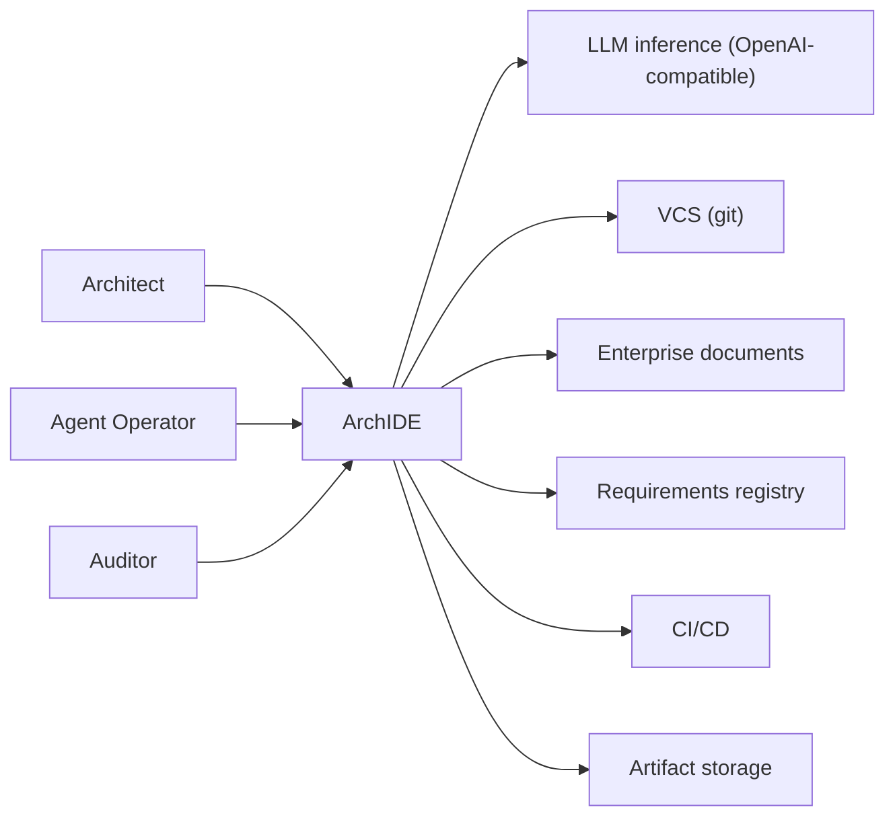
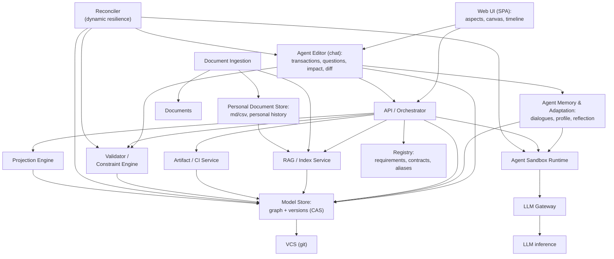
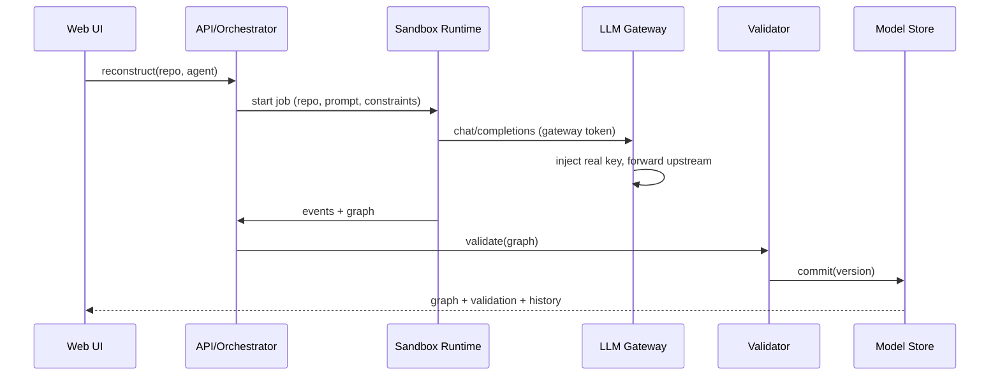
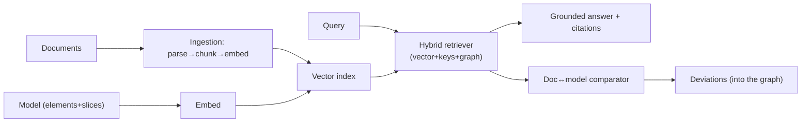

[Русский](ARCHITECTURE.md) · **English**

# ArchIDE — system architecture

How the system is put together as a whole. The concept lives in [`Concept.md`](Concept.md),
the plan in [`ROADMAP.md`](ROADMAP.md), and the PoC in [`archide-poc/`](archide-poc/).

## 1. Overview

ArchIDE is an environment in which architecture is described by a **single faceted graph**
(the C4 skeleton plus aspects), while code, diagrams, and documents are its **projections**.
The system:

- stores and **versions** the model (a Merkle-DAG of commits);
- **reconstructs** it from source code and documentation (validating both);
- lets you **edit** it while automatically enforcing consistency;
- **generates and validates** code from the model (with signed traceability markers);
- links the model to **enterprise documents** through RAG;
- runs **agents in a sandbox** through its own LLM gateway.

**The guiding principle is dynamic resilience.** The system does not rely on a "perfect"
ontology up front: the base graph model is **easily extensible** and may be incomplete, and
its consistency is **maintained dynamically** — through a continuous loop of "observation
(validation/impact/coverage) → divergence → correction (suggestions and auto-repair,
including by an agent)". The agent acts as a **stabilizer** of model integrity.

## 2. Context (C4 L1)

**Actors:** Architect, Agent Operator, Auditor.
**External systems:** LLM inference (OpenAI-compatible), VCS (git), enterprise
documents (Confluence/Wiki/files), requirements registry (Jira/…), CI/CD, artifact
object storage.

## 3. Containers (C4 L2)

## 4. Components by container

**Model Store**
- `Graph Store` — property graph (nodes/edges, aspects, anchors).
- `Version Store` — content-addressed commits (Merkle-DAG), snapshot trees.
- `Metamodel Registry` — node/edge types, aspect schemas, anchor rules, dictionaries.
- `Identity/Alias` — stable IDs, namespaces, aliases (rename-safe).
- `Requirements namespace` — external requirements + provenance.

**Reconstruction Pipeline (implemented in the PoC)**
- `Base pass (C4)` — a single agent pass over the sources → structural graph.
- `Aspect extraction` — heuristics over the code (interfaces/operations, data, state
  machines, events, access, deployment, constraints) with **anchoring to existing nodes**.
- `Sequential aspect passes (Ф3.5)` — after C4, each aspect is built by a **separate agent
  step** and merged using anchors and formal validation (rollback on error), with logging
  to the feed; the pass context is **narrowed to the aspect** (Ф3.6: relevant files +
  graph slice), and passes are **robust and resumable** (Ф3.7: skipping covered aspects,
  growth limit, starting from the saved model).
- `Continuous agent session (Ф3.10)` — one container/conversation per run: the repository
  is uploaded once, and the base pass + all aspect passes + reconciliation happen in a
  single session.
- `Reconciliation (Ф3.9)` — a report on orphans/elements without evidence + **agent
  correction** with safe merging (only evidence and links between existing nodes).
- `Quality metrics (Ф3.8)` — type coverage by aspect, orphans, evidence in `/api/eval`.
- `Notation fields (Ф2.14)` — the model carries what the diagrams need: `Transition.from/to`,
  `Participant` lanes, `cardinality` on links; views are built **from the graph** rather
  than stored separately.

**Validator / Constraint Engine**
- `Schema validator` (hard invariants), `Referential actions`
  (cascade/restrict/nullify/repoint), `Cross-aspect rules`, `Constraint language`,
  `Impact analyzer`, `Incremental validator`.

**Agent Editor (chat)**
- `Intent→transaction` — translating the user's intent into a transaction of edits.
- `Clarifying questions` — clarifying questions when something is ambiguous.
- `Impact advisor` — warnings about consequences (impact, invariant violations,
  loss of requirements coverage).
- `Diff proposer` — a semantic diff for confirmation.
- `Consistency reviewer` — **after a person's manual edits**, inspects the graph and
  **suggests fixes** to preserve consistency/integrity.
- Works through `Agent Sandbox Runtime` + `LLM Gateway`; relies on the `Validator` and
  `Model Store`. Both modes (chat and manual editing) go through a single gate.

**Reconciler (dynamic resilience, concept §0.1)**
- `State observer` — collects state signals: validation, anchors, cross-aspect
  rules, impact, requirements coverage, code↔docs deviations.
- `Divergence detector` — identifies divergences and integrity/completeness violations.
- `Correction planner (agent)` — forms a correction plan (a semantic diff);
  asks clarifying questions when something is ambiguous.
- `Auto-repair applier` — applies confirmed fixes and **completes related parts of the
  graph** (via `Validator` + `Model Store`).
- `Trigger scheduler` — starts the loop **on events** (after an edit/commit, a change of
  requirements/federation) and/or **periodically**.
- Invariant: the model may be **less than perfect**, but integrity is **dynamically
  stabilized** by the "observation → divergence → correction" loop.

**Agent Memory & Adaptation (Concept §18)**
- `Dialogue store` — storing dialogues (per architect / per project) with structure
  (intent → transaction → outcome) and provenance.
- `Feedback collector` — explicit and implicit feedback, attributed to a change/outcome.
- `Architect profile` — preferences (style, level of detail, risk appetite, formats);
  versioned and reversible.
- `Adaptation policy` — tuning behavior **within the invariants** (does not change the
  metamodel, does not weaken the gate/security).
- `Reflection scheduler` — periodic batch review of experience, extracting lessons,
  updating the profile/playbook, evaluating the result (convergence, share of accepted diffs).
- `Toxicity filter` / `Stability guard` — neutralizing abusive/manipulative
  feedback, prioritizing objective signals, limiting the influence of negativity,
  protecting the profile from "poisoning", auditing and rolling back adaptations.

**Projection Engine**
- `Layout engine`, `Aspect renderers` (C4/DFD/state/BPMN/roles/…),
  `Serializers` (OpenAPI/proto/DDL/JSON Schema), `Slice builder` (§6),
  `Coverage matrix` (§11).

**Agent Sandbox Runtime**
- `Agent registry`, `Scheduler`, `Container runtime` (isolation, limits),
  `Volume manager`, `Event bus` (activity feed), `Secrets/lease`.

**LLM Gateway**
- `Auth (lease)`, `Router` (upstream), `Stream` (SSE), `Quota/rate`, `Audit`.

**RAG / Index Service**
- `Chunker`, `Embedder`, `Vector index`, `Graph retriever`, `Hybrid ranker`,
  `Provenance/citations`, `Doc↔model comparator`,
  **`Marker-based grounding verifier`** — per-claim attribution: source (chunk marker) +
  **fidelity** (`verbatim/paraphrase/derived/unsupported`) and `added/omitted` (what the
  LLM changed); markers are **bound to the content** (a digest of the chunk text).

**Document Ingestion**
- `Connectors` (Confluence/Wiki/files, **Markdown/CSV from chat**), `Parser`, `Chunker`,
  `Requirement linker`, `Personal store` (the user's personal history, isolated),
  `Chunk marker issuer` (signed chunk markers, analogous to §11).

**Artifact / CI Service**
- `Generators`, `Marker issuer/verifier` (§11), `Conformance suite`, `Gate`.

**Registry**
- `Requirements`, `Contracts (GCR)`, `Aliases`, `Keys`.

## 5. Data and storage

| Storage | Contents | Technology (options) |
|---|---|---|
| Graph Store | nodes/edges/aspects/anchors | property graph (Neo4j/Kuzu/…) or in-memory + persistence |
| Version Store | model commits (Merkle-DAG) | CAS, git-like objects |
| Canonical serialization | git-friendly model | text files + parser |
| Vector Index | embeddings of document chunks and graph elements | pgvector/Qdrant/… |
| Document Store | source documents, metadata, spans | object storage |
| Artifact Store | artifacts, receipts, markers | object storage |
| Registry | requirements/contracts/aliases/keys | relational DB |

## 6. Key flows

**6.1 Reconstruction:** ingest the repository → collect/compress → sandbox agent
(pass 1: code; pass 2: documentation) → validate (host+agent, repair) → merge
(deviations) → **commit** to the model.

**6.1a Architecture synthesis from a description (implemented):** a prompt in chat
(`design <описание>`, optionally with attached documents) → synthesis material
(`data/scratch/design/<имя>`: `00-description.md` + documents) → a **design
pass** (no code needed) → the same validation/repair and aspect passes as in
reconstruction → model. Then: **architecture documentation from the model**, a handoff
package for a code-generating agent, and adjustment visually or via requests to the agent.
Synthesis is not a separate loop but another **input** into the same model and the same gate.

**6.2 Manual editing (human):** UI edit → **transaction** → incremental
validate → impact → commit or block with a reason (referential actions); then a
**reviewer agent** inspects the graph and **suggests fixes** (a diff for confirmation).

**6.3 Generation/verification:** slice → issuing **markers (lease)** → agent →
artifacts → **conformance gate** (signature/placement/coverage/attribution) → linking
`implemented_by` + committing artifacts.

**6.4 RAG query:** query → hybrid retrieval (vector + keys + graph traversal) →
(docs + model elements) → a grounded answer with **citations**; doc↔model reconciliation.

**6.5 Federation:** publish a contract → GCR → discovery → federated edges →
derived requirements/tests (§14).

**6.6 Dialogue editing (agent, the main scenario):** chat intent →
clarifying questions → a transaction of edits + impact warnings → a **semantic
diff** for confirmation → apply + auto-repair of dependent parts → commit (gate).
On request — custom aspects/slices/views.

**6.9 Personal documents and marked RAG (Ф7):** the architect attaches
Markdown/CSV in chat → the original goes to **personal history** → ingestion/chunking → each chunk
gets a **signed marker** → RAG index → query + **marked** chunks → **LLM (through the gateway/sandbox)** →
a **grounded answer with citations** that is **verified against the markers**
(reconstructed vs generated).

**6.7 Stabilization loop (reconciliation, §0.1):** trigger (edit/commit, change of
requirements/federation, periodic) → **observation** (validation, impact, coverage,
deviations) → **divergence** → **correction plan** (agent) → confirmation or
auto-repair → commit. Ensures the model's **dynamic resilience**.

**6.8 Experience accumulation and reflection (§18):** dialogue → feedback (explicit/implicit) →
updating the **architect profile** → **behavior adaptation** (within the invariants);
periodic **reflection** (review of experience → lessons → updating the profile/playbook).
**Toxic** feedback is neutralized, and objective signals (validator/gate) take priority —
stability and effectiveness are preserved.

## 7. Versioning subsystem

- **Commit** = `(parent, changes, author, ts, signature)`; content-addressed.
- **Tree** — a snapshot of the model (nodes/edges/aspects) → hash; deduplication.
- **Branches/merge**, **semantic diff**, **as-of** queries, **restore**,
  **branch-from** (§12).
- **Pins** — a run/slice fixes a commit; markers (§11) reference a commit.
- **GC** — garbage-collecting unreachable objects.

## 8. RAG subsystem

- **Chunking**: structural for documents (sections/paragraphs), semantic for the graph
  (element + slice/projection).
- **Retrieval**: hybrid + graph traversal + filters (version, project, aspect).
- **Requirement linking**: extraction → candidate links → review → confirmed
  links with **provenance** (§13).
- **Grounding**: answers with citations; a statement from a document with no support in
  the model is flagged as a deviation.

## 9. Security and trust

- **Keys**: the real inference key lives only on the host; agents get a token/lease from the
  gateway; the key never enters the container.
- **Sandbox isolation**: cpu/mem/pids/time limits, `--read-only`, cap-drop,
  network access only to the gateway.
- **Markers** are signed by the host (§11); the agent is untrusted — all artifacts go through the gate.
- **Personal history isolation** (§13.6): the user's source documents are stored
  per-user; chunks carry signed markers (§13.7), and the RAG answer is verified against them.
- **Resilience to toxic feedback** (§18): neutralizing abusive/
  manipulative feedback, prioritizing objective signals, limiting the influence of
  negativity, auditing and rolling back profile adaptations.
- **Permissions**: RBAC for editing (ownership of elements/aspects), auditing.

## 10. Deployment

- **Containers**: `web`, `api`, `model-store`, `validator`, `projection`,
  `sandbox-runtime`, `gateway`, `rag`, `ingestion`, `artifact-ci`.
- **Volumes**: shared agent volume, model store, vector index, doc store.
- **Networks**: internal; egress to the outside only from `gateway`.
- **Scaling**: horizontally — stateless (api/projection/rag); the graph store —
  vertically/partitioning; validation — incremental.

## 11. Technology stack (options)

| Layer | PoC | Target (options) |
|---|---|---|
| Backend | Python stdlib (`server.py`) | FastAPI/uvicorn, workers |
| Graph | in-memory dict + JSON | Neo4j / Kuzu / property-graph DB |
| Versioning | — | git-like CAS (custom objects or git) |
| Vectors | — | pgvector / Qdrant / Milvus |
| Frontend | vanilla SPA + SVG | the same SPA (no build) or a framework |
| Agents | Docker + stdlib/Kilo CLI | registry plugins, adapters |
| Embeddings | — | local or external providers |

## 12. Non-functional requirements

- **Consistency**: every version passes the validator; there is no invalid history.
- **Reproducibility**: runs/generations pin the version of the model and artifacts.
- **Audit**: provenance of requirements/artifacts, signatures of markers and receipts.
- **Scale**: incremental validation, graph partitioning.
- **Security**: sandbox isolation, keys on the host, RBAC.
- **Latency**: asynchronous runs, event streaming, projection caching.
- **Dynamic resilience**: a continuous reconciliation loop (observation →
  divergence → correction); **convergence** — the number of divergences decreases monotonically
  as corrections are applied; the model may be less than perfect, but integrity is maintained.
- **Agent stability**: behavior does not degrade under toxic feedback;
  adaptations are reversible; objective signals (validator/gate) take priority.

## 13. Current state vs target

Implemented (phases in `docs/IMPLEMENTATION_PLAN.md`; tests — API + browser):

| Component | PoC (now) | Target |
|---|---|---|
| Model Store | graph + JSON, **canvas layout stored separately** (`backend/layouts.py`) | graph DB + versions (CAS) |
| Validator | metamodel, anchors, cross-aspect links, constraints, **repair loop** | + referential actions, impact |
| Projection | **aspect sub-tabs** (C4 / ER / state / BPMN / …) with C4 notation, lenses, slices, levels | + specification export |
| Reconciler | reconciliation report (elements without links/evidence), aspect passes | + automatic correction |
| Sandbox | Docker without mount, shared volume, **one session per run** | + limits, lease |
| Gateway | token + key injection, audit in JSONL | + quotas, streaming |
| RAG | md/csv upload, marked chunks, search, **grounded answer with citations** | + hybrid retrieval |
| Artifact / acceptance | artifacts, work package, signed markers, **graph diff and acceptance verdict**, handoff package, external CLI-agent adapter | + conformance gate in CI |
| Synthesis and templates | **design from a spec**, **synthesis from a description in chat**, starter templates, **architecture documentation from the model** | + domain templates |
| Projects | projects as a first-class concept, workspace, history of runs and chat | + federation |
| Agent experience | **dialogues with provenance**, **feedback with attribution** | + profile, reflection, toxicity filter |
| Versioning | — | commits, branches, time-travel |

### 13.1. PoC module map

| Container (diagram above) | Modules in `archide-poc/` |
|---|---|
| API / Orchestrator | `server.py` (stdlib HTTP: UI, API, sandbox, gateway) |
| Model Store | `backend/model_store.py`, `backend/metamodel.py`, `backend/graph_schema.py` |
| Validator / Constraint Engine | `backend/graph_schema.py`, `backend/constraints.py`, `backend/edit.py` |
| Reconciler | `backend/merge.py`, `backend/extract.py`, `backend/aspect_pass.py`, `backend/evaluate.py` |
| Projection Engine | `frontend/app.js` (SVG rendering, sub-tabs, lenses), `backend/analysis.py` |
| Agent Sandbox Runtime | `agent/`, `agents/kilo/`, `backend/sandbox.py`, `backend/runtime.py` |
| LLM Gateway | `backend/gateway.py` |
| RAG / Index, Document Ingestion, Personal Document Store | `backend/docs.py`, `backend/rag.py`, `backend/markers.py` |
| Artifact / acceptance | `backend/generate.py`, `backend/handoff.py`, `backend/codegen.py`, `backend/graphdiff.py` |
| Synthesis, design, templates, documentation | `backend/design.py`, `backend/templates.py`, `backend/archdoc.py`, `backend/prompt.py` |
| Projects, agent experience | `backend/projects.py`, `backend/dialogue.py`, `backend/feedback.py` |
| Running jobs | `backend/runner.py`, `backend/runs.py`, `backend/context.py`, `backend/compress.py` |

## 14. Mapping to the concept

| Section of `Concept.md` | Containers/components |
|---|---|
| §0–§2 idea, graph, subgraphs | Model Store, Metamodel Registry |
| §0.1 dynamic resilience | Reconciler (observation → divergence → correction) |
| §18 agent experience/self-adaptation | Agent Memory & Adaptation (dialogues, profile, reflection, toxicity filter) |
| §3 skeleton/levels, §5 aggregation | Projection Engine, Layout |
| §4 aspects, §15 aspect UI | Web UI (**aspect sub-tabs**, C4 tree, canvas layout), Projection Engine |
| §9.1 design from a spec, §9.2 synthesis from a description | Prompt/design (`backend/design.py`), Runner, ArchDoc |
| §6 slices | Projection Engine (Slice builder), API |
| §7 requirements | Registry, Document Ingestion, RAG |
| §8 rigor/invariants | Validator / Constraint Engine |
| §9 reconstruction | Sandbox Runtime, Projection Engine |
| §10 editing/impact, dialogue with the agent | Validator (transactions, impact), Agent Editor (chat), API |
| §11 generation/markers | Artifact/CI (issuer/verifier) |
| §12 versioning/time-travel | Model Store (Version Store), Web UI (timeline) |
| §13 RAG, personal documents, chunk markers, grounded answer | RAG/Index, Document Ingestion, Personal Document Store |
| §13.7 grounded answer with citations | `backend/rag.py` (generation + per-claim attribution) |
| §14 federation | Registry (GCR), Validator, RAG |
| §15 surfaces/windows | Web UI |
| §16 tech loop | all containers |
| §17 hypothesis/constraints | — (cross-cutting) |
