[Русский](ARCHITECT_GUIDE_UI.md) · **English**

# ArchIDE — step-by-step architect guide (UI only)

A hands-on guide with screenshots: both scenarios **entirely from the interface**, no
command line. It complements `ARCHITECT_GUIDE.md` (the same steps with curl and an API
cheat sheet). The interface follows the **"graph first"** principle: the canvas fills the
whole screen, while aspects, edits, and operations open **from the element itself**;
everything else is on demand (wizard, panels, palette, reports).

- **Scenario A** — explore an existing repository, make and verify architectural changes,
  assemble coding-agent tasks, and accept the result against the graph.
- **Scenario B** — design an application from scratch, generate artifacts, hand them to a
  code-generation agent, and verify the resulting repository against the graph.

The screenshots were taken on the `ArchIDE` model (443 nodes) and `TripApproval` (55 nodes,
all aspects). To regenerate them: `tests/browser/capture_screens.mjs` and
`capture_screens_tail.mjs`.

---

## 0. Launching and how the screen is laid out

```bash
cd archide-poc && python3 server.py      # UI и API: http://127.0.0.1:8200
```

Open `http://127.0.0.1:8200` — you will see **only the graph**: panels are hidden, with a
narrow events strip at the bottom.

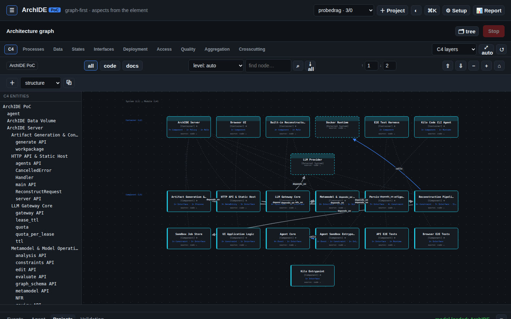

**Top bar:** `☰` — show/hide panels, `◐` — theme (dark/light), `⌘K` — command palette,
`🤖 Agent` — chat with the agent, `⚙ Setup` — setup wizard, `📊 Report` — report.
**Toolbar above the canvas:** breadcrumbs (nesting level), source filter (code/docs), C4
level selector, `↑`/`↓` layers, node search, `−`/`+`/`⌂` zoom, `⤓ all` — export all aspect
views as a single SVG, `＋` — create a node, `⧉` — open the aspect window.

**Keyboard shortcuts:** `Ctrl/⌘+K` — palette, `A` — aspect lens for the selected element,
`E` — edit, `Space` — chat with the agent, `R` — setup wizard, `,`/`.` — page through the
aspect view, `Esc` — back/close. State (model, lens, level, theme, panels) is
**persisted** across reloads.

**Models** live in `archide-poc/data/models/<Имя>.json` and are opened via the *Model name*
field → **Load** (panels: `☰`).

---

## Scenario A. Existing repository

### A1. Reconstruction

> A walkthrough of a real run across all aspects (MLScan + `Arch_v3`) is in
> [`RECONSTRUCTION_GUIDE.md`](RECONSTRUCTION_GUIDE.md): what happens at each step, how to
> read the log, what can go wrong, metrics, and artifacts.

1. `⚙ Setup` (or `R`) — the setup wizard: LLM connection, agent, agent volume, and
   **session context budget** (`Session context budget`, 60 000 characters by default):
   a long run trims old exchanges so it does not fail with "model ran out of context
   space"; the log shows `session context trimmed: X → Y`. **There is no longer a
   reconstruction launch here** — the wizard only configures.

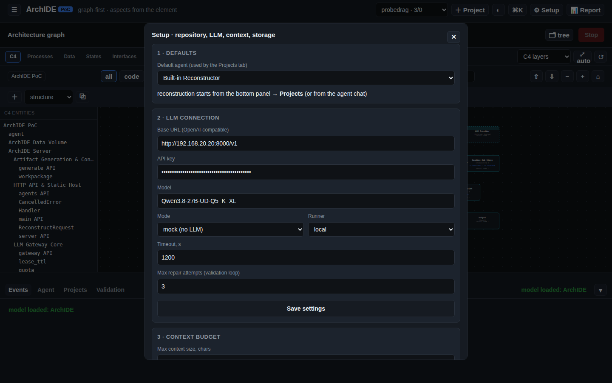

2. Launch it from the bottom **`Projects`** panel (or with the `reconstruct <репозиторий>`
   command in chat): enter the repository address/URL and click **Reconstruct graph**. The
   bottom panel switches to **`Events`** and shows progress: file collection, the C4 pass,
   aspect extraction, then **sequential aspect passes** (`aspect `data`: +N nodes…`), and a
   reconciliation report.

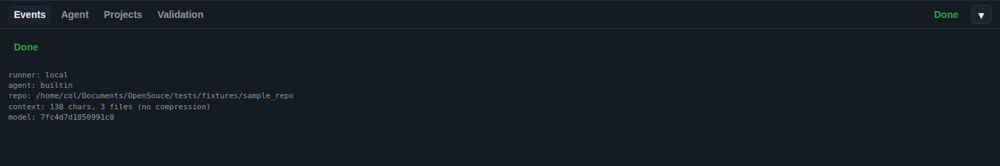

> The screenshot uses the `mock` profile (a deterministic graph without an LLM) — the
> interface and event flow are the same in `live` mode.

### How the screen is laid out (Ф10/UI)

The screen is built around a single idea: **the graph is the internal structure, while the
architect works with C4 and aspects as separate representations.**

- **Canvas sub-tabs** (`C4 | Processes | Data | States | Interfaces | Deployment |
  Access | Quality | Aggregation | Crosscutting`) — the representation switcher.
  **C4** is the main diagram (structural elements: system, container, component, external
  system). The other sub-tabs show **only their own aspect** for the selected element —
  they are not "layers on top of C4".
- **C4 entity tree** on the left (`🗂 tree`) — a navigator like the project tree in an IDE:
  system → containers → components. Clicking an element selects it for the active
  sub-tab; the tree collapses with a button and resizes by dragging its right edge.
- **Canvas layout** (sub-tab, right side): `C4 layers` / `Grid` / `By aspect` +
  **⤢ auto** — automatic arrangement; **↺** — forget the saved layout. **Elements can be
  dragged with the mouse**: the position is remembered for the model
  (`data/layouts/<модель>.json`) and restored the next time it is opened. After a manual
  drag, it is the manual arrangement that is kept.
- **Panel resizing**: the bottom panel — by its top edge; the left panels (settings
  sidebar, C4 tree) — by their right edge. Sizes are remembered.
- **Agent chat** — the **Agent** tab in the bottom panel (there is no separate button in
  the top bar). **Model load/export** — in the **Projects** tab (project management), not
  in the canvas panel.

### C4 notation (how to read the graph)

An element is drawn according to its **notation**, not as identical rectangles:

| What | How it looks | Label |
|---|---|---|
| Person (Person, Role, Actor) | stick figure | `[Person]` |
| System (System) | thicker border + colored header | `[Software System]` |
| External system (ExternalSystem) | **dashed** border | `[External System]` |
| Container (Container) | colored header | `[Container]` |
| Component (Component, Module) | border + colored stripe | `[Component]` |
| Store/data (DataStore, DataEntity) | **cylinder** | `[Database]` |
| Deployment node (Node, Runtime) | double border | `[Deployment Node]` |
| Interface/operation | border | `[Interface]` |

The border color is the element's aspect; the `source: code/docs` line at the bottom shows
where the element came from. Edges go **from boundary to boundary** (not from the center,
where elements used to hide them), are drawn thicker, with an arrow and a **link-type
label** on a chip above the graph. A wide level wraps onto several lines — the graph does
not stretch into a band that "fit" would squeeze into a line.

### A2. Exploration: everything starts from the element

Select an element (in the tree on the left or by clicking on the canvas), then switch
sub-tabs: `Data` shows that element's data, `States` — its states, `Interfaces` — its
interfaces. Frame: the C4 tree and an aspect sub-tab.

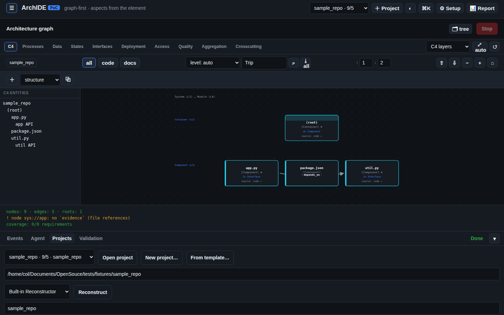

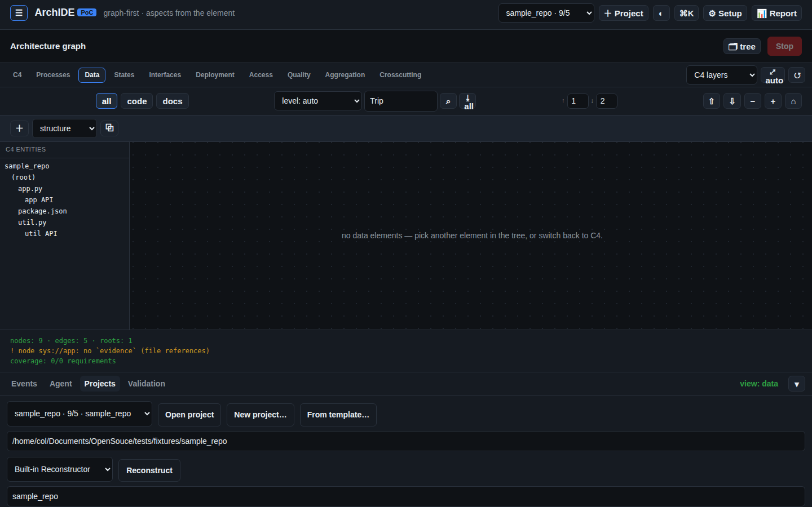

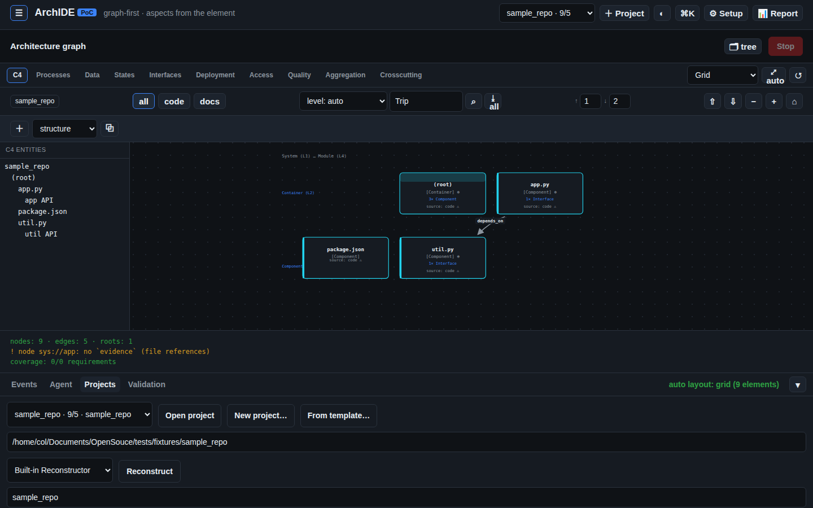

**Click any element** — the **inspector** opens on the right: properties (id, parent,
evidence, description), **aspect chips** in which the element participates (with counts),
and actions.

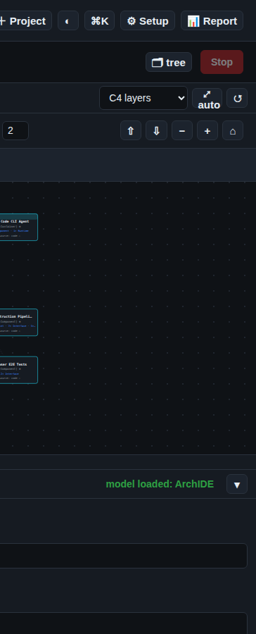

**Clicking an aspect chip** switches the whole canvas into **that aspect's notation** (the
aspect lens): states, BPMN, ER, sequence, C4, deployment tree, tables. At the top there is a
lens bar: aspect, element, view selector, and **"← to C4"**.

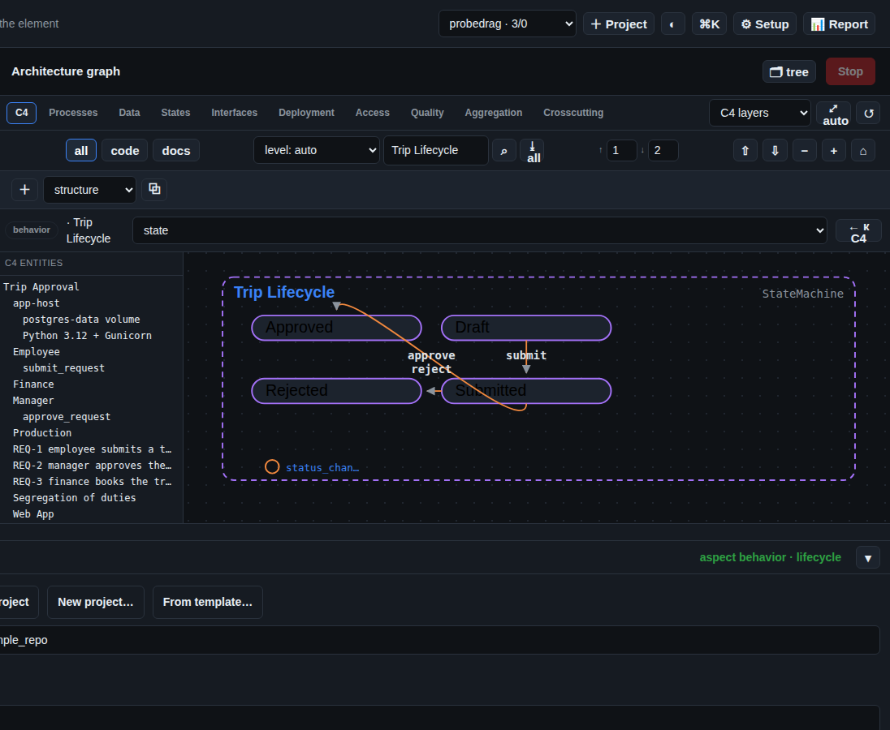

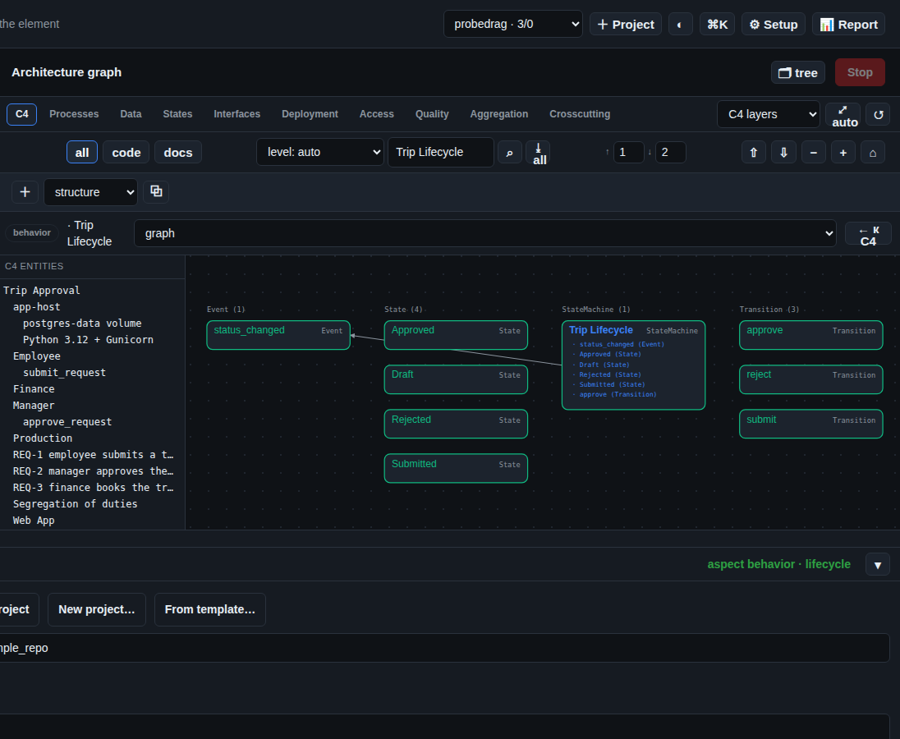

In addition: **double-click** a node — go deeper (next level); the **C4 level** selector
shows a whole level; **node search** finds an element, enables the right aspect, and
selects it.

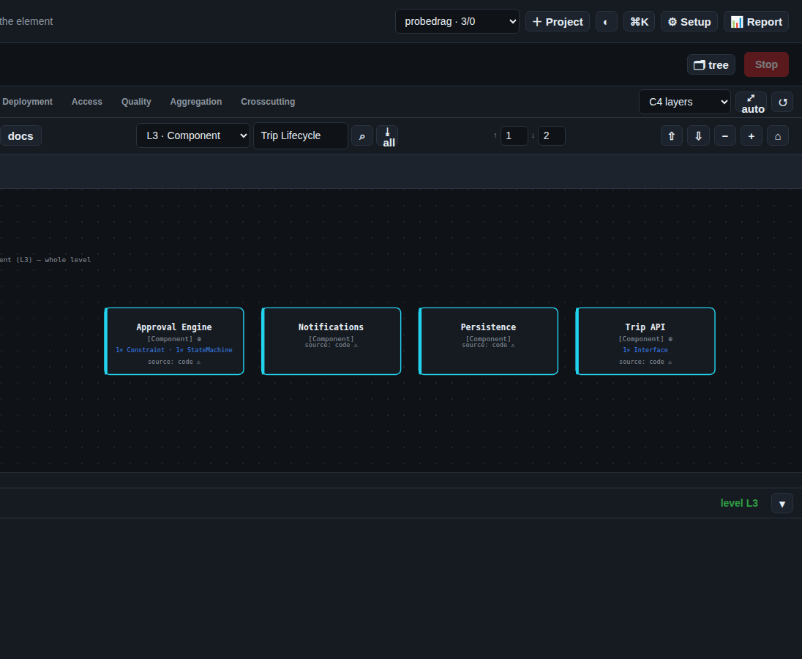

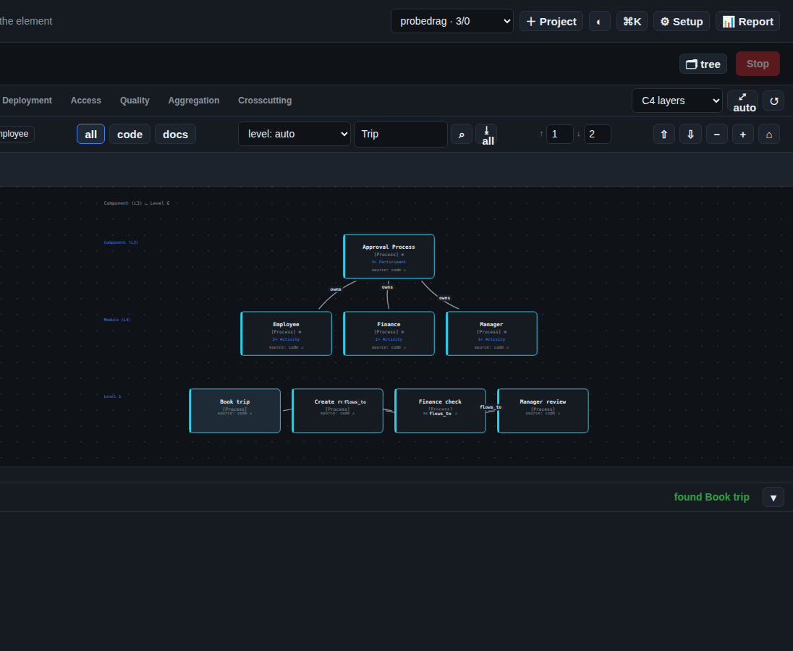

### A3. Changing the architecture

Everything is done **from the element** (inspector): **Rename**, **Create inside** (a child
element of the required type), **Link** (a relationship to another node), **Delete**. Every
edit runs as a transaction with validation, referential actions, and protection against
races (409) and permissions (403).

To create an "unrelated" element — **click an empty spot on the canvas** (the "create here"
popover). Bulk operations — from the `⌘K` **palette**: *Impact*, *Review*, *Reconcile
(apply fixes)*, *Validate*, *Metrics*, *Coverage*.

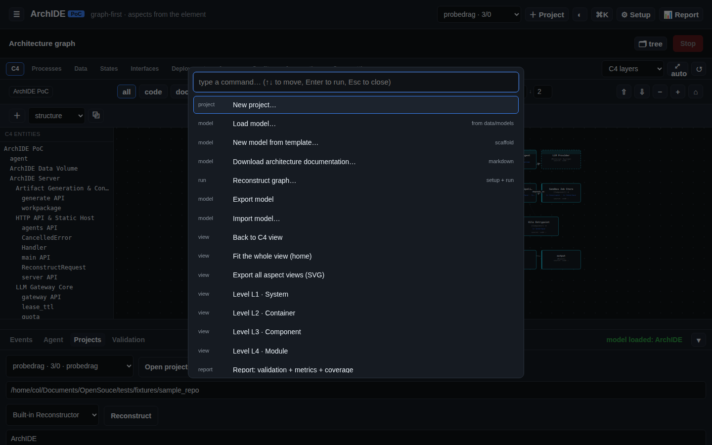

### A4. Validation and metrics

`📊 Report` — a full-screen report: validation (invariants, anchors, cross-aspect rules),
per-aspect metrics (elements, declared-type coverage, orphans, elements without evidence),
requirements coverage, and — if a result model is set — an **acceptance verdict**.

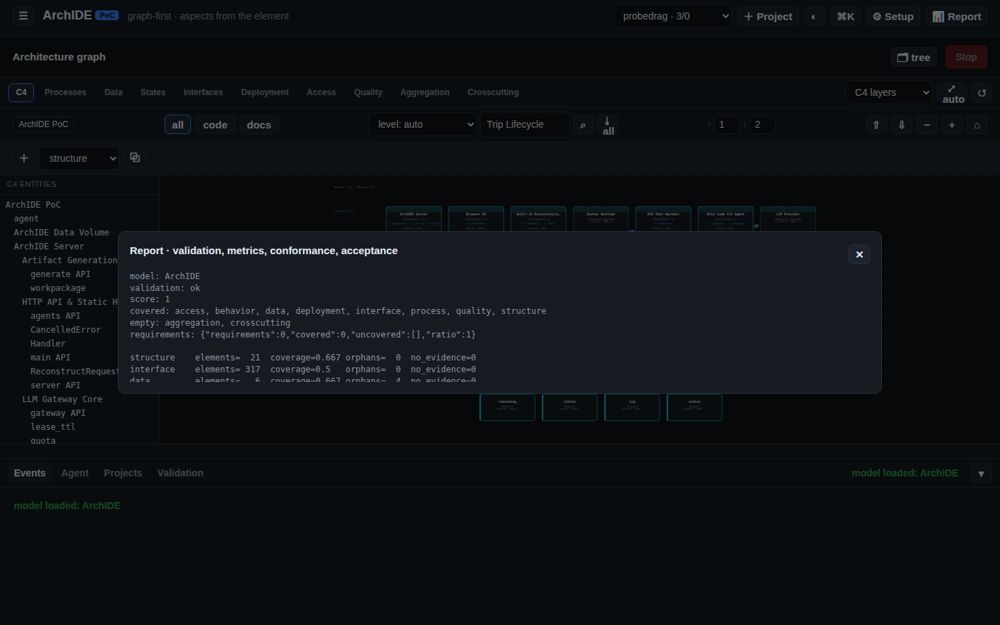

### A5. Kit for a coding agent

Panels `☰` → panel **9 · Architect scenario** (or palette commands): *Work package*
(slice + acceptance criteria), *Markers* (signed traceability markers), *Coverage matrix*,
*Conformance*, *Generate artifacts & package* (OpenAPI/DDL/JSON Schema/skeletons).
The **Download handoff package (.tar.gz)** button bundles all of this into a **single
archive** for the agent: `manifest.json` (model, hash, contents, marker verification),
`workpackage.json`, `artifacts/`, `markers.json`, and a `README.md` with instructions
(including the requirement to insert the markers into the code).

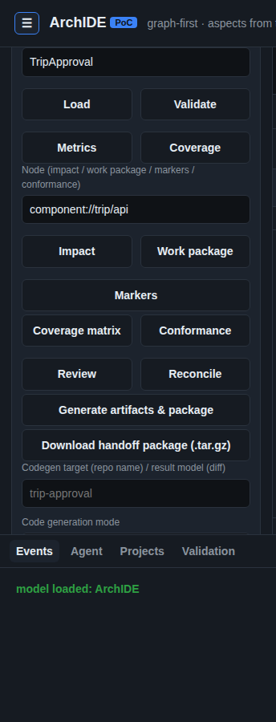

### A6. Handing off to a code-generation agent

In panel **9** (or from the palette), set *Codegen target* — the name of the result
repository — and click **Code generation**: the agent receives the work package,
specifications, and markers, and returns a **new repository** (files in
`data/generated/<имя>`, changes are committed). The window shows the path, the file list,
and the commit.

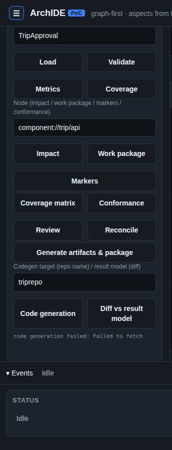

### A7. Accepting the result against the graph

1. Reconstruct the resulting repository (with the `⚙ Setup` wizard, path
   `data/generated/<имя>`) — this produces the result model.
2. In panel **9**, click **Diff vs result model** — a verdict (`ok`/`gaps`), a summary
   (target/result/matched/missing/extra/coverage), and a breakdown by aspect; the same
   verdict appears in `📊 Report`.

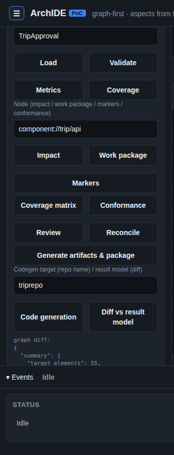

---

## Scenario B. Development from scratch

1. **Start from a template**: palette (`⌘K`) → *New model from template…* (or the bottom
   **Projects** panel → *From template…*). Choose a system shape — **Web service**,
   **Service + database**, **CLI**, or **Blank** — and give it a name: ArchIDE immediately
   creates a **valid starting model** (a C4 skeleton plus the typical aspects: interfaces
   and operations, data, states, roles, deployment) and opens it in the graph. After that,
   it is ordinary edits. Need a fully manual start — pick **Blank** and add nodes on the
   canvas (`＋`, in the inspector — *Create inside* / *Link*), or `Import` an existing
   model file.

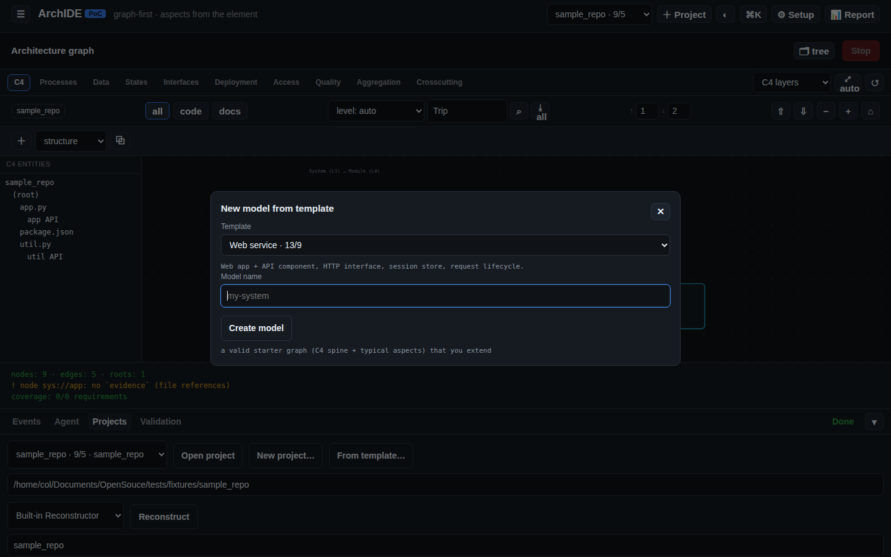
2. **Verify**: `📊 Report` (validation, per-aspect metrics, requirements coverage).
3. **Assemble artifacts and tasks**: panel **9** (or the palette) — *Work package*,
   *Markers*, *Coverage matrix*, *Generate artifacts & package*.
4. **Hand off to a code-generation agent**: *Code generation* (as in A6).
5. **Accept the result against the graph**: reconstruct the result repository and click
   *Diff vs result model* (as in A7). Fix the model on any discrepancies and repeat.

---

## Scenario C. Synthesizing architecture from a description (Ф11)

The case where there is no code yet: the architecture is **designed from a statement** that
the architect writes directly in chat.

1. **Describe the system in chat.** Open the **Agent** tab and write the statement with the
   `design …` command (or `синтез …`). The agent shows a confirmation and the description
   length.

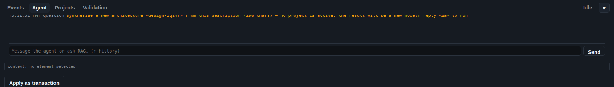

2. **Confirm** ("yes") — **synthesis** starts: the description (and any attached documents,
   if they have been uploaded) becomes the material for the design pass. The log shows
   `no source code: designing the architecture from N document(s)`.
3. **Get the graph.** When it finishes, the model is loaded into the canvas; from there you
   work with it as usual — aspect sub-tabs, the C4 tree, validation.

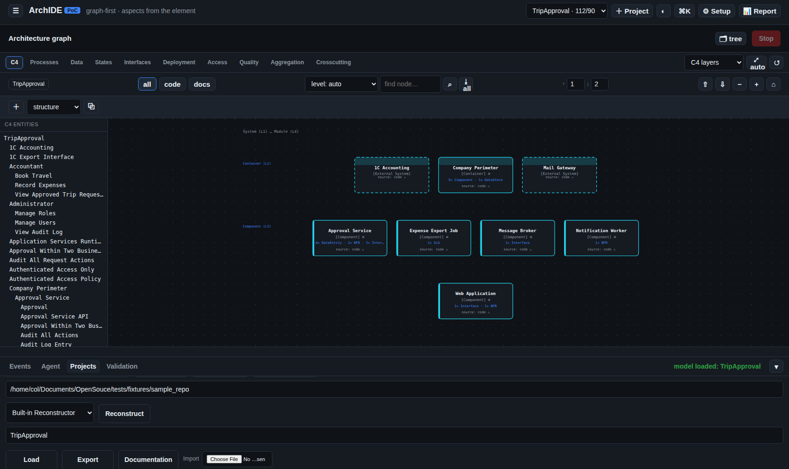

4. **Export the architecture documentation** — the **Documentation** button in the
   **Projects** tab (or the `⌘K` palette): Markdown with an overview, C4 decomposition, a
   section per aspect, relationships, requirements, and traceability (evidence). The
   document is generated **from the model**, so it does not drift from it.

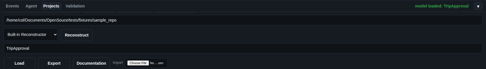

Aspect sub-tabs show their part of the same model (data as cylinders):

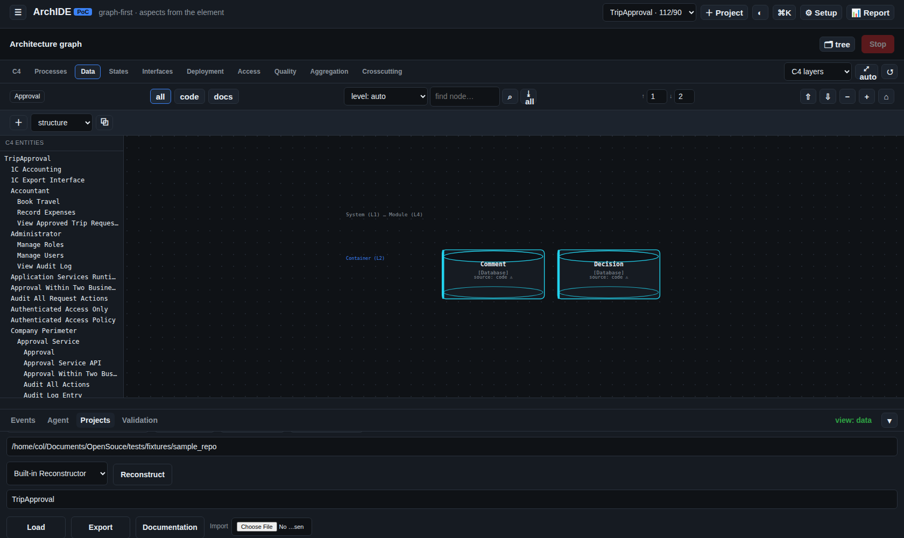

**A real run** (live `Qwen3.8-27B` model, `runner=docker`): the description paragraph above
produced **112 nodes / 90 edges** in ~20 minutes, with contributions from **all seven
aspects** (`data` +13, `interface` +18, `behavior` +11, `process` +14, `deployment` +4,
`access` +14, `quality` +6), and **100 %** of nodes have `evidence`. The graph contains
containers (web application, approval service, broker, notification worker), external
systems (1С, mail gateway) with dashed borders, roles and permissions (accountant,
administrator, role management), processes (booking, expense accounting), request states,
and requirements (approval within two business days, action audit). The architecture
documentation for this model is ~35,000 characters, 6 sections; the package for the
code-generation agent is a manifest, work package, markers, `schema.sql`, `openapi.yaml`,
`skeleton.py`.

5. **Hand the package to the code-generation agent** — as in scenario A5/A6 (the handoff
   assembles the work package, artifacts, markers, and acceptance criteria from the same
   model).
6. **Correct the result** — in two ways:
   - **visually**: drag elements (the layout is remembered), edit through the inspector
     (`Create inside`, `Link`, `Delete`), add nodes (`＋`);
   - **through the agent**: chat commands (`add Component … under …`, `remove …`,
     `проверь модель`, `fix`) — edits go through the same transaction with validation.

> The statement is written in free-form text; the more specific the roles, data, external
> systems, and processes, the more complete the resulting graph. Documents with
> requirements can be attached in chat (**Attach**) or uploaded in advance — they go into
> the RAG and into the synthesis material.
>
> The screenshots for this scenario were taken from a **live run** (`runner=docker`, local
> model), not in mock mode, which is why they show a real architecture.

## Chat with the agent

`🤖 Agent` (or `Space`) opens the **`Agent` tab in the bottom panel** (tabs
`Events | Agent | Projects | Validation`). At the top is a **context line**: what is
selected, which lens is active, which model. Through chat you can not only edit the model
but also run **commands**: `reconstruct <репозиторий>`, `add aspect <…>` / `rebuild aspects`,
`validate`, `apply`, `confirm` / `cancel`. The agent's response (a JSON array of
operations) is applied with the **Apply as transaction** button — it goes through the same
gated edit pipeline.

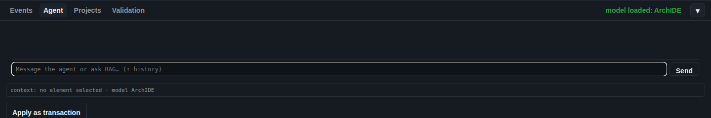

---

## Theme

`◐` toggles between the dark and light theme; the choice is saved.

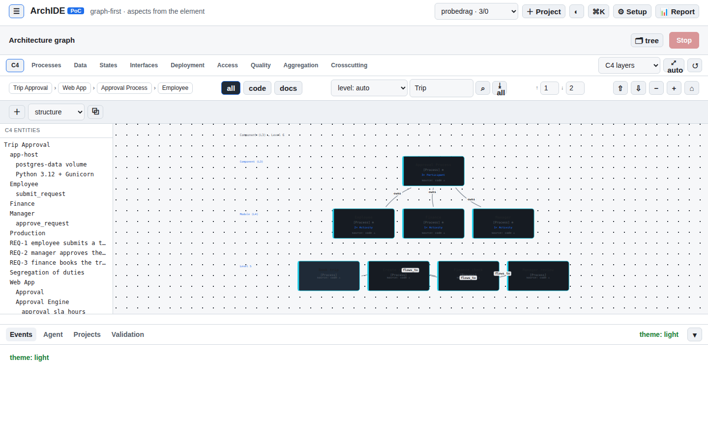

---

## Projects and the bottom panel (Ф10 — implemented)

The workspace is built around a **project**: a project selector in the top bar (switching
the graph, chat history, and view state), and a **＋ Project** button. At the bottom is the
**Events | Agent | Projects | Validation** panel:

- **Projects** — the list of projects, opening, creating, and **launching a repository
  reconstruction** into a project (the `⚙ Setup` wizard is now configuration only, with no
  launch);
- **Agent** — chat with the agent: the commands `design <описание>` (architecture synthesis,
  scenario C), `ask <вопрос>` / `rag <вопрос>` (an answer from the uploaded documents with
  citations and unverified content flagged), `reconstruct <repo>`, `add aspect <имя>`,
  `проверь модель`, `примени`; long-running commands ask for confirmation ("reply «да» to
  run"). `add aspect <имя>` continues the run **from the project's repository**, so it
  needs a project with a repository (after reconstruction it is already there) — otherwise
  the chat says so honestly;
- **Validation** — **Check** (formal validation + constraints), **Check with agent** (agent
  analysis of the model: issues and proposed fixes), **Propose fixes**, and **Apply fixes**
  (applied as a transaction with re-validation), plus validation history.

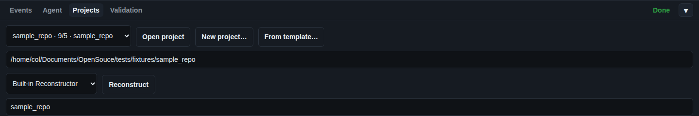

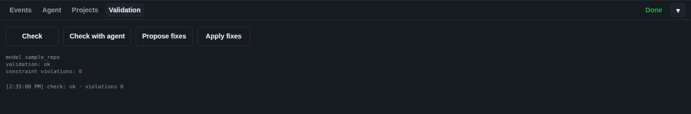

## Designing from specifications only

If the system **has no code yet** but there are **requirements** (specs, notes),
reconstruction runs in **design** mode: the base pass builds the architecture **from the
documents** (the log shows `no source code: designing the architecture from N document(s)`),
and comparison against the documentation is not duplicated. This way the "from scratch"
scenario can start not from an empty canvas but from a spec. The mode is disabled with the
`context.design_from_docs` flag.

## What's next (plan)

Details are in `IMPLEMENTATION_PLAN.md`. **Phases Ф0–Ф10 are closed**: reconstruction and
aspects, the model and edits, artifacts and markers, RAG over documents, the handoff package
(**Ф8.1**), the external CLI-agent adapter (**Ф8.2**/**Ф8.2b**), exact acceptance by markers
and evidence (**Ф8.3**/**Ф8.3b**), design from specs (**Ф8.4**), templates (**Ф8.5**),
projects and the workspace (**Ф10**).

Open: **Ф8.6** — pin both scenarios as separate items in `SCENARIOS.md` (requires agreeing
on the scenario set, AGENTS.md item 3); phases **Ф6** (agent experience and self-adaptation)
and **Ф7.6** (RAG generation with grounded answers) — not started yet and will **add new
screens**, so this guide's screenshots will have to be updated again once they appear.
