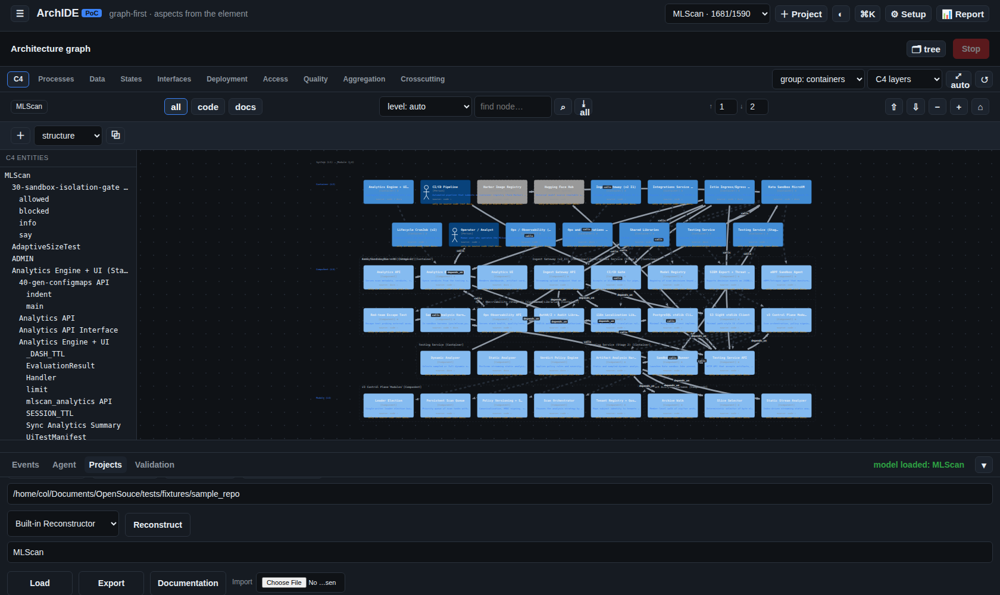
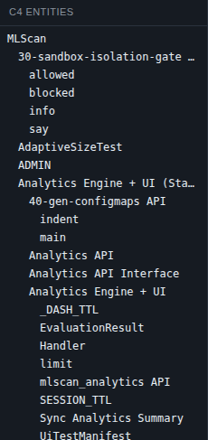
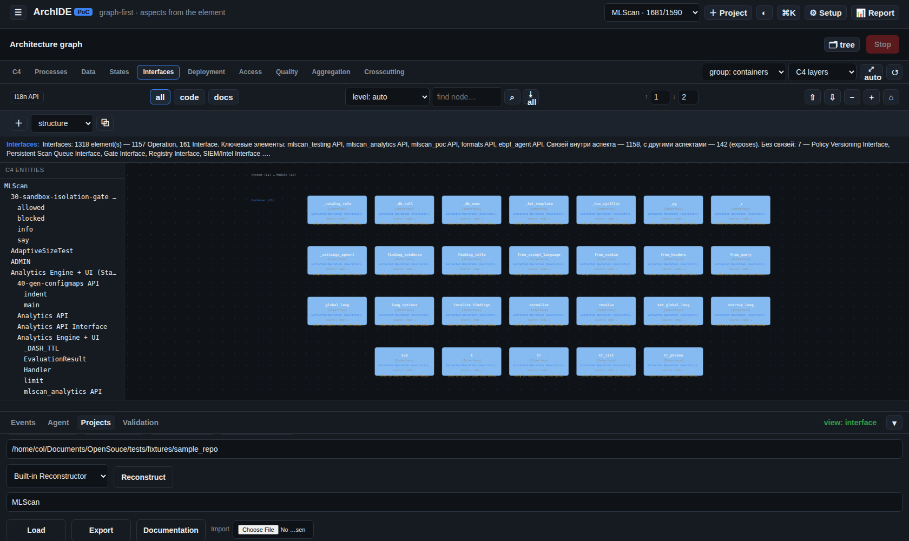

# Сверка реконструкции MLScan с архитектурной документацией

Проверка работы системы на **реальном проекте**: реконструкция репозитория
[`pol4/MLScan`](https://github.com/pol4/MLScan) и сопоставление результата с
архитектурной документацией проекта (`Arch_v3`, 23 документа, ~4000 строк).

Прогон: `runner=local`, живая модель `Qwen3.8-27B-UD-Q5_K_XL`, включено сравнение с
документацией и все девять аспектных проходов.

## Результат

| Метрика | Значение |
|---|---|
| Итоговая модель | **1681 узел, 1590 связей** |
| Уровни C4 | **L1 1 · L2 11 · L3 22 · L4 8** — все четыре уровня |
| Покрытие элементов из диаграмм документации | **71 из 74 — 96 %** |
| Элементов без `evidence` | **0** |
| Вклады аспектов | `data` +31/+10, `interface` +30/+12, `behavior` +42/+42, `process` +41/+41, `deployment` +17/+23, `access` +5/+0, `quality` +12/+12 |








## Плоскости документа ↔ контейнеры модели

Документ `02-architecture.md` делит систему на пять плоскостей. Реконструкция
воспроизвела их как **контейнеры** (то есть уровень L2, как и требует C4), а их
сервисы — как компоненты внутри:

| Плоскость в документе | Что получилось в модели |
|---|---|
| Edge (Upload Edge, API/UI, Gate) | `Ingest Gateway (v2 I1)`, `Analytics Engine + UI (Stage 3)`, `Istio Ingress/Egress Gateway` |
| Control plane | `Ops and Integrations Services`, `Lifecycle CronJob (v2)`, `Testing Service` |
| Data plane | контейнеры хранилищ и клиентов S3 (`DataStore`, `DataEntity` внутри) |
| Analysis plane | `Analytics Engine + UI (Stage 3)`, `Testing Service (Stage 2)`, `Integrations Service (Stage 4)`, `Kata Sandbox MicroVM` |
| Registry / Evidence | узлы `MicroK8s Node`, `services`, `sandbox`, `ebpf-agent`, `llama-cpp` |

Проход по документации добавил 17 узлов и 27 связей, расхождения с кодом помечены
(1675 отклонений) — то есть **документация использована**, а не проигнорирована.

## Единственное расхождение

Не найдены три имени из диаграмм подсистемы инференса LLM:

- `Движок инференса (OpenAI API /v1)`
- `Модель (веса/конфиг/токенизатор)`
- `Смонтированная/скачанная модель`

Причина: это **артефакты** (файлы модели и эндпоинт), а не элементы архитектуры —
в графе они не появились как узлы с `evidence`, хотя узел `llama-cpp` (носитель
движка) реконструирован. Для архитектурной модели это расхождение ожидаемо и
несущественно; при необходимости такие элементы добавляются правкой вручную.

## Что пришлось исправить в системе

Сверка на реальном проекте вскрыла три настоящих дефекта — все устранены и
покрыты тестами:

1. **Ответы модели обрывались** (граф приходил неполным): в запрос не задавался
   лимит вывода, и сервер резал ответ по своему умолчанию.
2. **Пустые ответы модели**: попытка задать лимит явно оказалась хуже — это
   **reasoning-модель**, у которой лимит целиком уходит на скрытые рассуждения
   (`finish_reason=length`, `content` пуст). Теперь лимит **не задаётся** (0), а
   пустой ответ **повторяется**; диагностика прямо называет обе причины.
3. **Материал вытеснялся из сессии** старыми обменами — аспектные проходы падали
   или возвращали пустой граф. Обрезка контекста теперь сохраняет материал и
   новейший запрос.

Плюс появилось то, чем эта сверка делается: `tools/compare_architecture.py`
(покрытие по документации) и `coverage_report.hierarchy` в отчёте прогона
(плоскость и её сервисы).

## Как повторить

```bash
python3 tools/compare_architecture.py --model archide-poc/data/models/MLScan.json \
  --docs <каталог Arch_v3>
```

Инструмент печатает покрытие по элементам диаграмм отдельно от заголовков
разделов, список пропущенного и состав типов.
