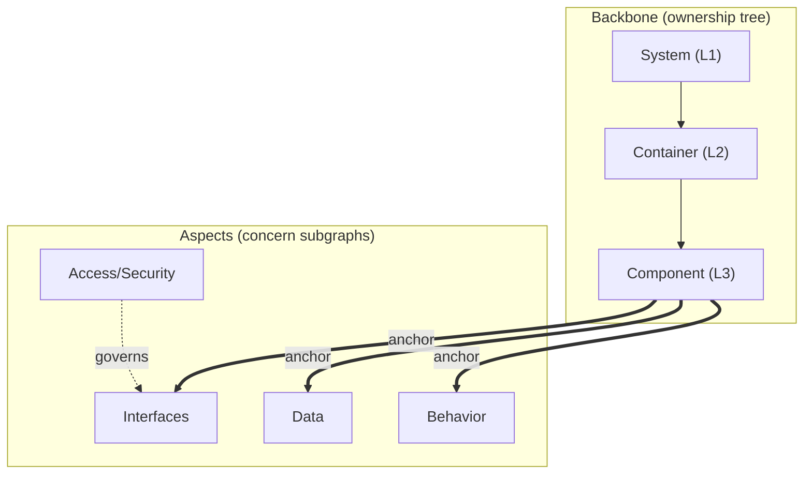

[Русский](Concept.md) · **English**

# ArchIDE — concept: a system of subgraphs

> **ArchIDE is an IDE for the architecture graph.** The architecture is described by a
> single graph of identities; everything else — code, diagrams, documents, slices,
> versions — are **subgraphs** of that graph. A human and an agent work with
> subgraphs, not with code text.

## 0. The key idea

A single **universal typed graph of identities** `G`. Every "thing" in the
system is a **subgraph** of `G` with a role:

- the backbone (C4 structure), aspects (interfaces, data, behavior, processes,
  access, deployment, quality), aggregates, projections (diagrams/specifications),
  context slices for agents, versions, external evidence (requirements, documents).

Three consequences:

1. A human and an agent edit the **model** (graph/subgraphs), not the code.
2. No document/diagram is "stored" — it is a **projection** (a query against the graph).
3. Rigor is ensured not by the author's discipline but by the **metamodel schema and
   the validator**.

A consequence for topology: **an entity exists exactly once** (one "home" place),
while every other place references it by a stable ID. Duplication is
physically impossible — one can only reference.

### 0.1. Principle: dynamic stability

We **deliberately do not try** to build an absolutely universal architecture model
that fits any system — that is unattainable and leads to over-complexity. Instead, we build an
**easily extensible graph model** with a **reasonably simple construction logic**:
closed but extensible type dictionaries; subgraphs; projections.

The consistency of such a model is **not guaranteed by the perfection of the design
"by construction"**; it is **maintained dynamically** — by the agent. This is
**dynamic stability**: we can use a **non-ideal base construction** and still
**stabilize it dynamically**, constantly observing and correcting the state.

The cycle (feedback, not a one-off check of a perfect ontology):

1. **observation** — continuous checking of the graph's state (validation, anchors,
   cross-aspect rules, impact, requirement coverage, code↔docs deviations);
2. **detection of discrepancies** — where integrity is violated or incomplete;
3. **correction** — proposing fixes and automatically refining the related parts
   (including after manual edits), with human confirmation.

This removes the impossible requirement of a "perfect ontology up front": the model grows and
is refined as it goes, and consistency is held by a constant cycle of
"observation → discrepancy → correction". Here the agent is not only an executor of changes,
but also a **stabilizer** of the model's integrity.

---

### 0.2. Implementation status (PoC)

The concept describes the target system; below is what of it **already works** in
`archide-poc/` and how it is verified (phases — `docs/IMPLEMENTATION_PLAN.md`).

| Concept section | Status | Verification |
|---|---|---|
| §1–§2 graph and subgraphs | ✅ the graph as the single source, merge/slices/aggregation | API + browser |
| §3–§4 the C4 backbone and aspects | ✅ 10 aspects, aspect extraction with anchors, sequential aspect passes | API + browser |
| §5 aggregation | ✅ aggregate interfaces | API |
| §6 context slices | ✅ bounded slices for the agent | API |
| §7 requirements and traceability | ✅ requirement coverage, signed labels | API + browser |
| §8 rigor | ✅ metamodel + validator + repair loop | API + browser |
| §9 reconstruction | ✅ two-pass (code + documentation), **design from a specification** (§9.1) and **synthesis from a description** (§9.2) | API + browser |
| §10 editing | ✅ edit transactions, invariants, dialogue with the agent | API + browser |
| §11 generation and verification | ✅ artifacts, work package, labels, acceptance by graph-diff | API + browser |
| §12 versioning | ⬜ target (versions/commits/time-travel) | — |
| §13 RAG | ✅ loading md/csv, marked chunks, search, **grounded answer with citations** | API + browser |
| §14 project federation | ✅ projects as a first-class concept, workspace | API + browser |
| §15 UI surfaces and windows | ✅ canvas with aspect sub-tabs, C4 tree, visual editing, palette, report | browser |
| §16 technology contour | ✅ stdlib server, Docker sandbox, LLM gateway | API + browser |
| §18 experience and self-adaptation | 🟡 dialogues with provenance and feedback — ✅; profile/reflection/toxicity — in progress | API |

## 1. The universal graph (identities)

`G` — a typed property graph.

**Nodes (closed dictionary):**
- structural: `System`, `Container`, `Component`, `Module`, `Actor`, `ExternalSystem`;
- contract: `Interface`/`Port`, `DataEntity`, `DataStore`;
- aspect: `Operation`, `Message`, `StateMachine`, `State`, `Transition`,
  `Process`, `Activity`, `Role`, `Permission`, `Policy`, `Node`, `Environment`,
  `NFR`, `SLO`;
- cross-functional: `Capability`, `Decision`, `AggregationInterface`;
- external anchors: `Requirement`, `Artifact`, `Agent`, `Task`.

**Edges (typed):**
- ownership: `contains`;
- interaction: `depends_on`, `calls`, `publishes`, `subscribes`, `reads`, `writes`;
- contracts: `exposes`, `consumes`, `implements`, `realizes`;
- traceability: `satisfies`, `derived_from`, `constrains`, `verifies`, `conflicts_with`;
- implementation: `implemented_by`, `tested_by`, `deployed_as`, `generated_from`;
- aspect binding (anchors): `owns`, `exposes`, `governs`, `anchored_to`;
- governance: `owned_by`, `decided_by`, `assigned_to`.

**Identity:** stable IDs (`scheme://path`), namespaces, an alias registry
(rename-safe). The closed type dictionary makes the model **strict and machine-checkable**.

**Topology (three orthogonal axes):**

| Axis | Topology | Role | Invariant |
|---|---|---|---|
| **A. Backbone** | a strict tree (one parent) | ownership, C4 levels | exactly one parent → one "home" |
| **B. Mesh** | a directed DAG | interactions, flows | edges of permitted types |
| **C. Cross-cutting** | references into external namespaces | requirements, code, tests, agents | by ID only |



---

## 2. Subgraphs and their roles

A **subgraph** `S = (V_S, E_S, role, scope, version)` is a part of `G` with a role, a scope and
(optionally) a pinned version.

| Role | What it is | How it is obtained |
|---|---|---|
| `backbone` | C4 structure (identity) | decomposition |
| `aspect` | a concern layer (interfaces/data/behavior/…) | binding to the backbone |
| `aggregate` | a reified set of relations/subgraphs | aggregation `agg` |
| `projection` | a diagram/specification (a view) | projection `view` |
| `slice` | bounded context for an agent | slice `slice` |
| `version` | the state of the model over time | pin `pin` |
| `evidence` | external evidence (a requirement, a document) | ingestion/linking |

**Subgraph algebra** — a single set of operations over any subgraphs:

| Operation (token) | Meaning | Where it applies |
|---|---|---|
| `merge` | union subgraphs | multi-pass reconstruction, federation |
| `common` | the common part (intersection) | agreement of sources |
| `minus` | difference (subtraction) | **deviations** code ↔ documents |
| `view` | a view at a level/aspect/scope | C4 zoom, diagrams, specifications |
| `slice` | bounded context around a node | slices for agents |
| `agg` | reify a set of relations into a single entity | aggregation interfaces |
| `pin` | pin a state | versions, runs, labels |
| `changes` | semantic change | history, review, rollback |

Everything that follows is a special case of this algebra. This is the "more complete structure":
C4 is a projection of the backbone, a state diagram is a projection of an aspect, an agent's slice is a
`slice`, a version is a `pin`, the RAG context is `merge(slice, evidence)`.

---

## 3. The backbone (C4) and levels

The backbone is the structure subgraph; the C4 levels are the **depth** of the
tree. "Draw a diagram" = `view(backbone, level)`.

- L1 Context → `System` + `Actor`/`ExternalSystem`;
- L2 Container → children of System;
- L3 Component → children of Container;
- L4 Code → `CodeUnit` (may be delegated to generated code).

The levels **physically cannot desynchronize** — it is one graph at different
depths. Visibility rule: an edge is visible at level `L` if and only if
`L ≤ min(глубина концов)`.

---

## 4. Aspects (orthogonal subgraphs)

> **Implementation (PoC).** Aspects are reconstructed **sequentially**: first
> the structural C4 pass, then each aspect as a separate agent step, with anchors and
> formal validation (rollback on error) and recording to the log; the pass context is narrowed
> to the aspect, and the passes are resumable. Representations are **derived from the graph**: the model carries
> what the diagrams need (for example, `Transition.from/to`, `Participant` lanes,
> `cardinality` of relations), so diagrams are not stored separately.

An aspect is a typed subgraph by concern, bound to the backbone by **anchors**
(`owns`/`exposes`/`anchored_to` edges). An aspect does not redefine the structure — it only
supplements it.

| Aspect | Elements | Responsible for | Projection (generates) |
|---|---|---|---|
| Interfaces/contracts | Interface, Operation, Message, SchemaRef, Version | API, contracts | OpenAPI / proto / JSON Schema |
| Data | DataEntity, Attribute, DataStore, DataFlow | schemas, flows (DFD), provenance | DDL / ER / DFD |
| Behavior | StateMachine, State, Transition, Event, Guard | states, events | state diagrams |
| Processes | Process, Activity, Task, Gateway, Participant | scenarios, orchestration | BPMN / sequence |
| Access/Security | Principal, Role, Permission, Policy, Resource | role models, policies | RBAC/ABAC, policies |
| Deployment | Node, Environment, Runtime, InfraResource | topology, environments | deployment diagrams |
| Quality | NFR, SLO, Constraint | non-functional requirements | SLO specs |

**Cross-aspect links** (they make the model coherent):
`component —exposes→ interface —has→ operation —reads/writes→ dataEntity`;
`stateMachine —owned-by→ component`, `transition —emits→ event`,
`process —consumes→ event`; `role —allowed→ operation`,
`policy —governs→ resource`; `dataFlow —from→ dataStore —to→ process`;
`container —deployed-on→ node`.

---

## 5. Aggregation (aggregation interfaces)

A transition between levels may connect **heterogeneous** relations, so an aggregate is not
computed but **reified**: `agg(links) → AggregationInterface`.

- An aggregate **contains** any composition of the original relations/subgraphs (heterogeneity
  is encapsulated); at a coarse level it appears as **a single entity**.
- It has a `contract` (the supertype of the contents) → the validator checks **conformance**.
- Nestability: `связь → агрегат → супер-агрегат`.
- Auto-suggesting candidates is a heuristic; the model makes the decision.

---

## 6. Context slices for agents

`slice(node)` — a bounded subgraph for a task. It contains exactly:

1. **where I am** — the node + the chain of parents;
2. **my contract** — ports/operations and signatures;
3. **what I touch** — direct (1-hop) mesh edges with contracts;
4. **why** — related requirements;
5. **how it is implemented** — bound artifacts/tests;
6. **what is NOT mine** — explicit boundaries.

Slices are **deterministic, versioned (`pin`), hashed and non-overlapping**;
in the aspect model a slice is made **aspect-aware** (it includes the interface, data,
behavior and access of the component).

---

## 7. Requirements and traceability

Requirements are an external `evidence` subgraph; they are connected by an adapter (Jira/a registry/documents).

- An external ID → a `Requirement` node with provenance (source, version, date).
- The link to the model — by typed edges `satisfies / constrains / verifies`.
- **Two namespaces — one graph**: architecture and requirements kept separate, joined
  by traceability.
- The coverage matrix is computed (`view`), not maintained by hand.

---

## 8. Rigor and consistency

**Classification of invariants:**

| Class | Decidability | Behavior |
|---|---|---|
| Hard (types, bindings, references, tree, uniqueness) | yes, cheap | auto-enforced, blocking |
| Soft (coverage, completeness, style) | yes, allow a waiver | warnings + `Decision` |
| Judgments ("is the decomposition right") | no | only a human/agent |

**Rigor mechanisms:** a closed metamodel; a canonical ID + aliases; referential
integrity; a single "home" place; projection queries; **referential actions**
on edge types (`cascade | restrict | nullify | repoint`); **edit transactions** with
a validator gate; **impact analysis** (transitive closure over dependency/anchor/
cross-aspect edges); **incremental validation** of the affected subgraph.

---

## 9. Reconstruction from code and documentation

Two-pass reconstruction (code is primary, documentation is secondary):

1. **Pass 1 — code**: a graph from the source files (`view`/`slice` by code).
2. **Pass 2 — documentation**: a graph from the docs.
3. **Merge** `merge(code, docs)`; elements from both sources → `sources:["code","docs"]`;
   single-source ones are **deviations** (`minus`) with a mark.

Both **the code and the documentation** are validated: metamodel conformance, `evidence` on
the source files, boundary checking (for code); documentation consistency with code and coverage
(for documentation). Identity resolution during the merge — signatures + review.

### 9.1. Design from a specification only (implemented)

If there is no source code but there are **requirement documents**, reconstruction runs in
**design** mode: the base pass builds the architecture from the documents
(in the log — `no source code: designing the architecture from N document(s)`),
and comparison with documentation is not duplicated. It is disabled by the flag
`context.design_from_docs`.

### 9.2. Architecture synthesis from a description in chat (implemented)

The architect states **the task directly in chat** (`design <описание>`) and can
attach documents with requirements and descriptions of adjacent systems. ArchIDE assembles
**synthesis material** from this (`00-description.md` + the attached documents) and launches
the design pass: no code is needed, and the result is a complete graph across all aspects.

Then, from the resulting model:

- **architectural documentation** is generated **from the model** (an overview, the C4 decomposition,
  sections by aspect, links, requirements, traceability) — so it cannot
  diverge from it;
- a **package for a code-generating agent** is assembled (§11);
- the result is **corrected** — visually (drag-and-drop with layout memory,
  the inspector, adding nodes) and by **requests to the agent** in chat.

This is the same graph and the same gate as in reconstruction: synthesis is not a separate mode
of work, but another input into the same model.

---

## 10. Editing and automatic consistency

A human/agent edits the model; consistency is ensured automatically:

- **the main mode is a dialogue with the agent** (§15): the user states an intent in
  chat, the agent proposes an edit transaction, asks clarifying questions, warns
  about impact, and **itself refines the dependent parts of the graph**, preserving consistency;
- **manual editing is preserved**: a human edits the graph and its aspects in the UI;
  after manual edits, **a reviewer agent checks the graph** and **proposes fixes**
  (a semantic diff for confirmation) to preserve consistency and integrity;
- **edit transaction → validator → accept/reject/repair**;
- **referential actions** handle deletion/move (`contains` → cascade,
  `depends_on` → restrict/repoint, a published contract → immutable+versioned);
- **impact analysis** shows what else is affected; where it is deterministic, auto-repair;
  where it is not, a waiver (`Decision`);
- adding/deleting/moving **by ID** is cheap (references are not by path).

---

## 11. Generation and verification

**Generation** (`view`): contracts (OpenAPI/proto/JSON Schema), DDL, IaC, configs,
skeletons, tests, diagrams. A **work package** = an aspect-aware slice + acceptance criteria.

**Unforgeable traceability labels:** from the model, for each artifact, **signed** labels are
generated that carry **the full chain of levels**
(System→Container→Component→aspects→Requirement) and the run `lease`; the key is held by the host,
so the agent cannot forge them.

```
archide://v1
  artifact: artifact://svc/api/handler.py
  chain: { system, container, component, interface, requirement }
  lease: run=<id> slice=<id> nonce=<nonce>
  sig: <подпись хоста>
```

**Verification (gate):** the signature; existence of the element and its inclusion in the lease;
placement; **coverage** (all levels); **attribution** (no code without a label and no "dangling"
labels); chain consistency; requirement coverage (the chain down to code + tests).
A violation → rejection → repair loop. A **coverage matrix** is built by levels.

The same label mechanism applies **not only to code, but also to document chunks** in
RAG (§13.7): a chunk label makes it possible to verify that the answer relies on actually
reconstructed fragments rather than on LLM generation.

---

## 12. Versioning and time-travel

- **A Merkle-DAG of commits** (`pin`): every change is a content-addressed commit;
  versions are immutable.
- The **identity** of elements is preserved across versions (ID); per-element history.
- **Semantic diff** (`changes`): a node/edge added/removed/changed.
- **Branches/merge** (the validator as a gate); **restore**; **preview** (as-of, without changing
  head); **branch-from**; **version pinning** for runs/slices (labels reference a commit).
- UI: timeline, diff view, "switch to a state", "restore", "branch from here".

---

## 13. RAG: the graph + corporate documents

The model and corporate documents are a **single retrieval space**:

- documents → chunks → embeddings (+ metadata: source, version, page, span);
- graph → **graph-aware chunks** (an element + a slice/projection);
- **hybrid search**: vector + keywords + **graph traversal**.

**Requirement binding:** documents are mapped onto `Requirement` (extraction → candidates
→ review → confirmation) with **provenance** (doc/page/span). A RAG answer is grounded
in both sources with **citations**; a statement from a document without support in the model
is marked as a **deviation** (`minus`). Retrieval is version-aware (it takes the commit into account).

---

### 13.6. Personal documents (Markdown / CSV) via chat

- In a dialogue with the assistant agent, the architect can **attach documents**
  (**Markdown**, **CSV**) as **requirements** or **reference information** for the agent.
- **Originals** are stored in the **user's personal history** on the backend (isolation by
  user) with provenance (who, when, version, type).
- The documents are **available for search in RAG** alongside corporate ones and the graph.

### 13.7. Chunk marking and verification of RAG answers

- When loaded into RAG, each **document chunk** is automatically augmented with a
  **unique signed label** — analogous to the labels on graph elements (§11):
  `{doc, chunk, version, user, span, sig}`.
- The label is **unforgeable** (the key is held by the host) and **unique** to the chunk.
- **A RAG result is verified by labels**: the answer must rely on chunks with
  valid labels ⇒ it is possible to distinguish **actually reconstructed** information from
  **LLM-generated** information.
- Citations in the answer reference **chunk labels**; statements without labels are marked as
  **unconfirmed** (not grounded).
- **The label is bound to the content:** the signature includes a **digest of the text** of the chunk, so
  verification detects any change to the chunk text (not just to the metadata).
- **Answer generation:** the user's request together with the retrieved **marked**
  chunks is fed to the LLM (through the gateway §16/sandbox) — the LLM forms a **grounded answer
  with citations**.
- **Per-claim verification:** the answer is split into statements; for each, a
  source (a chunk label) is found and **fidelity** is assessed — `verbatim / paraphrase / derived /
  unsupported`; it is shown **what the LLM changed** (`added/omitted` relative to the chunk).
  Unconfirmed/changed parts are marked in the answer to the user. Search and generation are
  one mode of questions in chat.
- **Implemented (Ф7.1–Ф7.6):** loading md/csv into personal storage, chunk marking,
  search, verification by labels, **generation of a grounded answer** (the `ask …` command in
  chat: an answer + a list of sources + marking of unconfirmed statements).

## 14. Project federation

Projects publish **contract surfaces** into a shared registry (GCR) with versions and
immutability. Links are discovered automatically (signature matching, anchors,
data intersection, telemetry), recorded in `federation.lock`, and **materialized**
into derived requirements, constraints and tests. A federated edge is a subgraph-aggregate
whose contract = the `published` surface.

---

## 15. UI surfaces and windows

**Surfaces (§0):** the canvas (a space), forms (the inspector), a grid (a matrix),
dialogue (NL) — they all edit one graph; text is the machine serialization for git/agents.

**Windows:** Model Navigator, Inspector, Requirements & Traceability, Agent Workspace,
Impact & Integrity, Conversation, Build & Runtime. Each window is a projection of the model.

**Dialogue with the agent (the main scenario for working with the graph):** the user **delegates
changes to the agent in chat mode**. The agent turns the intent into an **edit transaction**,
**asks clarifying questions**, **warns about problems** (impact, invariant violations, lost
requirement coverage), forms a **semantic diff** for confirmation, and after confirmation
**immediately refines the other parts of the graph** so that it
does not lose consistency. On request, the agent creates **non-standard aspects, slices and
representations** on the fly.

**Manual editing is preserved:** a human can still edit the graph and its
aspects **by hand** (canvas/forms/grid). After manual edits, a **reviewer agent** checks the
graph, finds integrity/coverage violations and **proposes fixes** (a semantic
diff for confirmation). Both modes — chat and manual — coexist and go through a single
consistency gate.

**Aspect UI (implemented):** the canvas has **view sub-tabs**
(`C4 | Processes | Data | States | Interfaces | Deployment | Access | Quality |
Aggregation | Crosscutting`). This is **a view switcher, not layers over the
diagram**: **C4** is the primary entity (structural elements), and each sub-tab
shows **only its own aspect** for the selected element. Each aspect has its own
notation (C4 / API / ER / state / BPMN / roles / topology / NFR).

Navigation across elements is a **collapsible tree of C4 entities** (analogous to a project tree
in an IDE): system → containers → components; clicking an element selects it for the active
sub-tab. The tree can be hidden so as not to take up space, and it can be dragged by its edge.

**The graph is the internal structure; the architect works with C4 and aspects as
representations.** There is no solid "mishmash" of elements on a shared canvas.

**Canvas layout:** elements are **dragged with the mouse**, the position is remembered
(separately from the model) and restored on the next open; there are
**auto-groupings** (`C4 layers` / `Grid` / `By aspect`), while manual placement
takes priority. The **C4 notation** is observed: a person is a stick figure, an external system is a
dashed frame, a store is a cylinder, a container has a header, a deployment node is a
double frame; edges go from boundary to boundary, with an arrow and a type label.

**Viewing one level at a time**, breadcrumbs, zoom in/out, a filter by source
(all/code/docs). **Editing is visual, directly on the canvas**
(add/rename/delete a node, link them) and by **commands in chat with the agent**;
both paths go through a single consistency gate. Panels are **resizable**: the bottom one by
its top edge, the left ones by their right edge.

---

## 16. Technology contour (briefly)

- **Model storage**: canonical git-friendly serialization → a parser → a graph
  index; versions are content-addressed (Merkle-DAG).
- **Core**: a parser + a metamodel validator + a subgraph engine (`view · slice · agg · pin · changes`).
- **API**: queries against the graph; an agent interface (slices, acceptance of artifacts).
- **Agent sandbox**: Docker without bind-mounts, a sandbox protocol, limits, a lease.
- **LLM gateway**: the agent's token/lease, substitution of the real key, auditing.
- **RAG**: ingestion + hybrid retrieval + requirement binding.
- **Frontend**: web, doc panels, all of them projections of one model.

The full system architecture is in `ARCHITECTURE.md`; the roadmap is in `ROADMAP.md`.

---

## 17. Hypothesis validation and limitations

**Optimality criteria:** expressiveness; absence of duplication; locality of
change; decidability of checking; determinism of projections/generation; verifiability;
evolvability; reversibility; scalability.

**Verdict:** the system of subgraphs is an adequate and near-optimal foundation for
reconstruction (R), editing (E), generation (G) and verification (V) thanks to
a single identity (cheap edits by ID), typed anchors and closed
dictionaries (decidability), projections (determinism), and slices (agent scoping).
It is **incomplete without** referential actions, transactions+gate+impact and a conformance layer.

**Experiments:** property-based (a valid input is accepted, an invalid one is rejected,
determinism); metamorphic (rename/move do not change the meaning of projections); round-trip
(model→generation→reconstruction→convergence); conformance tests on an injected violation.

**Irreducible limitations:** the semantic "correctness" of an architecture is undecidable
(it needs `Decision`/a waiver); cross-aspect rules require a bounded declarative
language; scale requires incremental validation.

---

## 18. Experience accumulation, self-adaptation and agent reflection

An agent working with a particular **human architect** must **accumulate conversational
experience** and **adapt** to them — without losing stability and without weakening the
invariants. This is "dynamic stability" (§0.1) at the level of the agent itself.

### 18.1. Memory and dialogues

- **Saving dialogues** (per architect / per project) with **provenance**: intent →
  the proposed transaction → confirmation/edit → the result.
- The history is structured (not a "raw chat"): each turn is bound to nodes/subgraphs,
  a model version and an outcome.
- **Implemented (Ф6.1):** an append-only log `data/users/<архитектор>/dialogue.jsonl`;
  each turn carries provenance (the model, the run, the project, the view, the selected element, the command
  type, the outcome), and there is a summary of dialogues by project.

### 18.2. Feedback

- **Explicit**: ratings, comments, acceptance/rejection of a semantic diff.
- **Implicit**: what was accepted/rejected, repeated clarifications, rollbacks, manual edits after
  the agent's proposal.
- Feedback is **attributed** (who, to which change, with what outcome) and
  separated from substantive correctness (which is determined by the validator/gate, not by tone).
- **Implemented (Ф6.2):** explicit signals (👍/👎, a rating, a comment) and implicit
  ones (an edit applied/rejected, validation improved) with **mandatory attribution** —
  a signal without an indication of what it refers to is rejected; there are aggregates for future
  reflection.

### 18.3. Architect profile

A **preference profile** is formed from experience: terminology and style, the desired
level of detail, representation formats, risk appetite, the tendency toward clarifying questions vs
actions, and priorities. The profile is **versioned and reversible**.

### 18.4. Self-adaptation

The agent adjusts its **behavior** to the profile (tone, volume, defaults, the frequency of
questions, the representations proposed) — **within the invariants**: adaptation **does not change
the metamodel**, does not weaken the gate and does not disable safety.

### 18.5. Periodic reflection

- A **batch review** of the accumulated experience → extracting **lessons** → updating the profile and
  the agent's "playbook".
- **Outcome assessment**: convergence (§0.1), the share of accepted diffs, the number of rollbacks and
  clarifications; regressions → rollback of adaptations.

### 18.6. Resilience to toxic feedback

- **Filtering and neutralizing** abusive, manipulative and contradictory
  feedback; **separating style from content**.
- **Priority of objective signals** (the validator, the gate, coverage, tests) over
  subjective ratings: a toxic signal does **not** become "truth" and does not change
  the correctness of the model.
- **Limiting the influence** of an individual negative signal (weights, cool-down, escalation),
  and protection against "poisoning" the profile.
- **Preserving stability and efficiency**: even under toxic feedback,
  behavior does not degrade, invariants are not weakened, and quality does not drop.
- **Auditing and reversibility**: all profile adaptations are traceable and rollable back.

### 18.7. Invariants

- Adaptation **does not change** the metamodel and the integrity invariants.
- The profile and dialogues are **versioned**, have provenance and are reversible.
- Toxic feedback **does not affect** correctness and safety.

---

**In essence:** ArchIDE is an IDE for the architecture graph, represented as a **system
of subgraphs** over a single graph of identities: backbone, aspects, aggregates, projections,
slices, versions and external evidence — all of them are subgraphs connected by the algebra
`merge · common · minus · view · slice · agg · pin · changes`. A single identity and a closed
metamodel give rigor and coherence, projections and slices make the model efficient for people and
agents, and versioning and signed labels ensure consistency and provable
traceability.
