# Пример: ApprovalHub — все уровни C4 и все аспекты

Этот документ — **сквозной разбор на реальном примере**. Система `ApprovalHub`
(корпоративное согласование заявок) синтезирована **в самой ArchIDE** из текстового
описания и доведена до состояния, когда в модели есть **все четыре уровня C4** и
**все десять аспектов**.

Он показывает два сценария работы архитектора — **разработку** (синтез из описания)
и **реконструкцию** (получение модели из репозитория) — и то, чем проверяется
результат.

## Что получилось (факт прогона)

| Метрика | Значение |
|---|---|
| Узлов / связей | **121 / 90** |
| Уровни C4 | **L1 1 · L2 7 · L3 11 · L4 4** — пропущенных нет |
| Аспекты | **все 10**: structure 30, interface 22, process 21, access 13, data 12, behavior 12, deployment 4, quality 3, crosscutting 3, aggregation 1 |
| Источник | синтез из описания (`design`), живая модель, локальный запуск |

Проверка покрытия — не «на глаз»: прогон печатает строку вида

```
coverage: levels L1 1, L2 7, L3 11, L4 4 · aspects access 13, aggregation 1, behavior 12, …
```

и добавляет предупреждение `coverage: missing …`, если уровень или аспект пусты.
Это самая полезная проверка полноты модели: она есть в ленте каждого прогона.

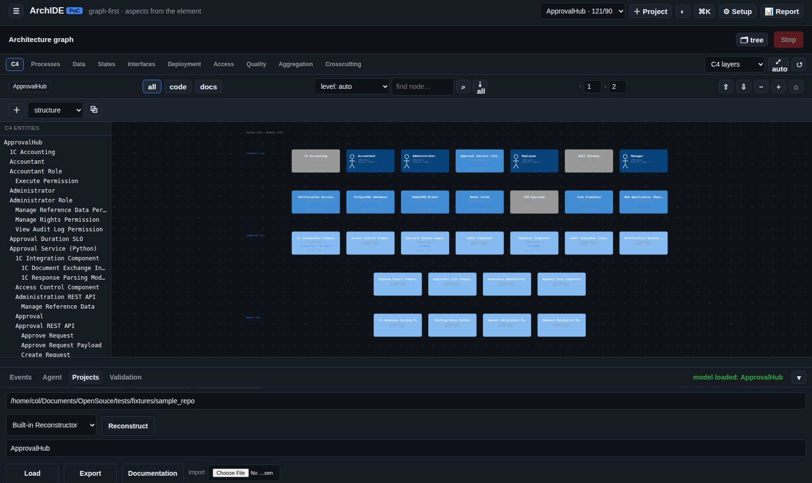

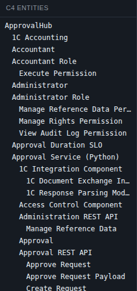

## Диаграммы всех аспектов

Модель — не одна картинка, а десять представлений. Подзакладки канваса показывают
**свой аспект для выбранного элемента**: в примере это состояния заявки, процесс
согласования, данные, интерфейсы, развёртывание, доступ и требования.

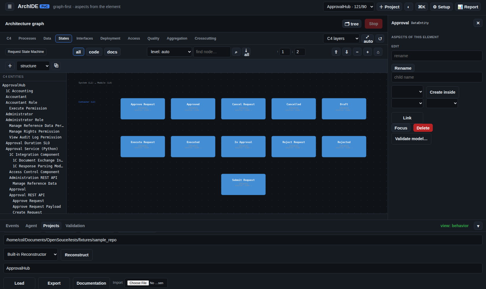

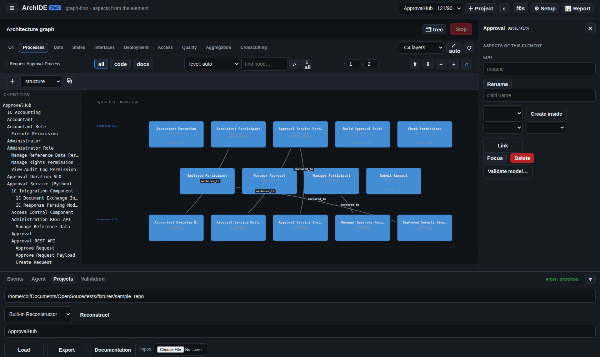

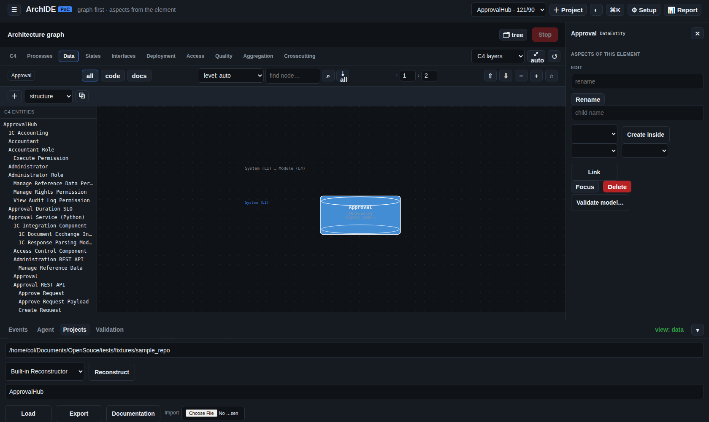

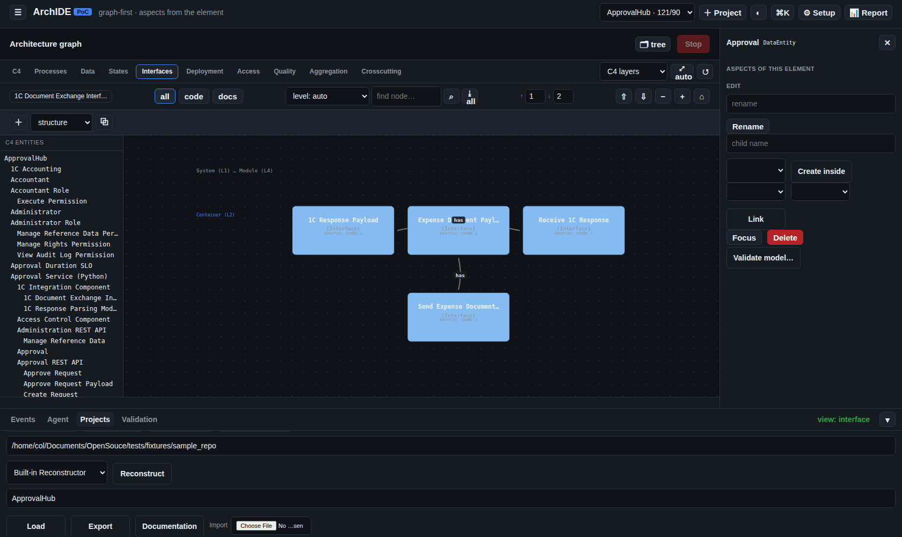

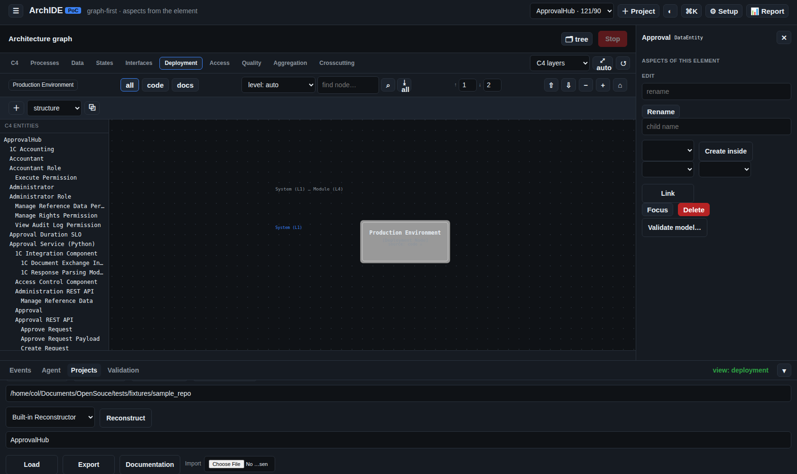

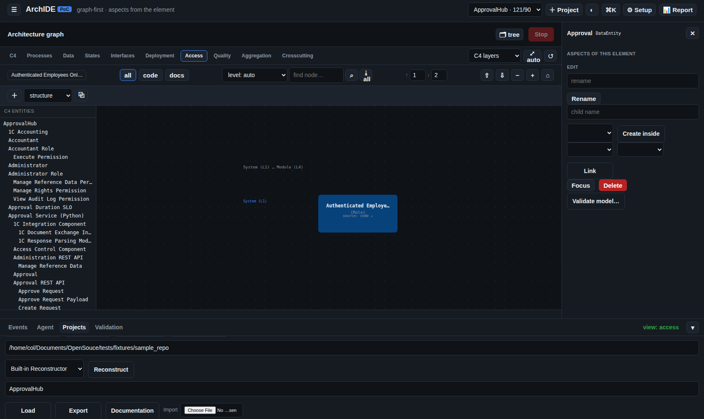

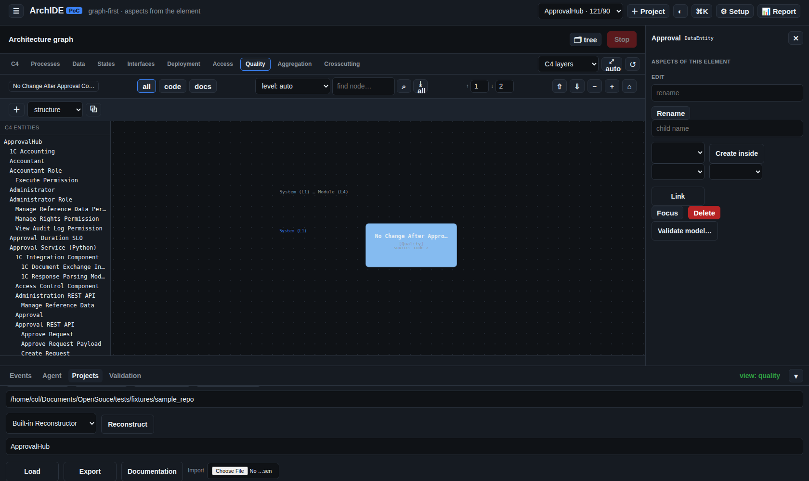

## Готовый пример в поставке

Модель лежит в репозитории: `archide-poc/data/examples/ApprovalHub.json` — её можно
открыть локально (скопировать в `data/models/`) или загрузить в работающую систему:

```bash
kubectl -n t-archide-app cp archide-poc/data/examples/ApprovalHub.json \
  $(kubectl -n t-archide-app get pod -l app=archide -o jsonpath='{.items[0].metadata.name}'):/data/models/
```

После этого модель `ApprovalHub` появляется в списке панели **Projects**.

## Часть A. Разработка: синтез из описания

### A1. Постановка

Сценарий: кода нет, есть только замысел. Архитектор описывает систему текстом —
достаточно подробно, называя людей, внешние системы, контейнеры, компоненты,
модули, данные, интерфейсы, состояния, процессы, развёртывание, доступ и
требования. Именно так был получен ApprovalHub; полный текст описания
(26 строк) приложен ниже в разделе «Описание примера».

Ключевое правило, которое система теперь проверяет сама: **всё, что названо в
описании, должно появиться в графе**. Если вы назвали контейнер, модуль, роль или
процесс — они обязаны быть в модели.

### A2. Запуск

1. Нижняя панель → **Projects** → **+ New project**: имя (`ApprovalHub`) и, если
   есть, адрес репозитория (для синтеза не нужен).
2. Откройте вкладку **Agent** и напишите постановку командой:

   ```
   design <текст описания>
   ```

   ArchIDE покажет подтверждение; ответьте «да». (То же доступно через API:
   `POST /api/design` с полем `description`.)
3. Панель переключится на **Events**. В ленте будет видно: `no source code:
   designing the architecture from N document(s)` → базовый проход → **аспектные
   проходы** (data, interface, behavior, process, deployment, access, quality,
   aggregation, crosscutting) → `coverage: …` → сохранение модели.

Модель появляется в графе сама; её можно открыть в любой момент.

### A3. Что смотреть по результату

- **Coverage** в ленте прогона: все ли уровни и аспекты. Это первое, что стоит
  проверить (см. таблицу выше).
- **`📊 Report`** — сводка по модели: покрытие, метрики, состояние.
- **Подзакладки аспектов** — каждая показывает свой аспект **для выбранного
  элемента**: `Data` — данные этого компонента, `States` — его состояния,
  `Interfaces` — интерфейсы.

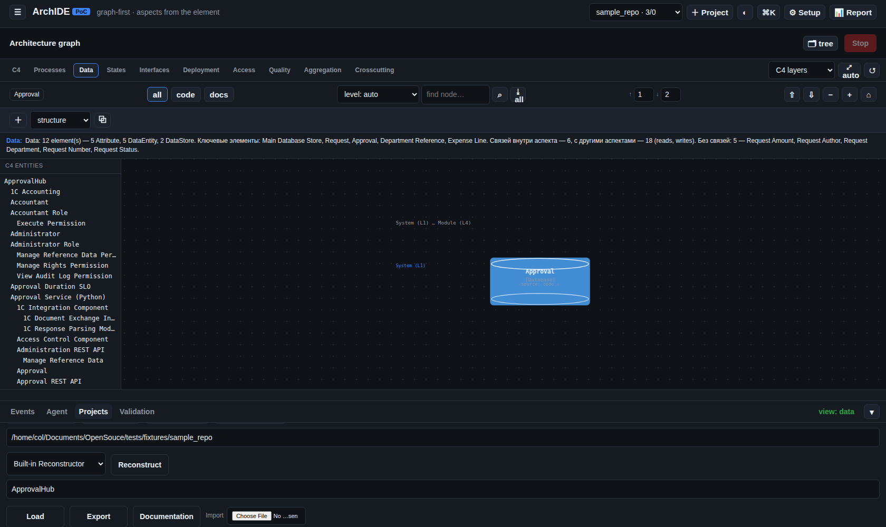

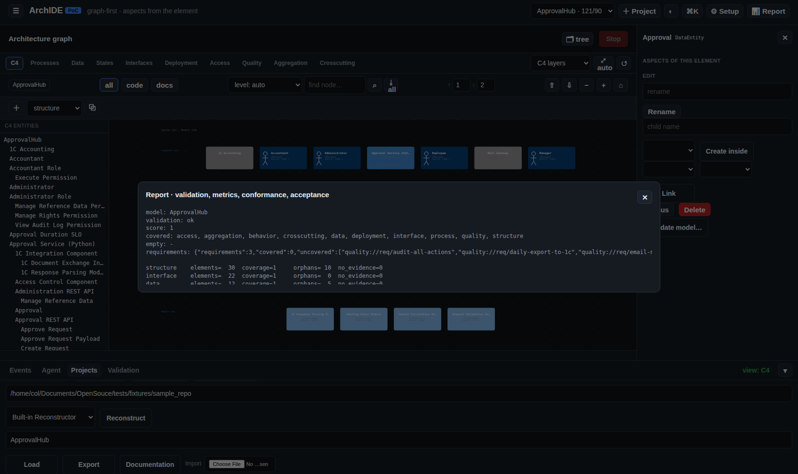

### A4. Дополнение модели

Модель почти никогда не бывает «сразу идеальной» — и это нормально: её доводят.
В примере так закрыли единственный пропущенный аспект `aggregation`:

- **визуально**: выбрать компонент → в инспекторе **Create inside** (новый дочерний
  элемент) и **Link** (связь). Правка идёт транзакцией с валидацией — если она
  нарушает метамодель, система её отклонит и объяснит причину;
- **через агента**: командой в чате (`add AggregationInterface … under …`).

Показательный случай: добавление агрегатного интерфейса **без** связи `aggregates`
было отклонено с точной причиной — «`aggregation …: no members (no \`aggregates\`
edge targets it)`». Это ровно та строгость, ради которой метамодель и существует:
модель нельзя «подкрасить», не описав отношение.

### A5. Выгрузка результатов

- **Документация** — вкладка **Projects** → **Documentation** (или палитра `⌘K`):
  Markdown из модели — обзор, декомпозиция C4, разделы по аспектам, связи,
  требования, трассируемость. Документ генерируется **из модели**, поэтому не
  расходится с ней.
- **Пакет кодогенерации** — палитра `⌘K` → *Code generation*, либо `POST
  /api/models/<имя>/handoff`: архив с манифестом, work package, маркерами и
  артефактами (`schema.sql`, `openapi.yaml`, `skeleton.py`).
- **Приёмка** — когда по пакету получен репозиторий: **граф-дифф «цель ↔ результат»**
  даёт вердикт и покрытие требований.

---

## Часть B. Реконструкция: модель из репозитория

Тот же результат можно получить «снизу» — из существующего кода. Порядок:

1. **Projects** → выбрать проект (или создать, указав адрес репозитория) —
   адрес подставится в форму автоматически.
2. **Reconstruct**. Приложение клонирует репозиторий и проходит те же шаги:
   базовый проход по коду → **сравнение с документацией** (если она есть) →
   аспектные проходы → `coverage: …` → сохранение.
3. В ленте видны детали каждого шага: сколько файлов собрано, сколько узлов дал
   аспект (`aspect \`data\`: +N nodes`), какие элементы отброшены и почему.
4. Дальше — то же, что и в части A: проверка покрытия, доведение правками,
   документация, пакет, приёмка.

Важное отличие от синтеза: здесь архитектура **уже есть в коде**, и задача системы
— извлечь её и показать расхождения с документацией, а не придумать заново.

## Что в системе пришлось доработать ради этого примера

Пример вскрыл два реальных пробела — их закрыли, потому что «все уровни и все
аспекты» должны быть **проверяемым свойством**, а не пожеланием:

1. **Промпт проектирования не требовал глубины C4.** Он перечислял аспекты, но не
   задавал иерархию, поэтому уровень модулей (L4) мог не появиться. Теперь промпт
   прямо требует `L1 System → L2 Container → L3 Component → L4 Module` и все
   аспекты.
2. **Список аспектных проходов покрывал 7 из 10** — не было `aggregation` и
   `crosscutting`. Теперь проходов девять (структуру даёт базовый).

Плюс добавлен **отчёт о покрытии** в ленту прогона (см. выше) — чтобы неполноту
было видно сразу.

## Описание примера (используйте как образец постановки)

```
Нужна корпоративная система согласования заявок (ApprovalHub).

ЛЮДИ И ВНЕШНИЕ СИСТЕМЫ: сотрудник (подаёт заявки), руководитель (согласует),
бухгалтер (исполняет и ведёт расходы), администратор (управляет правами и
справочниками). Внешняя система 1С:Бухгалтерия — обмен документами; внешний
почтовый шлюз — уведомления; внешний сервис SSO (Keycloak) — вход сотрудников.

КОНТЕЙНЕРЫ (уровень 2): веб-приложение на React, сервис согласования на Python,
сервис уведомлений, брокер сообщений RabbitMQ, база данных PostgreSQL, кэш Redis,
планировщик задач (ночная выгрузка расходов в 1С).

КОМПОНЕНТЫ (уровень 3): в сервисе согласования — «Заявки», «Маршруты
согласования», «Права и роли», «Интеграция с 1С», «Аудит»; в веб-приложении —
«Форма заявки», «Список согласований», «Админка справочников»; в сервисе
уведомлений — «Шаблоны писем», «Отправка».

МОДУЛИ (уровень 4, код): в «Заявках» — модуль валидации заявки, модуль расчёта
суммы; в «Маршрутах» — модуль правил маршрутизации; в «Интеграции с 1С — модуль
разбора ответов 1С.

ДАННЫЕ: сущности Заявка, Согласование, СтрокаРасхода, Сотрудник,
СправочникПодразделений; хранилища: основная БД, кэш.

ИНТЕРФЕЙСЫ: REST API согласования (POST /requests, GET /requests/{id},
POST /requests/{id}/approve, POST /requests/{id}/reject), REST API
администрирования, подписка на события в брокере.

ПОВЕДЕНИЕ: черновик -> на согласовании -> согласована -> исполнена; из «на
согласовании» возможен отказ; из «черновика» — отмена.

ПРОЦЕССЫ: «Согласование заявки» (подача, проверка прав, маршрут, согласование,
исполнение) и «Ночная выгрузка расходов в 1С».

РАЗВЁРТЫВАНИЕ: узел Kubernetes (прод-кластер) с подами сервисов и базой данных;
отдельный узел офисной сети для веб-приложения; контур — внутренняя сеть компании.

ДОСТУП: роли сотрудник, руководитель, бухгалтер, администратор; права — создание
заявки, согласование, отклонение, исполнение, управление правами, просмотр журнала
аудита; политика — действия только у аутентифицированных сотрудников, заявку
нельзя менять после согласования.

ТРЕБОВАНИЯ: согласование не дольше двух рабочих дней; все действия фиксируются в
журнале аудита; заявку нельзя изменить после согласования; выгрузка расходов в 1С
раз в сутки; уведомления приходят на почту; доступ только у аутентифицированных
сотрудников; время отклика списка заявок не более 500 мс.
```

## Короткий чек-лист

- [ ] Есть ли в ленте строка `coverage:` и нет ли в ней `missing`.
- [ ] Четыре уровня C4: `System` → `Container` → `Component` → `Module`
      (проверяется деревом сущностей слева).
- [ ] Все десять аспектов присутствуют.
- [ ] Валидация (`Validation`) — модель консистентна.
- [ ] Документация выгружается и совпадает с моделью.
- [ ] Пакет кодогенерации собирается, приёмка даёт вердикт.
